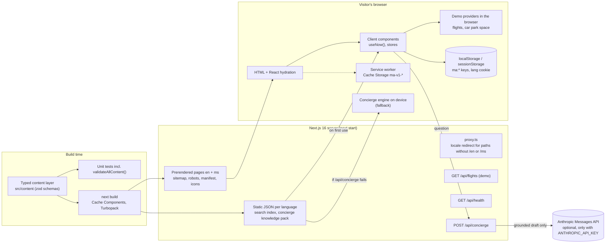
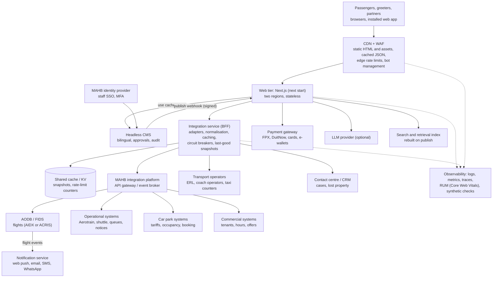
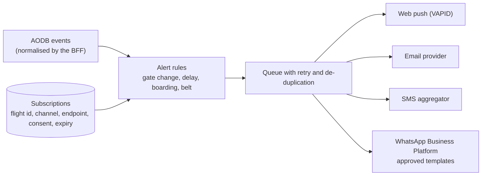
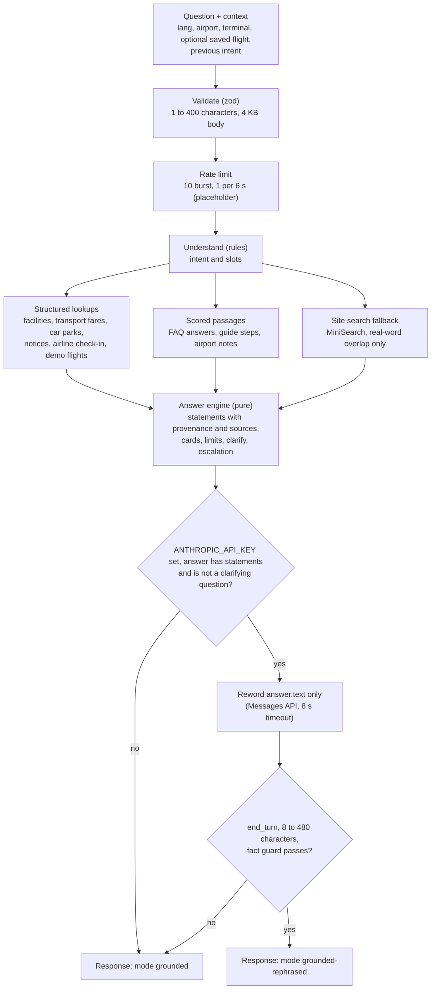

# Technical architecture and integration

Malaysia Airports passenger and corporate platform, concept prototype. Phase 7 of the brief.

| | |
|---|---|
| Written | 18 November 2026 |
| For | MAHB digital leadership, enterprise and solution architects, delivery vendors |
| Covers | The prototype as it is in this repository, and what a production service run by Malaysia Airports would need |
| Related | [Build specification](build-spec.md), [Security, privacy and resilience](security.md), [Next.js 16 notes](next16-notes.md), [hand-off notes](handoffs/), [product strategy](../strategy/product-strategy.md), [MAHB audit](../research/audit/mahb-audit.md), [first-hand observations](../research/audit/firsthand-observations.md), [content provenance](../research/content-provenance.md) |

## How to read this document

Every statement is tagged by what supports it.

| Tag | Meaning |
|---|---|
| **[code]** | True of the code in this repository on 18 November 2026. File paths are given so it can be checked. |
| **[measured]** | Measured in this repository: test runs, or the build output of 17 November 2026 in `.next/`. |
| **[observed]** | Seen first hand on MAHB's current websites on 16 and 17 November 2026 (audit files). |
| **[proposed]** | Our design for production. A recommendation, not something that exists. |
| **[assumption]** | Something we believe but MAHB must confirm. Listed again in section 9. |
| **[prior]** | General knowledge (standards, law, vendor products) that the project's research did not source. Confirm before relying on it. |

The prototype is an independent concept. It has no access to any MAHB system, and every operational value it shows (flights, gates, belts, car park space) is simulated and labelled "Demonstration data" on screen.

## Summary

1. **The prototype is a static-first Next.js 16 application.** Pages are prerendered in English and Bahasa Malaysia from a typed, validated content layer; everything that depends on the clock or the visitor runs in the browser after load. Static guidance stays readable with JavaScript off and with every API down. [code]
2. **Operational data sits behind provider interfaces** (`FlightDataProvider`, `WaitTimeProvider`, `ParkingAvailabilityProvider`). Only demo implementations exist. An `OfficialFlightProvider` stub documents the mapping to MAHB's public flight endpoint and throws by design. [code]
3. **Every published fact carries its source and retrieval date** (251 registered sources), and every piece of guidance carries one of four provenance tags. Bad content fails the unit tests. [code, measured]
4. **Production needs four things the prototype cannot supply:** agreements and feeds for operational data (flights first), a headless CMS with approvals in both languages, an integration layer that keeps passenger information available when an upstream fails, and the operating disciplines around them (observability, incident response, privacy and cyber-security compliance). [proposed]
5. **The most important design rule carries over unchanged:** no page depends on an API to show static guidance. MAHB's current passenger site renders empty pages when its content API is unavailable [observed]; this design does not.

---

## 1. Overview

### 1.1 The prototype as built

What the diagram says [code]:

- Content is TypeScript modules under `src/content/`, validated by zod schemas and cross-reference checks, imported at build time. There is no database and no CMS.
- Pages are prerendered for both languages. The proxy (`src/proxy.ts`) only redirects paths that have no locale; it never runs for localised pages, API routes or files.
- Flight boards and car park space are generated **in the browser** by the demo providers, as pure functions of the airport, the local date and the current instant. The pages do not call `/api/flights`; that route exists to demonstrate the integration contract. A demo queue-time provider exists and is reported by `/api/health`, but no page displays queue times.
- Personal state (saved flights and places, parked-car note, preferences, recent searches, concierge consent and conversation) stays in browser storage. Nothing personal is stored on the server.
- The concierge asks `/api/concierge`; if that fails it runs the same engine in the browser with a static knowledge pack. An AI model is used only to reword a grounded answer, and only if the server has an API key.

### 1.2 The production target

### 1.3 What changes between the two

| Concern | Prototype [code] | Production [proposed] |
|---|---|---|
| Published content | TypeScript modules in git, reviewed as code | Headless CMS with editorial roles, approvals and scheduling; the same typed model as the contract |
| Operational data | Demo providers in the browser | Provider implementations that read the BFF; the BFF reads MAHB's systems under agreement |
| API layer | Three route handlers in the Next.js app; in-memory rate limit | Route handlers as the public contract, a separate integration service behind them, edge and shared rate limits |
| Personal data | Browser storage only | Browser storage by default; a small server-side store only for opt-in alerts and bookings |
| Commerce | Links to official booking pages | Deep links first, then checkout through a licensed payment gateway |
| Operations | Health endpoint, tests run by hand | CI/CD, observability, alerting, disaster recovery, security testing |

---

## 2. Stack, rendering and performance

### 2.1 Stack and rationale

| Component | Version [code] | Why it was chosen | Validated here, or assumed |
|---|---|---|---|
| Next.js App Router | 16.4.6 (`package.json`) | Static prerendering with per-request islands (Cache Components), route handlers for the integration contract, proxy, metadata, sitemap and font tooling in one framework. MAHB's corporate site is already a Next.js application [observed], so skills exist in the supplier market | **Validated:** production build succeeds; 176 of 178 Playwright tests pass against `next build` + `next start`, 2 skipped by design (integration hand-off, 17 Nov). **Assumed:** behaviour under production load and on the chosen host |
| React | 19.3.0 | Required by Next.js 16; Server Components keep content off client bundles | Validated through the end-to-end suite |
| TypeScript (strict) | 5.x | One type system from content to UI; `tsc --noEmit` is a release gate | Validated: clean type check reported by integration |
| Tailwind CSS (via `@tailwindcss/turbopack`) | 4.3.3 | Design tokens in `src/app/globals.css` (`@theme`); default palette removed so only tokens can be used | Validated: token contrast audit, 95 pairs in 6 themes, no failures (`scripts/design-tokens.mjs`, design-system hand-off) |
| Radix primitives (`radix-ui`) | 1.8.x | Accessible dialog, popover, tabs, accordion, tooltip behaviour | Validated: axe reports zero violations at 41 scan points (wcag2a, 2aa, 21aa, 22aa) on desktop and phone profiles |
| zod | 4.6.x | One schema per content type; types are inferred from schemas so they cannot drift; also validates API input | Validated by tests. Cost: zod reaches client bundles (section 2.3) |
| MiniSearch | 7.2.x | Small client-side full-text search over a static index; no search server | Validated: 165 indexed documents per language, every link checked (integration hand-off; count from the 17 Nov build) |
| lucide-react | 1.73.x | One icon set behind `src/components/ui/icon.tsx` | n/a |
| Vitest, Playwright, @axe-core/playwright | 5.1.x, 1.63.x, 4.14.x | Unit tests for pure logic; end-to-end and accessibility against a production build | **Measured 18 Nov:** 29 unit test files, 363 tests passing |
| Self-hosted fonts (`next/font/local`) | Fraunces, Hanken Grotesk, Geist Mono, latin subsets | No font CDN, no third-party request at runtime | Validated: CSP `font-src 'self'` holds in the production CSP test |

Deliberately absent [code]: analytics, tag managers, chat widgets, embedded video, map tiles and any other third-party script. MAHB's current homepage requests at least eight third-party hosts, including Google Tag Manager, Microsoft Clarity and a Kommunicate chat widget [observed]. Any of these in production is a privacy and performance decision for MAHB, and a change to the Content Security Policy (section 7).

Assumed, not validated [assumption]: the hosting platform (none is chosen; the health endpoint reads `VERCEL_GIT_COMMIT_SHA` or `GIT_COMMIT` if present, nothing more); browsers other than Chromium (both Playwright projects are Chromium: desktop 1440 x 900 and a Pixel 7 profile at 390 x 844); field performance; the AI wording path (tested with a mocked `fetch` only).

`output: 'export'` (a pure static export) is not an option: it would drop the proxy, the security headers, the redirects, the POST route handler and the streamed flight detail page (Next.js notes, section 17).

### 2.2 Rendering model

**What happens today** [code, measured]:

- `next.config.ts` sets `cacheComponents: true` and `partialPrefetching: true`. Under Cache Components every page is prerendered as far as it can be; anything that needs request-time data must sit inside `<Suspense>` or the build fails.
- Content is imported from modules, so content pages complete at build time and are fully static. The prerender manifest of the 17 November build lists 152 routes per language; the sitemap lists 120 pages per language (it excludes search, My journey, offline, the design system and flight details on purpose).
- `[lang]` is the root segment; pages read it through `next/root-params`. Several dynamic routes declare `ensureStatic = 'navigation'` (airport overview, guide topic, help topic, corporate news item), which makes the build fail if they ever read runtime data and turns an unknown slug into a real 404 on the first request.
- The flight detail route `/[lang]/[airport]/flights/[flightId]` has no `generateStaticParams`, because ids carry a date. Its `params` are awaited inside `<Suspense>`, so it builds as a static shell with streamed content (`◐`). The flight's identity (airline, route, scheduled time) is derived on the server from the id alone, so the `h1`, breadcrumbs and metadata are correct without reading the clock; its live status comes from the client.
- The three API routes are rendered per request (`ƒ`). They read the request before they read the clock, as the framework requires, and send `Cache-Control: no-store`.
- Server Components never read the clock or random values (it is a build error under Cache Components). On the client, `useNow()` returns `null` on the server and until the first tick, then the epoch time every 30 seconds by default; components render a placeholder while it is `null`. Providers are immutable snapshots of one instant (`getFlightProvider(now)`), rebuilt every 30 seconds by `useFlightProvider()`.

**Why time-dependent data is computed on the client:**

1. **Correctness.** "Boarding", "open now", "check-in closes in 20 minutes" and which fare applies today depend on the moment the visitor looks, not the moment the site was built.
2. **Cacheability.** The HTML is identical for every visitor and every minute, so it can be served from a CDN and from the service worker.
3. **Resilience.** A page that renders its guidance at build time cannot be emptied by a failing API. This is the main failure of MAHB's current passenger site, whose pages carry no text in the HTML and stay on "Loading..." when the content API stops answering [observed].
4. **Privacy.** Saved flights and preferences never need to reach a server to personalise a page.

**What production changes** [proposed]:

- CMS content is fetched inside `"use cache"` functions with a `cacheLife` profile and `cacheTag` tags, and invalidated on publish by a signed webhook that calls `revalidateTag(tag, 'max')`. Pages stay in the static shell; freshness is driven by publishing, not by short timers. `"use cache"` entries live in memory per instance, so a multi-instance deployment needs a shared cache handler for tag invalidation to reach every instance (Next.js notes, section 17).
- Live flight data stays client-fetched: the board shell is static, and rows come from `/api/flights` through the CDN (section 6.2). A server-rendered snapshot for visitors without JavaScript is possible inside `<Suspense>`, but cache profiles shorter than five minutes are excluded from prerenders, so it would render per request; weigh that against the origin load before adding it.

### 2.3 Bundle and performance strategy

**Measured on the build of 17 November 2026** [measured] (gzip level 9 of the files referenced by each page; brotli on a real CDN will be somewhat smaller; images excluded):

| Page (English) | HTML | JavaScript (script files) | CSS | Preloaded font |
|---|---|---|---|---|
| Home `/en` | 76 KB | 305 KB (17) | 18 KB | 33 KB (1 file) |
| KLIA overview `/en/kul` | 69 KB | 306 KB (19) | 18 KB | 33 KB |
| KLIA departures `/en/kul/flights` | 59 KB | 309 KB (18) | 18 KB | 33 KB |
| KLIA parking `/en/kul/parking` | 68 KB | 306 KB (18) | 18 KB | 33 KB |
| KLIA map `/en/kul/map` | 75 KB | 312 KB (19) | 18 KB | 33 KB |
| Departing guide `/en/guides/departing` | 64 KB | 294 KB (17) | 18 KB | 33 KB |
| Concierge `/en/concierge` | 56 KB | 303 KB (18) | 18 KB | 33 KB |

Loaded on first use only, never in a page's own payload: the search index (`/en/search/index.json`, 18 KB gzip) and the concierge knowledge pack (`/en/concierge/knowledge.json`, 85 KB gzip, prefetched at idle once the visitor has agreed to use the concierge).

For comparison, MAHB's current homepage moved 32.7 to 34.3 MB over about 171 requests in a lab run, with a layout shift of 0.62 [observed, lab].

**What keeps the weight down** [code]: static HTML; `'use client'` on leaf components only; server-side view builders (`*.server.ts`) that pass small serialisable props instead of whole airport content; the command palette and the concierge chat loaded with `React.lazy`; search and concierge data as separate static JSON; three self-hosted variable fonts with latin subsets, of which only the interface face is preloaded (`preload: false` on the display face); SVG artwork; dense data (the flight board) that switches between table and stacked rows with container queries; partial prefetching (one reusable shell per route).

**Where it falls short** [measured]: JavaScript is 294 to 312 KB gzip per page, above the 250 KB budget for homes in the product strategy (section 7 of that document). The largest chunks are `react-dom` (about 70 KB gzip) and a chunk dominated by zod (about 33 KB gzip). Three changes would close most of the gap [proposed]:

1. Split the few runtime helpers that clients need (`pick`, labels, constants) out of `src/content/types.ts` into a schema-free module, so zod leaves client bundles (the domain hand-off lists this).
2. Remove the demo flight generator and the illustrative route table from client bundles in production; live data arrives as JSON.
3. Measure with Lighthouse in CI on mobile emulation and enforce the budgets (section 3.5). No Lighthouse run of the prototype is recorded in this repository; the targets on the transparency page (LCP under 2.5 s, INP under 200 ms, CLS under 0.1) are design targets, not results.

### 2.4 Offline service worker

[code: `src/components/platform/service-worker.ts`, `sw-routes.ts`, `sw-client.ts`]

| Aspect | Behaviour |
|---|---|
| Registration | Production builds only; scope `/`; `updateViaCache: 'none'`. Development removes stale registrations |
| Install | Precaches `/en`, `/ms`, `/en/offline`, `/ms/offline` and the bundles and fonts those pages reference |
| Caches | `ma-v1-static` (400 entries), `ma-v1-pages` (60), `ma-v1-data` (8). Names carry a storage-format version (`v1`); on activate, any `ma-*` cache with another name is deleted. The build version (`__MA_BUILD__`) is compiled into the worker, so every deploy installs a new worker, and it is recorded on each saved page (`x-ma-build`) |
| Static assets | Cache first (hashed bundles, fonts, icons) |
| Guidance pages | Stale-while-revalidate: airport overview and sections, guides, help, accessibility, airport directory |
| Data | Stale-while-revalidate: manifest, search index, concierge knowledge pack |
| Other pages | Network first with a 3.5 s timeout, then the saved copy; otherwise `/[lang]/offline?from=<path>` |
| Never stored | `/api/*`, React Server Component requests, search results, non-GET, other origins |
| Storage rules | Only `200`, same-origin, not redirected, not `no-store` or `private`; pages keyed by path only, so query strings (search terms, filters) are never written to the device |
| User interface | "You are offline: showing saved information" indicator; update prompt (Reload or Later, no forced reload); offline page lists saved pages and can remove them |
| Recovery | Kill switch documented in `security.md` section 8 |

Tested by unit tests of the routing rules and an end-to-end test that saves pages and serves them offline (`e2e/platform.spec.ts`) [code].

Production additions [proposed]: when live flights arrive, the worker must keep bypassing `/api/*`, so a stale board is never shown as current; the board shows its own "last updated" time instead. Web push needs a `push` handler in the same worker (section 5.10). Consider `experimental.useOffline` from Next.js for client navigations into already-prefetched routes (Next.js notes, section 13).

---

## 3. Code organisation, testing and delivery

### 3.1 Layers

| Layer | Folder [code] | What it holds | May be imported by client components? |
|---|---|---|---|
| Content | `src/content/` | `types.ts` (every schema and type, `validateContent`), `airports.ts` (39-airport registry), `airports/<code>.ts` (six per-airport files), `guides.ts`, `faqs.ts`, `notices.ts`, `corporate.ts`, `sources.ts`, `index.ts` (entry point) | Only `@/content/types` and `@/content/airports`. `@/content` pulls in every airport and is for the server |
| Domain logic | `src/lib/flights`, `journey`, `map`, `search`, `i18n`, and `time.ts`, `format.ts`, `parking.ts`, `transport.ts`, `locale.ts`, `storage.ts`, `stores.ts`, `preferences.ts`, `hooks/` | Pure functions that take `now` explicitly; client stores over `localStorage` with versioned `ma:` keys | Yes, except `@/lib/i18n` (server translator) and `@/lib/search` (document builder) |
| Providers | `src/lib/providers/` | Interfaces, demo implementations, the official-flight stub, pure handlers for the API routes | Yes (the demo runs in the browser) |
| Concierge | `src/lib/concierge/` | Understanding, retrieval, answer engine, request schema, rate limiter, fact guard; `*.server.ts` for the knowledge builder and AI wording | Engine yes; `*.server.ts` no |
| SEO and platform | `src/lib/seo/`, `src/components/platform/` | Headers, redirects, sitemap registry, JSON-LD; service worker and offline UI | Platform UI yes |
| Design system | `src/app/globals.css`, `src/components/ui/`, `common/`, `art/`, `src/fonts/`, `scripts/design-tokens.mjs`, `/[lang]/design-system` | Tokens, primitives, domain-aware shared components (`ProvenanceTag`, `DemoDataBanner`, `Freshness`, `NotPublished`, `FlightStatusChip`) | Yes |
| Shell | `src/app/[lang]/layout.tsx`, `src/components/shell/`, `src/proxy.ts` | Header, footer, navigation, airport switcher, overlays, preferences | Yes |
| Features | `src/components/<feature>/`, routes under `src/app/[lang]/` | Flights, map and facilities, transport and parking, commerce, guides and help, concierge, corporate, home and airports | Feature components yes; `*.server.ts` view builders no |
| Integration contract | `src/app/api/*`, `src/app/[lang]/search/index.json`, `src/app/[lang]/concierge/knowledge.json` | Route handlers | n/a |

Dependency direction: routes → feature components → common and ui → lib → content types. Client components receive content as props. These rules are **conventions**: the `server-only` package is not installed and no lint rule enforces import boundaries [code]. One inversion exists: `src/lib/search/documents.ts` imports `CORPORATE_SECTIONS` from `src/components/corporate` (integration hand-off, item 10).

Production additions [proposed]: add `server-only` to the server modules; enforce boundaries with `no-restricted-imports` rules in `eslint.config.mjs`; move `CORPORATE_SECTIONS` into `src/content`.

### 3.2 Ownership boundaries

The build specification (section 4 and 5) assigns every route and shared module to one owner, and only that owner edits it; others ask, or add a clearly named file in their own feature folder. In the prototype the owners were teams of the build; in production they map to product teams or vendor squads.

| Owner in the prototype | Owns | Production owner [proposed] |
|---|---|---|
| domain | `src/content/types.ts`, registry, `src/lib/**` except concierge, `/api/flights`, `/api/health` | Platform core team (content model, providers, BFF contract) |
| content authors | `src/content/airports/<code>.ts`, guides, FAQs, notices | Editorial team in the CMS (section 4.6) |
| design-system | Tokens, `ui/`, `common/`, `art/`, fonts | Design system team |
| foundation-ui (shell) | Layout, shell, home, airports, notices, search | Platform core team |
| flights, map, transport, commerce, guides, concierge, corporate-network | Their routes and `src/components/<feature>/` | One product team per journey area |
| platform | `next.config.ts`, headers, redirects, service worker, sitemap, `security.md` | Platform and security engineering |
| integration | Release checks, cross-team fixes | Release management and QA |

Recommended [proposed]: a `CODEOWNERS` file that encodes this table, so pull requests are routed to the right reviewers automatically.

### 3.3 Testing pyramid

| Level | Tooling [code] | What it covers | Current result |
|---|---|---|---|
| Unit | Vitest in a Node environment, `src/**/*.test.ts` next to the code | Pure logic: providers and status rules, flight search and ids, journey timeline, parking calculator, transport ranking, map routing, search, i18n parity, storage, time and formatting, headers, redirects, service-worker rules, concierge engine and server, commerce and corporate view logic | **29 files, 363 tests passing** [measured, 18 Nov] |
| Content | `validateAllContent()` inside `src/content/content.test.ts`; `src/components/corporate/corporate-content.test.ts` | Every record against its schema; unique ids; every source id resolves; items point at real airports and terminals; map graphs connected; published rates present when claimed; corporate facts dated, sourced and bilingual | Passing; zero issues [measured] |
| End to end | Playwright, `e2e/*.spec.ts` (9 specs), against `next build` + `next start` on port 3100 | One or more journeys per feature, headers, CSP violations, every sitemap URL answering 200, redirects, offline behaviour, the designed 404 | 176 passed, 2 skipped, of 178 (desktop and phone projects; integration hand-off, 17 Nov) |
| Accessibility | `@axe-core/playwright` with tags `wcag2a`, `wcag2aa`, `wcag21aa`, `wcag22aa` inside the journeys | Automated WCAG checks at 41 scan points across the 9 specs, on the desktop and phone projects | Zero violations [integration hand-off] |
| Design tokens | `node scripts/design-tokens.mjs` | Contrast of every text and boundary pair in every theme; exits 1 on failure | 95 pairs, 6 themes, no failures [design-system hand-off] |
| Links | Crawl scripts run outside the repository | Static and rendered internal links, fragments, search-index links | 0 broken [integration hand-off]; scripts not kept in the repository |

Gaps [code]: React hooks are not unit-tested in a DOM (no jsdom); there is no WebKit or Firefox project; no Lighthouse run; no visual regression; no load test; the link crawler is not in `scripts/`.

### 3.4 What the tests do not replace

Automated accessibility checks find a minority of WCAG issues. Production needs a manual audit by specialists and testing with disabled passengers before launch (product strategy, section 7). Native review of the Malay copy is still outstanding; every hand-off lists it.

### 3.5 CI/CD design

There is no CI configuration in the repository today [code]. The Playwright configuration is already CI-aware (`forbidOnly`, one retry and two workers when `CI` is set). Proposed GitHub Actions pipeline [proposed]:

| Job | Runs | Needs | Blocks merge? |
|---|---|---|---|
| `install` | `npm ci` with the npm cache keyed on `package-lock.json` | – | Yes |
| `typecheck` | `npx next typegen && npx tsc --noEmit` (the global `PageProps` helpers are generated into `.next/types`, so a clean checkout needs `typegen` first) | install | Yes |
| `lint` | `npx eslint .` | install | Yes |
| `unit` | `npx vitest run` (includes content validation) | install | Yes |
| `content` | Content validation report as a build artefact; expiry check (items whose `validTo` has passed or whose `asOf` is older than the review period); weekly source-link liveness check | install | Validation yes; liveness no (official hosts may block automated clients, as observed) |
| `tokens` | `node scripts/design-tokens.mjs --quiet` | install | Yes |
| `build` | `next build` with `APP_VERSION=${{ github.sha }}` and `NEXT_PUBLIC_SITE_URL` set; uploads `.next` as an artefact | typecheck, lint, unit | Yes |
| `e2e` | `next start` from the artefact; `npx playwright test` on desktop and phone projects; axe inside the specs; HTML report and traces on failure. Add a WebKit project | build | Yes |
| `lighthouse` | Lighthouse CI on about 12 URLs per language, mobile emulation, median of 3 runs. Budgets from the product strategy: LCP 2.5 s or less, CLS 0.1 or less, total blocking time 200 ms or less (lab stand-in for INP), home 1,000 KB or less and guidance pages 500 KB or less transferred, JavaScript 250 KB, fonts 150 KB, 40 requests or fewer | build | Yes, once the JavaScript budget is met (section 2.3); warn-only until then |
| `links` | Crawl from `/sitemap.xml` (status, fragments, no links through redirects), then the same after hydration; check the search index links | build | Yes |
| `security` | Dependency review on pull requests, `npm audit --omit=dev`, CodeQL, secret scanning | install | High and critical findings block |
| `preview` | Deploy every pull request to an access-protected preview: demo providers, `SITE_INDEXING` unset (so `X-Robots-Tag: noindex`), preview-only secrets, a unique `APP_VERSION`; post the URL on the pull request; run the smoke spec and Lighthouse against it | build | No |
| `release` | On merge to `main`: deploy to staging, run smoke and synthetic checks. Production deploy from a tagged release with a manual approval; post-deploy smoke; automatic rollback on failed smoke | all | n/a |

Rollback is a redeploy of the previous immutable build (RTO 15 minutes in `security.md`, section 8). Each deploy ships a new service worker version, so visitors see the update prompt once per release.

---

## 4. Content model and CMS

### 4.1 The typed model

`src/content/types.ts` is the single authority. Each type is a zod schema with the TypeScript type inferred from it; schemas are strict, so a misspelt field fails validation [code].

| Type | What it represents | Key fields and rules [code] |
|---|---|---|
| `LocalizedText` | Bilingual text | `{ en, ms? }`; `pick(text, lang)` falls back to English and the page then shows a translation notice |
| `Provenance` | Kind of guidance | `official` \| `estimated` \| `suggestion` \| `demo` |
| `Source` | A citable source | `id`, `title`, `publisher`, `url` (https or an internal path), `retrieved` (date checked), `asOf?` (date the source states), `kind` (`official`, `government`, `operator`, `news`, `aggregator`, `other`) |
| `Hours` | Opening hours | `24h`, `daily` (`open`, `close`) or `text`; only the first two can answer "open now" |
| `Money` | An amount | MYR only; `basis?` per person, per vehicle, metered or "from" |
| `Contact` | Official channel | `kind` (phone, email, web, chat, app), display value, `href`, sources |
| `Airport`, `Terminal`, `Level` | The 39-airport registry | IATA `code` and `slug`, `icao?`, names, region, `classification` (international, domestic, STOLport), `depth` (full, essential, listing), one timezone, approximate coordinates, terminals (`T1`, `T2`, `MAIN`) with levels, contacts; `verification` and `unverifiedFields` |
| `Facility` | Facilities and services, lounges and hotels included | 26 categories, terminal, `zone` (landside, airside, both, unknown), `level?`, `locationNote?`, `hours?`, `operator?`, `access?`, `accessible?` (only when a source says), `bookingUrl?`, `mapPoint?`, provenance, sources |
| `Outlet` | Shop, restaurant or commercial service | Trading name, `kind` (dine, shop, service), category, `cuisine?`, zone, `hours?`, `priceBand?` (1 to 4), `halal?` (certified, pork-free, non-halal), `mapPoint?`, sources. No provenance field and no offer or promotion field |
| `TransportOption`, `TransportDestination` | A way to or from the airport | `mode` (rail, bus, taxi, e-hailing, car rental, private car, shuttle, inter-terminal), operator, destinations with `fare?` and `durationMinutes?`, frequency, hours, boarding points per terminal, payment, step-free status, `bookingUrl?`, provenance. No validity dates: fare periods are parsed from destination names |
| `CarPark`, `RateBand` | A car park and its tariff | Type, bays and qualifier ("over 5,700"), walk, `rates` (bands: from and to minute, flat or per block, amount), `rateStatus` (`published` or `not-verified`), `dailyMax?`, `graceMinutes?`, features, EV and accessible bays, booking URL |
| `AirlineAtAirport` | An airline as a published fact | Code, name, terminal, check-in location, destinations (empty unless sourced), `basis` (airline, airport, third party) |
| `Guide`, `GuideSection`, `GuideStep` | "Plan your journey" guides | Audiences, sections, steps; **each step has its own provenance**, and `official` steps must carry sources |
| `GuideNote` | Airport-specific sourced note attached to a journey step | Topic (15 journey topics), `appliesTo` (terminal, airline, gate prefixes, scope, direction), provenance |
| `Faq`, `HelpTopic` | Help centre | Topic slug, question, answer, airports, provenance (`HelpTopic` is an interface in `faqs.ts`) |
| `Notice` | Travel advisory or operational notice | `airport?`, `terminal?`, `severity` (info, advisory, warning, critical), `validFrom?`, `validTo?`, provenance. The client works out upcoming, active or expired from `now` |
| `CorporatePage`, `ContentBlock`, `NewsItem` | Corporate pages and news | Light rich text: paragraph, heading, list, sourced fact |
| Corporate extensions | Facts, milestones, people, traffic figures, carbon accreditation, media items, links | TypeScript interfaces in `corporate.ts` without zod schemas; checked by `corporate-content.test.ts` |
| `MapModel` | Schematic terminal map | `schematic: true` always; levels, zones, points of interest (each with provenance; non-demo points need sources), walk-graph nodes and edges in a 1000 x 600 space |
| `AirportContentModule` | What a per-airport file exports | Facilities, outlets, transport, car parks, airlines, notices, maps, guide notes, own sources; built with `defineAirportContent` |

**Coverage today** [measured]: 39 airports in the registry (5 full, 17 essential, 17 listing), 12 of them fully verified and 27 with at least one unverified field (usually the ICAO code). Content files exist for 6 airports. KLIA has 20 facilities, 8 outlets, 9 transport options, 4 car parks (none with verified rates), 16 airline records, 2 notices, 17 guide notes and one map (KLIA Terminal 1, 39 points, 17 of them illustrative). Penang has the only car park with published rates. Network-wide: 11 guides, 28 FAQs in 11 help topics, 6 notices (one of them the demonstration notice).

### 4.2 Provenance and the source registry

- **251 sources** are registered [measured]: 96 core, 87 brought by airport files, 68 for the corporate section. By kind: 58 official, 14 government, 15 operator, 81 news, 50 aggregator, 33 other.
- A fact is published only if the research evidence is a search result of high or medium confidence; prior knowledge and low-confidence facts are withheld ([content provenance](../research/content-provenance.md)). Unknown values stay `undefined` and the interface says "Not published" with a link to the official channel.
- `official` means the airport operator, an airline about itself, a government body, or such a statement reported by the press. Facts supported only by guides, listings or directories are `estimated`, and the text names who reports them.
- Every page shows the sources it rests on with their retrieval date. The concierge cites the same ids.

### 4.3 Validation

`validateContent(bundle)` runs every schema and these cross-checks: unique ids per collection; every `sources` id resolves; every item names a registered airport and one of its terminals and levels; map points, nodes, zones and references resolve and each walk graph is connected; `official` guide steps have sources; car parks with `published` rates have bands. It runs in `npm run test`, so invalid content cannot pass the release gate [code].

### 4.4 Mapping to a headless CMS

[proposed]

| Model element | CMS representation |
|---|---|
| Each zod schema | One content type with the same field names; required and optional fields as in the schema; enums as fixed lists |
| `LocalizedText` | Field-level localisation with locales `en` and `ms`, English as fallback; per-locale review status (section 4.6) |
| `sources: string[]` | References to `Source` entries; at least one required on publish; `retrieved` and `asOf` as date fields |
| `provenance` | Required enum on every guidance-bearing type; editors cannot publish without choosing |
| Airport and terminal references | References to `Airport` entries; terminal and level as dependent choices |
| `Notice.validFrom` / `validTo` | Date-time fields in airport time. Rendering already respects them, so a notice can be published early and appear on time; scheduled publishing is still useful for embargoed text |
| `MapModel` | Not hand-edited in the CMS: imported from MAHB's spatial data (IMDF or CAD/GIS export), with descriptive text in the CMS |
| Operational values (flights, gates, queues, availability) | Never in the CMS: they come from providers |

Delivery [proposed]:

1. The web tier reads the CMS delivery API inside `"use cache"` functions tagged by type and airport (`notices`, `notices-kul`, `transport-kul`).
2. On publish, the CMS calls a signed webhook route that validates the payload, then calls `revalidateTag` for the affected tags and purges the CDN paths.
3. A **pre-publish validation** step runs the same `validateContent` rules against the entry plus its references (as a CMS extension or a webhook that can veto publication), so the CMS cannot publish what the build would reject.
4. The search index and the concierge knowledge pack, built per deploy today, become route handlers cached under the same tags and are rebuilt when content changes.
5. Draft preview uses Next.js draft mode on the staging host.
6. The current typed modules remain the seed import and the schema source; a one-off migration script loads them into the CMS.

MAHB's current passenger site already loads its content from CMS endpoints on `api.myairports.com.my` (highlights, news, banners, help page, page content by page name and others) [observed]. Which CMS that is, and whether its content and editors can be migrated, is a question for MAHB (section 9).

### 4.5 CMS options against MAHB's needs

Assessment from vendor documentation as generally known in 2026 [prior]; no product was trialled for this document. Features differ by plan and change often: confirm each cell in a request for proposal.

| Need | Contentful (SaaS) | Sanity (SaaS, hosted content store) | Strapi (open source; self-hosted or Strapi Cloud) | Payload (open source; runs inside a Next.js app, self-hosted) |
|---|---|---|---|---|
| Multi-airport structure | References and tags; one space, or a space per environment | Flexible schemas in code; references | Collection types and relations | Collections and relations defined in TypeScript |
| Bilingual workflow | Built-in field-level locales with fallback | Field- or document-level localisation through official plugins | Built-in internationalisation (per-locale entries) | Built-in field-level localisation with fallback |
| Scheduled notices | Scheduled publishing built in | Scheduled publishing and content releases | Releases with scheduling | Scheduled publishing through its jobs queue |
| Approvals | Workflow features on higher tiers | Built by customising the Studio, plus roles | Review workflows in the paid edition | Implemented in code (access control, status fields, hooks) |
| Audit trail | Version history; audit logs on enterprise tiers | Document history (retention by plan) | Audit logs in the paid edition | Document versions; an audit log needs hooks or a plugin |
| Staff SSO and roles | SSO and custom roles on enterprise tiers | SSO and custom roles on enterprise tiers | SSO in the paid edition; roles built in | Authentication and access control in code; SSO through custom strategies |
| Malaysian data residency | Vendor-hosted; published regions are outside Malaysia (confirm) | Vendor-hosted; no Malaysian region known (confirm) | Full control when self-hosted in a Malaysian region | Full control; it runs wherever the web tier runs |
| Typed model fit | Content types mirrored by hand or by script | Schemas in TypeScript; close fit | Schemas in JSON or code | Schemas in TypeScript; closest fit to the zod model |
| Operating burden | Lowest | Low | Medium to high when self-hosted (patching, backups, uptime) | Medium to high; ships with the web tier |
| Lock-in | Proprietary API and model | Proprietary store; query language GROQ | Open source; portable database | Open source; portable database |

What decides the choice [proposed]:

- **Residency.** Public guidance is not personal data, so where it is stored matters little under PDPA. Editor accounts, audit logs and any form submissions are personal data, and their storage abroad is a cross-border transfer. If MAHB's legal position, or a designation under the Cyber Security Act (section 7.6), requires these to stay in Malaysia, the self-hosted options lead. If not, the SaaS options lead on operating cost and editor experience.
- **Approvals and audit** are mandatory for notices that can redirect passengers. Price the tier that includes them, or the engineering to build them.
- **A two-week proof** with the real `Notice`, `TransportOption` and `Facility` types in both languages, the pre-publish validation hook and the revalidation webhook would settle the remaining questions.

### 4.6 Editorial workflow and roles

[proposed]

| Role | Can do | Typical holder |
|---|---|---|
| Contributor | Draft and edit in one language for assigned airports or domains | Airport content officers, tenant liaison |
| Translator | Edit the `ms` (or `en`) locale; mark a locale as reviewed | In-house or agency translators; native-speaker review for Malay |
| Domain owner | Approve facts in their domain (parking, transport, assistance, retail) and confirm sources and validity | Named owner per content domain (product strategy, section 9) |
| Publisher | Publish and schedule after approval | Digital team |
| Duty notices editor | Publish `warning` and `critical` notices at once, with a second person confirming within 30 minutes | Airport operations control centre, corporate communications |
| Administrator | Manage schema, roles and integrations | Platform team |

Workflow: draft → source and provenance check → domain approval → translation and review → publish (or schedule). Rules: no publish without sources and provenance; a fact with a review date that has passed raises a warning to its owner (the model needs a `reviewBy` field, which it lacks today); both locales reviewed for passenger-safety content; an emergency path for notices with retrospective review; every action in the audit log.

---

## 5. Data integration

### 5.1 Integration map

Privacy classes used below [proposed]: **Public** (no personal data); **Internal** (operational, not for publication); **Personal** (identifies a person: contact details, booking data, device push endpoints); **Sensitive personal** (PDPA "sensitive personal data", for example health information in an assistance request); **Payment** (cardholder or bank data, kept out of MAHB's systems by a hosted payment page).

| Integration | Prototype now [code] | Likely source and owner at MAHB [assumption] | Freshness target [proposed] | Authorisation needed | Failure mode and fallback [proposed] | Privacy |
|---|---|---|---|---|---|---|
| Flight information | `DemoFlightProvider` in the browser; `OfficialFlightProvider` stub; `/api/flights` (demo) | AODB and FIDS; airport operations / operations control centre with IT | Status, gate, belt on screen within 60 s of the AODB update (95th percentile) | Data-sharing agreement; service credentials to the integration platform; airline publication terms where they apply | Last good snapshot with its age; withhold gates and statuses when older than 15 min; point to the airline and airport screens | Public |
| Operational data and notices | `Notice` in content files; a demo queue-time provider that no page displays | Operations control centre, corporate communications; asset systems for Aerotrain and shuttle; queue sensors or Immigration | Notices live within 2 min of publish; status and queues within 5 min | Publishing authority; access to status and queue data | Notices from the last published build; emergency banner path; queues hidden when stale | Public |
| Terminal and facility data | `Facility`, `MapModel` (schematic, KLIA T1 only) | Terminal operations, facilities management, GIS or CAD | Daily; closures through notices | Licence to use floor plans; export from spatial systems | Last published data; closures as notices | Public |
| Parking | `CarPark` content; `calculateParking`; demo occupancy; links to the official booking page | Car park operations: parking access and revenue control system, tariff tables, booking engine | Tariffs on change with validity dates; occupancy within 5 min | Agreement with the car park operation; booking API terms; payment set-up | Hide occupancy; keep tariffs with their date; booking shows "unavailable, pay on exit" | Public; bookings Personal and Payment |
| Retail and dining | `Outlet` content (8 at KLIA); no hours, prices or offers | Commercial (retail and F&B) leasing systems; tenants; duty-free operator | Daily; offers with validity dates | Tenant data agreements; brand use | Directory without hours or offers | Public |
| Ground transport | `TransportOption` content with dated fares; no live data | Express Rail Link (KLIA Ekspres and KLIA Transit), coach operators, taxi counters, e-hailing pick-up rules | Fares and timetables on change; disruptions within 5 min | Data agreements per operator; open timetable formats where published | Published timetable and fares with dates; operator links | Public; tickets Personal and Payment |
| Customer service | Sourced contacts, escalation ladder, links to the feedback site and care chat | Contact centre and CRM; lost property system | Case creation immediate; status on change | CRM API access; data processing terms | Show phone, email and chat links | Personal; assistance requests may be Sensitive personal |
| CMS | Typed modules in git | Digital team; editorial roles across MAHB | Publish to screen within 2 min | Licence; staff SSO | Last published content keeps being served | Public; editor data Personal |
| Notifications | Demo browser notifications while a page is open; no push server | New notification service; channels from vendors | Event to device within 60 s | Consent records; WhatsApp Business account; SMS sender; email domain | Queue and retry; drop events that are no longer true | Personal |
| Commerce and payments | None; links to official sites (parking, Fast Track, lounges) | Commercial and finance; partners; licensed payment gateway | Real time | Merchant accounts; partner agreements; PCI DSS responsibilities | No partial bookings; clear failure message; fall back to deep link | Personal and Payment |

### 5.2 Flight information (AODB and FIDS)

**Prototype** [code]. `FlightDataProvider` (`src/lib/providers/types.ts`) defines `meta()`, `listFlights(query)`, `getFlight(id, airport?)` and `search(query)`. `meta()` returns `mode` (`demo` or `live`), label, `generatedAt`, `refreshSeconds`, source and disclaimer, and the UI shows the label and disclaimer wherever flights appear. `DemoFlightProvider` builds a stable daily timetable for 21 airports from an illustrative route table and derives statuses from the current instant (about 14% of flights delayed and about 1% cancelled per day, seeded). Flight ids are `<airline><number>-<yyyymmdd>-<d|a>`, for example `mh2610-20261117-d`, so saved flights would survive a switch to live data.

Client components call the demo provider's synchronous methods (`listFlightsSync`, `getFlightSync`, `searchSync`) in about a dozen files. A live provider is asynchronous and remote, so production needs a client data hook that fetches the BFF with stale-while-revalidate behaviour and the same `Flight` shape. The seam is in the right place, but the comment in `types.ts` that "nothing in the UI would need to change" understates this work.

**What the audit observed about MAHB's public endpoint** [observed]:

- The official board loads its rows from `GET https://api.myairports.com.my/passenger-fids/api/flights/search-flights`. The homepage request was `search-flights?code=D&key=all&terminal=KLIA&live=true&limit=5`: parameters `code` (`D` or `A`), `key` (search key, `all`), `terminal` (`KLIA`), `live` and `limit`. The stub in `official-flights.ts` also lists `skip` and `take` for paging; the audit record does not show them.
- Without the official site's own request headers the endpoint answers 401, so **the response schema was not observed**. The fields the official board displays are known: scheduled time, origin or destination, airline, flight number, status, check-in row and counter, gate (departures), baggage belt and gate (arrivals), and a "Last Update" stamp. The homepage widget shows the columns From, Airline, Flight, Status, Time.
- `OfficialFlightRowAssumed` in the stub names these as `scheduledTime`, `estimatedTime`, `airline`, `flightNumber`, `origin`, `destination`, `status`, `checkInCounter`, `gate`, `belt`, `terminal`, `lastUpdate`. These names are our assumption, not MAHB's schema.

**Production** [proposed]. Take flight data at its source, the AODB (or the FIDS feed derived from it), through MAHB's integration platform under an agreement, not from the public website API. Prefer event messages (AIDX flight-leg notifications pushed to a broker) for low latency, with a periodic full snapshot to repair gaps; accept an ACRIS-style REST interface if that is what MAHB's AODB vendor offers.

**Data contract.** The prototype's `Flight` type is the target shape. The AIDX and ACRIS columns are indicative, for scoping [prior]; element names and code lists must be checked against the version MAHB's AODB vendor implements.

| `Flight` field [code] | On MAHB's board or endpoint [observed] | AIDX (indicative) | ACRIS concept (indicative) |
|---|---|---|---|
| `id` | No per-flight page evidenced | Derived from `LegIdentifier`: airline, flight number, departure and arrival airport, origin date | Flight leg identity |
| `airline.code`, `airline.name` | "Airline" column | `LegIdentifier/Airline` (IATA or ICAO code context) | Operating carrier |
| `number` | "Flight" column | `LegIdentifier/FlightNumber` | Flight number |
| `direction` | Request parameter `code=D\|A` | Arrival or departure perspective of the airport's resources | Arrival or departure movement |
| `terminal` | Request parameter `terminal`; separate boards per terminal | Terminal or resource allocation in `AirportResources` | Terminal |
| `origin`, `destination` | "From" column; origin or destination | `LegIdentifier/DepartureAirport`, `ArrivalAirport` | Departure and arrival airport |
| `scheduled` | Scheduled time ("Time") | `OperationTime` with qualifier `SCH` | Scheduled time |
| `estimated` | Expected time (arrivals) | `OperationTime` with qualifier `EST` | Estimated time |
| `actual` | Not evidenced | `OperationTime` with qualifier `ACT` | Actual time |
| `status`, `statusDetail` | "Status" | `OperationalStatus`, remark text | Flight status, public remark |
| `checkInRow`, `checkInCounters`, `checkInOpensAt`, `checkInClosesAt` | Check-in row or counter (departures) | Check-in counter allocation in `AirportResources` | Check-in desk allocation |
| `gate`, `boardingAt`, `gateClosesAt` | Boarding gate (departures), gate (arrivals) | Passenger gate in `AirportResources`; boarding times in `OperationTime` (code list to confirm) | Gate, boarding times |
| `belt` | Baggage belt (arrivals) | Baggage claim unit in `AirportResources` | Baggage reclaim belt |
| `codeshares` | Not evidenced | `CodeShareInfo` | Marketing flights |
| `aircraft`, `durationMinutes` | Not evidenced | `AircraftInfo`; flight duration | Aircraft type |
| `meta().generatedAt` | "Last Update" stamp | Message timestamp | Last updated |
| `isDemo` | – | Always `false` for live data | – |

Status text from the source maps to the 14 keys of `FLIGHT_STATUSES` through a lookup table, keeping the original remark in `statusDetail`.

**Freshness and latency** [proposed]: AODB event to BFF store within 10 s; BFF to CDN-cached JSON with a 15 s shared cache life; browser refresh every 30 s (as today). Target: change visible within 60 s at the 95th percentile. Every board keeps its "Updated hh:mm" line (`Freshness` component exists).

**Authorisation** [assumption]: a data-sharing agreement with MAHB covering scope (which airports, which fields), refresh rate, rate limits and display rules (product strategy, Q1); service-to-service credentials (OAuth 2.0 client credentials or mutual TLS) and network allow-listing between the BFF and the integration platform; confirmation of any airline restrictions on publishing codeshare or aircraft data.

**Failure modes and fallbacks** [proposed]: feed silent (detect by heartbeat and message age); out-of-order or duplicate messages (upsert by leg identity, keep the newest by source timestamp); day-boundary and timezone errors (all times stored with `+08:00` offsets, as in the prototype). When data is older than 5 minutes the board shows a warning with the age; older than 15 minutes, it withholds gates and statuses, keeps scheduled times, and points to the airline and the airport screens. Static guidance is unaffected.

**Privacy**: public operational data. Saved flights stay on the device; alert subscriptions are personal (section 5.10).

### 5.3 Airport operational data and notices

**Prototype** [code]: notices are content records with severity, optional terminal and validity window; the client decides whether each is upcoming, active or expired. One network notice exists to explain the demonstration data; five airport notices are sourced (for example the Aerotrain software update from 28 November to 1 December 2026, published as scheduled "subject to an independent safety assessment"). `DemoWaitTimeProvider` simulates queues at six checkpoints (check-in, security, departure and arrival immigration, customs, taxi queue) and `/api/health` reports it, but no page displays queue times. Aerotrain, train and shuttle status are not available.

**Production** [proposed]: notices authored in the CMS by the operations control centre and corporate communications, with the duty-editor path in section 4.6. A machine-readable status feed for the Aerotrain, the inter-terminal train and the shuttle from the systems that run them (product strategy, Q6 and Q16). Queue estimates only from a measured source (MAHB sensors or Immigration data); until then, none are shown. `WaitTimeProvider` is the contract: `{ airport, terminal, checkpoint, minutes, level, trend, updatedAt }`.

**Emergency path when the CMS is down** [proposed]: a single signed JSON document in object storage behind the CDN (`/status.json`), editable by two named people through a separate tool, read by the shell on every page and cached for 60 s. It carries one banner per airport at most.

**Freshness**: notices within 2 minutes of publish; status and queues within 5 minutes, with the age shown. **Privacy**: public.

### 5.4 Terminal and facility data

**Prototype** [code]: `Facility` records (KLIA 20, Penang 3, Kota Kinabalu 2) and one `MapModel` for KLIA Terminal 1 with a walk graph and `shortestPath` routing at 70 and 48 metres per minute. Most map positions are illustrative and labelled; facility locations for prayer rooms, medical services, ATMs and lost property are unverified and say so. No Terminal 2 map.

**Production** [proposed]: facility master data (what, where, which level and zone, step-free status, hours) owned by terminal operations and facilities management, edited in the CMS; geometry from MAHB's CAD or GIS, exported as IMDF (Indoor Mapping Data Format) so maps are not hand-drawn. Georeference the existing `MapModel` (per-level transform, real metres on edges, door and lift nodes, step-free attributes), as set out in the map hand-off. Positioning, if added later, runs on the device and is opt-in. **Freshness**: daily; temporary closures as notices. **Authorisation**: licence and export of floor plans. **Privacy**: public.

### 5.5 Parking: systems, availability and booking

**Prototype** [code]: four KLIA car parks with bays and features but `rateStatus: 'not-verified'` (sources disagree, and the official page showed no rate table [observed]); the calculator therefore only shows a ceiling from the Long Term Car Park's daily maximum (RM 32 from 1 May 2026), labelled estimated. Penang's premium car park has published rates and a working calculator. Occupancy comes from `DemoParkingAvailabilityProvider`. Booking links go to the official page.

**Production** [proposed]:

- **One tariff source** for the page, the calculator and the barrier (product strategy, Q2). Contract: `RateBand[]` as in the model (`fromMinute`, `toMinute`, `kind`, `amount`, `blockMinutes`), `dailyMax`, `graceMinutes`, plus `validFrom` and `validTo` (missing today). Tariffs change rarely; publish them through the CMS with the operator's approval, or read them from the operator's system if it exposes them.
- **Occupancy** from the parking access and revenue control system: `{ carParkId, capacity, occupied, updatedAt }` every 1 to 5 minutes. Contract: `ParkingAvailability` (`percentFull`, `availableBays` only when capacity is published, `level`, `updatedAt`).
- **Booking**: phase 1, a deep link with entry and exit times prefilled; phase 2, a booking API (quote, hold, confirm, cancel) with payment (section 5.11). Booking data (name, email, phone, vehicle registration) is personal data held by the car park operation, not by the web tier.

**Failure**: occupancy unknown → hidden; tariff feed unavailable → last approved tariff with its date, never a computed price after its validity ends; booking down → message and drive-up information. **Authorisation**: agreement with the car park operation; API credentials; merchant set-up.

### 5.6 Retail and dining directories and offers

**Prototype** [code]: 8 KLIA outlets confirmed by a named source, none with hours, price band or cuisine, so "Open now" and the price filter explain why they find nothing. Outlet provenance is derived from the kind of source (no field). Offers and promotions are not modelled; MAHB's homepage currently carries promotions as editorial [observed].

**Production** [proposed]: tenant master data (trading name, unit, terminal, level, zone, category) from the commercial leasing system; hours, cuisine, halal status and offers maintained by tenants through a tenant portal or CMS role, approved by the commercial team. Add `Outlet.provenance` and an `Offer` type (`outlet`, `title`, `validFrom`, `validTo`, terms, sources). Duty-free reserve-and-collect depends on the duty-free operator and the concession review (product strategy, Q14). **Freshness**: daily; offers expire automatically. **Failure**: directory without hours or offers. **Privacy**: public (tenant contacts are internal).

### 5.7 Ground transport providers

**Prototype** [code]: KLIA has 9 options: KLIA Ekspres and KLIA Transit (Express Rail Link), buses and coaches, the prepaid coupon taxi, e-hailing ("Grab and other apps"), the train and the free shuttle bus between Terminal 1 and Terminal 2, the Aerotrain inside Terminal 1, and the Long Term Car Park shuttle. KLIA Ekspres fares are dated (RM 55 until 31 December 2026, RM 65 from 1 January 2027) through the destination names; the planner picks the fare that applies today. E-hailing ranks without a fare. No timetables or disruption data.

**Production** [proposed]:

| Provider | Data | Format | Notes |
|---|---|---|---|
| Express Rail Link (KLIA Ekspres, KLIA Transit) | Fares with validity, timetable, disruptions | GTFS static and GTFS-Realtime if published; otherwise an operator API or file under agreement [assumption] | Add `validFrom` and `validUntil` to `TransportDestination` first |
| Coach operators (booking sites name Aerobus, SkyBus and Airport Coach at KLIA) | Routes, boarding bays, first and last departures, fares | Operator files or booking-partner API | Bays at Terminal 2 are not verified today |
| Taxi counters | Coupon fare table by zone | MAHB landside operations, through the CMS | Anti-touting guidance stays next to it |
| E-hailing | Pick-up zones and rules | MAHB landside operations, through the CMS | No fares: link to the apps |
| Car rental | Desks, hours | CMS | Not published today |

**Freshness**: fares and timetables on change; disruptions within 5 minutes. **Failure**: published data with its date and the operator's link. **Privacy**: public; ticket sales are personal and payment data handled by the operator or gateway.

### 5.8 Customer service systems

**Prototype** [code]: sourced contact channels (group phone, email, the care chat at `care.malaysiaairports.com.my/chat`, the feedback site), an escalation ladder and "who handles what" (airline, airport, Immigration, Customs), lost property guidance, and concierge answers that end in an escalation block when data is missing.

**Production** [proposed]: a case API in MAHB's contact centre or CRM for feedback, lost property reports and assistance requests, with a case reference and status page; concierge hand-off to a live agent that passes the conversation only with the passenger's consent; contact reasons coded so deflection can be measured (product strategy, section 7). Assistance requests can contain health information: classify as sensitive personal data, collect the minimum, and set retention with the DPO. **Failure**: show phone, email and chat. **Authorisation**: CRM API access and a data processing agreement if a vendor operates the contact centre.

### 5.9 CMS

Covered in section 4. Contract: the content types in `src/content/types.ts`; publish webhook; draft preview. **Failure**: the web tier keeps serving the last published content; editors cannot publish until the CMS recovers; the emergency banner path (section 5.3) covers urgent notices.

### 5.10 Notifications: web push, email, SMS, WhatsApp

**Prototype** [code]: "Turn on demo alerts" asks for browser notification permission from a click; alerts fire only while a page is open, every title starts with "Demo:", and the preference is stored in `ma:flight-alerts:v1`. No push server, no email or messaging.

**Production** [proposed]:

- Subscription record: `{ flightId, channel, endpoint or contact, language, consentText version, consentedAt, expiresAt }`, deleted automatically 24 hours after the flight. No account needed.
- Web push needs a `push` handler in the existing service worker, VAPID keys in the secret store, and is the default channel because it carries no phone number or email. On iOS, web push works only for an installed web app [prior].
- WhatsApp needs a WhatsApp Business account, pre-approved message templates and explicit opt-in [prior]. SMS needs a local aggregator and sender registration, and costs per message. Email needs the sending domain's SPF, DKIM and DMARC (already listed in `security.md`).
- Rules: never send an event that is no longer true (a gate change after the gate has closed); one message per change; quiet hours do not apply to flight changes the passenger asked for.

**Freshness**: AODB event to device within 60 s. **Failure**: retry with back-off; messages expire when the flight state moves on. **Privacy**: personal; email, SMS and WhatsApp providers are processors and often abroad (cross-border transfer, section 7.5).

### 5.11 Digital commerce and payments

**Prototype** [code]: no checkout, no payment code. Links go to the official parking page, the Fast Track site (`myairportfasttrack.com`, a separate domain [observed]) and operators' own pages. The CSP sets `form-action 'self'`, `frame-src 'none'` and `connect-src 'self'`, and `Permissions-Policy` sets `payment=()`.

**Production** [proposed], phased as in the product strategy (section 8):

1. **Deep links** carrying the flight and dates but no personal data, with a referral code for attribution.
2. **Checkout** with partners as merchant of record, or MAHB as merchant through a licensed Malaysian payment gateway that offers FPX and DuitNow (both operated by PayNet), cards with 3-D Secure, and e-wallets such as Touch 'n Go eWallet, GrabPay, Boost and ShopeePay [prior].
3. **One basket** across parking, Fast Track, lounges and transport, only if research shows passengers want it.

Design rules: a hosted payment page or redirect so card data never touches MAHB's servers (keeps PCI DSS scope small); idempotency keys on every order; signed and verified gateway webhooks; reconciliation and refund flows owned by finance; prices include mandatory fees. Each step changes the CSP (`form-action`, possibly `frame-src` and `connect-src` for the gateway's hosts) and, if the Payment Request API is used, the `payment` permission: these are deliberate security reviews, not configuration details. **Failure**: no partial bookings; a clear message; fall back to the deep link. **Privacy**: personal and payment data; the gateway is a processor.

---

## 6. Integration layer design

### 6.1 Backend for frontend and API gateway

[proposed]

- **Public contract in the web tier.** The Next.js route handlers (`/api/flights`, `/api/concierge`, `/api/health`, and later `/api/parking/availability`, `/api/alerts`) stay the only API the browser calls. Their shapes exist today and are tested (`src/lib/providers/api.ts`, `api.test.ts`).
- **Integration service behind them.** A separately deployed BFF holds the adapters for each upstream (AODB, car parks, transport, CRM), normalises data to the content and provider types, keeps last-good snapshots in a shared store, and applies breakers and timeouts. It is the only component with credentials to MAHB's integration platform, and it scales and fails independently of page delivery.
- **Gateway in front of MAHB systems.** MAHB's integration platform (API gateway or event broker) authenticates the BFF, enforces quotas, and keeps the web estate out of operational networks: data flows one way, from operations to the web, with no inbound path from the internet to the AODB.
- **Provider implementations** (`LiveFlightProvider` and so on) in the web tier call the route handlers, implement the existing interfaces, and return `mode: 'live'`, which removes the demonstration labels.

### 6.2 Caching

| What | Where | Policy [proposed] | Today [code] |
|---|---|---|---|
| Hashed assets (`/_next/static/*`) | CDN, browser, service worker | Immutable, one year | Cache first in the service worker |
| Prerendered pages | CDN, service worker | Cached until the next deploy or a tag revalidation; purge on deploy | Static; service worker as in section 2.4 |
| CMS-driven content | Web tier (`"use cache"`, shared cache handler), CDN | Tagged, revalidated on publish; `cacheLife('hours')` as a safety net | Not applicable (content in modules) |
| `/api/flights` | CDN | `s-maxage=15, stale-while-revalidate=30, stale-if-error=600`, cache key normalised from `airport`, `direction`, `terminal`, `date`, `limit`; free-text `q` searches served from the board snapshot in the browser rather than cached per query | `Cache-Control: no-store` (demo data generated per request) |
| Flight snapshots | BFF shared store | Last good board per airport and direction, with its source timestamp | Not applicable |
| Search index, knowledge pack | CDN, service worker | Rebuilt on publish; stale-while-revalidate | Static per build; stale-while-revalidate in the worker |
| `/api/concierge`, alert and booking endpoints | Nowhere | `no-store`, `private` | `no-store` |
| Locale redirect | Nowhere | `private, no-store`, `Vary: Accept-Language, Cookie` | As proposed |

### 6.3 Rate limiting

Today the concierge route has an in-memory token bucket per process (10 requests in a burst, then one every 6 seconds, keyed by `x-forwarded-for`), which resets on restart and is not shared [code]. Production follows `security.md` section 4 [proposed]: edge rules first (for example 60 requests per minute per client on `/api/flights`, 10 on `/api/concierge`, body size limits); a shared sliding-window limiter keyed by the client address as seen by the trusted edge plus a short-lived anonymous session id; `429` with `Retry-After` and a message the interface already handles calmly; budget caps on the model provider.

**Shared networks.** MAHB's content API stopped serving this project's network after about 15 page loads at roughly one per second, and one load showed a WAF block page [observed]. Airport Wi-Fi, hotels and mobile carriers put many travellers behind one address. Limits must be generous per address, challenge before blocking, and never affect static guidance, which does not depend on the API.

### 6.4 Circuit breakers and timeouts

[proposed]

| Upstream | Timeout | Breaker opens | While open |
|---|---|---|---|
| AODB / flight feed (pull) | 2 s per call | 5 consecutive failures, or 50% errors over 30 s | Serve last good snapshot with its age; probe every 30 s |
| AODB events (push) | Heartbeat every 30 s | No message or heartbeat for 2 min | Switch to snapshot polling; alert |
| Car park occupancy | 2 s | As above | Hide occupancy |
| Transport disruptions | 3 s | As above | Show timetable only |
| CRM case creation | 5 s | As above | Show contact channels; never lose a submission silently (queue it or tell the user) |
| CMS (revalidation fetch) | 5 s | n/a | Keep serving the previous cached entry. Verify in a test that a failed revalidation keeps the old entry on the chosen version and host |
| LLM rewording | 8 s (existing `CONCIERGE_REPHRASE_TIMEOUT_MS`) | Error rate or spend threshold | Deterministic answers only (already the fallback for every failure) |

Bulkheads: separate connection pools per upstream so a slow car park system cannot exhaust capacity for flights.

### 6.5 Graceful degradation

Critical passenger information (where to go, how to get there, what to do if delayed, who to contact) is static and served from the CDN and the service worker, so it survives the loss of every dynamic component.

| Failure | What passengers still get, and from where [proposed] |
|---|---|
| Flight feed down or stale | Board from the last good snapshot with its age (BFF store, CDN `stale-if-error`); after 15 minutes scheduled times only, a clear message, links to the airline and the airport screens. Flight pages keep the timeline guidance, which is static |
| CMS down | Every page as last published (CDN and web-tier cache); editors cannot publish; urgent notices through the emergency banner path |
| Concierge API down or rate limited | Same engine in the browser with the static knowledge pack, labelled "Answered on this device" (exists today) |
| LLM provider down or over budget | Deterministic grounded answers (exists today) |
| Web tier origin down | CDN serves cached pages; the service worker serves the shell and every guidance page the visitor opened |
| Car park systems down | Car park pages without occupancy; tariffs with their date; booking link replaced by drive-up guidance |
| Notification service down | Alerts queue and expire; the flight page itself stays current |
| Payment gateway down | Checkout unavailable with a clear message; deep link or pay-on-site guidance |
| Visitor offline | Saved pages, the offline page, saved flights and the parked-car note from the device (exists today) |

### 6.6 Observability

[proposed]

- **Logs**: structured JSON from the web tier and the BFF: request id, route, status, latency, cache status, provider mode, upstream timings. Never the concierge question, never search terms; client addresses truncated or hashed at ingestion (`security.md`, section 6).
- **Metrics**: rate, errors and duration per route and per upstream; flight data age per airport (the key freshness signal); CDN hit ratio; `429` volume; breaker state; service-worker version adoption; model spend.
- **Traces**: OpenTelemetry through the Next.js instrumentation hook and in the BFF, propagated to MAHB's integration platform where it supports it.
- **Real-user monitoring**: Core Web Vitals (LCP, INP, CLS) from Next.js's web-vitals reporting to a first-party collection endpoint (allowed by the current `connect-src 'self'`), sampled and aggregated, with no identifiers. Whether consent is needed is part of MAHB's analytics decision (product strategy, Q15).
- **Synthetic checks**: uptime of `/en`, `/ms` and `/api/health` from two regions; the Playwright smoke spec every 15 minutes against production (`security.md`, section 7).
- **Service levels**: static pages 99.95% monthly (product strategy); `/api/flights` 99.9%; 95% of flight changes visible within 60 s.

### 6.7 Alerting and incident response

Severity levels and routing follow `security.md` section 7: P1 (site or a language down, wrong guidance published, flight data older than 5 minutes at an international airport during operating hours) pages on-call at once; P2 (an API down, error rate above 2% for 5 minutes, CSP violation spike, a feed degraded) pages in working hours; P3 (budget thresholds, certificate expiry under 21 days) raises a ticket. Each alert has a runbook. Passenger-facing incidents get a notice. Post-incident review within five working days. A PDPA breach assessment starts within 24 hours of any suspected exposure of personal data, and cyber incidents follow the Cyber Security Act duties if they apply (section 7.6).

### 6.8 Disaster recovery

| Component | RPO [proposed] | RTO [proposed] | How |
|---|---|---|---|
| Static site and assets | 0 (immutable builds) | 15 min | Redeploy the previous build; multi-region CDN |
| Content | 15 min | 1 h for editing; 0 for reading | CMS point-in-time backups or the vendor's guarantee; pages keep serving from caches |
| Flight data | Not applicable (transient) | 5 min | Second ingestion path (snapshot polling); last good snapshot |
| Alert subscriptions | 5 min | 1 h | Replicated store with point-in-time recovery |
| Bookings and payments | 0 at the gateway and operator | Per partner terms | The system of record is the operator or gateway; the web tier stores references only |
| Configuration and secrets | 0 | 1 h | Infrastructure as code; secret manager with replication |

**Multi-region** [proposed]: public pages and assets are not personal data and can be served from a global CDN. The web tier runs in two regions, active-active behind the CDN. Personal data (subscriptions, booking references, logs with personal data) stays in a primary region in Malaysia with replication across availability zones; replicating it to a second country is a cross-border transfer that needs a PDPA assessment (section 7.5). Restore and failover drills twice a year, as in `security.md`.

### 6.9 Environments

| Environment | Purpose | Data and providers | Indexing | Access |
|---|---|---|---|---|
| Local | Development | Demo providers; content seed | No | Developers |
| Preview (per pull request) | Review of a change | Demo providers; CMS preview space | `noindex` | Access-protected |
| Integration | Contract tests against MAHB test systems | AODB test feed, CMS staging, payment sandbox | `noindex` | Team and vendors |
| Staging | Release candidate; performance and security testing | Read-only production feeds where agreed; CMS staging | `noindex` | Team, testers, penetration testers |
| Production | Passengers | Live providers; CMS production | Indexed (`SITE_INDEXING=allow`) | Public |

Each environment has its own secrets, its own `NEXT_PUBLIC_SITE_URL` and an `APP_VERSION` set to the commit. `PROVIDER_MODES` is a constant today (`src/lib/providers/index.ts`, all `demo`); production makes it per environment.

---

## 7. Security and privacy

`docs/engineering/security.md` is the full treatment (threat model, headers, rate limits, secrets, PDPA, monitoring, recovery, audit and testing). A QA security review (`docs/qa/security.md`) did not exist when this document was written. This section summarises what exists and what production adds.

### 7.1 What exists in the prototype

[code]

- Security headers on every response from `next.config.ts`: a static CSP (`default-src 'self'`; scripts and styles from this origin plus `'unsafe-inline'`; `frame-ancestors`, `frame-src` and `object-src 'none'`; `base-uri 'none'`; `form-action 'self'`), HSTS for two years with subdomains, `nosniff`, `strict-origin-when-cross-origin`, a `Permissions-Policy` that denies camera, microphone, geolocation, payment, USB and screen capture, COOP `same-origin`, `X-Frame-Options: DENY`; `noindex` unless `SITE_INDEXING=allow`; no `X-Powered-By`.
- No accounts, no payments, no server-side personal store, no third-party scripts.
- Input validation with zod on the two API routes that take input (`/api/flights`, `/api/concierge`); 4 KB body cap and content-type check on the concierge.
- The concierge question is never logged; the AI provider receives only the question, the draft and the retrieved statements.
- A privacy page that lists every storage key and clears them all.
- Known compromise: `'unsafe-inline'` in `script-src`, the documented cost of a static CSP (nonces would force per-request rendering).

### 7.2 Authentication and authorisation

[proposed]

- **Passengers**: no accounts. Alerts and bookings are tied to a flight and a channel, managed through signed links in each message. An optional account is a later decision (product strategy, section 8).
- **Staff (CMS and admin tools)**: SSO through MAHB's identity provider (SAML or OpenID Connect), multi-factor authentication, role-based access as in section 4.6, least privilege, quarterly access reviews, immediate removal on leaving.
- **Services**: OAuth 2.0 client credentials or mutual TLS between the BFF and MAHB's integration platform; HMAC-signed webhooks (CMS publish, payment gateway) with replay protection; secrets in a managed secret store, rotated every 90 days (`security.md`, section 5).

### 7.3 Encryption

TLS for every connection (HSTS already sent; preload is a domain-wide decision for MAHB); encryption at rest with managed keys for every store; field-level encryption for contact details in alert subscriptions; payment data never stored [proposed].

### 7.4 Consent management

Today [code]: the concierge asks for consent on first use and explains what is sent; notifications use the browser's permission prompt; the only cookie is `lang`; nothing else needs consent because nothing else is collected.

Production [proposed]: separate, recorded opt-ins for analytics (if MAHB's analytics needs consent), each notification channel, and any marketing, each withdrawable in one step and from every message. Consent records keep the text version and time. The PDPA requires the written notice in both the national language and English [prior]; the platform's bilingual model supports that directly.

### 7.5 Malaysian Personal Data Protection Act, as amended in 2024

As we understand the Personal Data Protection (Amendment) Act 2024 [prior; the project's research did not source it, and `security.md` and the privacy page say the same: confirm obligations and dates with MAHB's counsel]:

| Obligation | What it means for this platform [proposed] |
|---|---|
| Data protection officer | MAHB names a DPO; the privacy notice gives the contact; the DPO approves retention for concierge questions, alert subscriptions, logs and case data |
| Data breach notification | Notify the Personal Data Protection Commissioner promptly (guidance sets 72 hours) and affected people where significant harm is likely. The incident process in section 6.7 starts the assessment within 24 hours |
| Data portability | A route for people to receive their data. Server-side personal data is small by design (subscriptions, bookings, cases); data on the device is already visible and removable on the privacy page |
| Cross-border transfer | The whitelist regime is replaced by conditions (comparable law or adequate protection, among others). Applies to the LLM provider, email, SMS and WhatsApp providers, a SaaS CMS holding editor data, and any offshore replica. Document a transfer assessment for each |
| Processors | Data processors now carry the security principle directly; processor agreements with each vendor |
| Sensitive data | Biometric data joins the sensitive categories. The platform collects none; assistance requests with health information are sensitive and need explicit consent |

### 7.6 Cyber Security Act 2024

As we understand Act 854 [prior; confirm with MAHB's CISO and counsel]: it applies to entities designated as national critical information infrastructure (NCII) in named sectors, transportation among them; designated entities must follow the sector code of practice, carry out risk assessments and audits, report cyber security incidents to the National Cyber Security Agency (NACSA) within short deadlines set by regulation, and take part in exercises; cyber security service providers such as penetration testers and managed security operations centres must be licensed.

For this platform [proposed]: MAHB to confirm whether it, or which of its systems, is designated, and whether the passenger website and the BFF fall inside the designated scope. Either way, keep the web tier isolated from operational technology (one-way data flow through the integration platform), include the platform in MAHB's security operations monitoring, use licensed providers for penetration testing, and align incident reporting with NACSA's timelines.

### 7.7 Audit trails

Git history with reviewed pull requests (signed commits recommended); deploy records with `APP_VERSION`; CMS audit log of every edit, approval and publish; access logs for admin tools; change logs for WAF rules, DNS and environment variables; consent records; notification delivery logs; payment and booking events at the gateway and operator; provenance and retrieval date on every published fact (exists today) [code and proposed].

### 7.8 Security testing

Every change [proposed, partly in place]: the unit tests of headers, redirects and service-worker rules, and the Playwright checks for headers, CSP violations and offline behaviour (all exist); dependency review, `npm audit`, CodeQL and secret scanning (to add). Before launch and quarterly: OWASP ZAP baseline against staging; header grades; an external penetration test by a licensed provider covering the API, the service worker, the concierge (prompt injection, data exfiltration, cost abuse) and any payment flow; restore, rollback and kill-switch drills (`security.md`, section 9).

---

## 8. AI concierge architecture

### 8.1 Pipeline

If the browser cannot reach `/api/concierge` (offline, timeout after 12 s, server error, or `429`), it loads `/[lang]/concierge/knowledge.json` and runs the same engine on the device; the answer says "Answered on this device" [code].

### 8.2 Deterministic grounded engine

[code: `src/lib/concierge/`]

- **Understanding** (`understand.ts`) is rule-based, in English and Malay: 16 intents (check-in, terminal transfer, transport, dining, facility, layover, parking, lost property, assistance, flight delay, flight status, gate, notices, contact, greeting, unknown) and slots (airport and aliases such as "klia2", terminal, flight number, destination, facility category, duration, gate, priority, airline). Follow-ups keep the topic.
- **Retrieval** tries structured lookups first, then scored passages, then site search, keeping only hits that share a real word with the question.
- **Answers** (`engine.ts`, pure) contain at most 5 statements, 4 cards and 4 actions. Each statement carries a provenance tag and source ids. Demo flights are tagged `demo`, never cited as sources, and set `answer.demo`. When data is missing the answer says what is not known and escalates to official contacts; when the airport is ambiguous it asks.
- **Templates** only frame values from the content; the engine never composes facts.

### 8.3 Optional LLM rewording

[code: `src/lib/concierge/rephrase.server.ts`]

- Runs only when the server has `ANTHROPIC_API_KEY`. Raw `fetch` to the Messages API (the SDK is not a dependency), `anthropic-version: 2026-10-21`, model from `CONCIERGE_MODEL` (default `claude-opus-5-5`), `output_config.effort: 'low'`, `max_tokens` 2048, 8-second timeout. For models that support it, the request opts into server-side refusal fallbacks.
- Sends the question, the draft text and the numbered statements, wrapped in tags and declared as data in the system prompt. Not sent: the flight id, client address, conversation history or any stored data.
- Only `answer.text` can change. Statements, cards, provenance and sources are untouched.

### 8.4 Guardrails

[code]

1. Grounding first: the model sees only what the engine retrieved and may only reword it.
2. Prompt-injection posture: inputs inside tags are declared data; the output replaces one text field and cannot add links, cards or sources.
3. Acceptance checks: `stop_reason` must be `end_turn`; length 8 to 480 characters; the **fact guard** (`fact-guard.ts`) rejects any number or capitalised name that does not appear in the question, the draft, the limits, the statements or the cards.
4. Any failure (refusal, timeout, HTTP error, parse error, guard failure) keeps the deterministic text.
5. Input limits (400 characters, 4 KB body), rate limiting, no logging of questions, no server-side conversation store (the conversation lives in session storage in the tab).
6. Consent screen before first use states what is sent and that wording may be AI-generated; answers show "Worded by AI from verified content" when the rewording was used.

Production additions [proposed]: redact obvious identifiers (booking references, phone numbers, email addresses, passport numbers) before forwarding; a processor agreement with the model provider with no training use and a short retention period; spend caps and a breaker on spend; red-team tests before launch.

### 8.5 Evaluation

Today [code]: `engine.test.ts` runs every example question and a property check over 38 questions × 7 airport contexts × 2 languages: no number or name in any answer that the content, the demo flights or the question does not contain; every source id resolves; demo data is always flagged. `server.test.ts` covers the rate limiter, the request schema, the fact guard and the AI rewording against a mocked `fetch` (what is sent, the configured model, and that a refusal, failure, timeout or added fact keeps the grounded text). The end-to-end spec checks the consent screen, answers, Malay, the panel and the on-device fallback, with axe. The AI path is tested with a mocked `fetch` only.

Production [proposed]:

- A gold set of at least 300 real, anonymised questions per language, drawn from contact-centre reasons and search logs, each labelled with the expected facts, sources and escalation.
- Scored on: grounded (every fact traceable), correct, cites the right source, escalates when it should, asks when it should, never invents. Run on every content publish (sampled), every engine change and every model change; block a release on regression.
- Weekly human review of a sample of live answers, and a feedback control on each answer (not built).
- Metrics: answered rate, "not verified" rate, escalation rate, rewording acceptance rate (guard pass rate), latency.

### 8.6 Cost and latency

- **Deterministic path**: no external call; cost is web-tier compute. Latency was not measured in this repository.
- **Rewording path**: one Messages API call per answer that has statements. Input is roughly the system prompt plus question, draft and up to five statements, so about 500 to 1,500 tokens [assumption]; output is one or two sentences plus the model's thinking tokens (Claude Opus 5.5 always thinks; effort `low` keeps it short).

Indicative cost per rewording at 1,000 input and 300 output tokens, at Anthropic's published list prices as of November 2026 [prior; confirm current prices and measure real `usage` in a pilot]:

| Model | Price per million tokens (input / output) | Per rewording | Per 100,000 rewordings |
|---|---|---|---|
| Claude Opus 5.5 (`claude-opus-5-5`, the code's default) | US$4 / US$20 | about US$0.010 | about US$1,000 |
| Claude Sonnet 5.5 (`claude-sonnet-5-5`) | US$2 / US$10 | about US$0.005 | about US$500 |
| Claude Haiku 5.5 (`claude-haiku-5-5`) | US$0.10 / US$0.50 | about US$0.0003 | about US$25 |

Choosing a smaller model is MAHB's decision and should rest on the evaluation set: the task is short and tightly constrained, but quality must be measured, not assumed. The model is a configuration value (`CONCIERGE_MODEL`); no code change is needed. Prompt caching would save little: the fixed system prompt is far shorter than the minimum cacheable prefix.

Latency: the rewording adds a network round trip and generation time, capped at 8 s by the timeout. Because the deterministic answer is ready before the call, a production option is to return it at once and replace the lead sentence when the rewording arrives [proposed].

Data residency: the question leaves Malaysia when the provider processes it abroad. Options to evaluate are the provider's own data-residency controls and access through a cloud platform in a nearby region; availability for Malaysia must be confirmed [assumption].

### 8.7 When AI is unavailable

The concierge is fully usable without any AI service, by design [code]: with no key it answers in deterministic mode; if the model fails, times out, refuses or fails the guard, the deterministic text stands; if the server is unreachable or rate limited, the browser runs the same engine with the knowledge pack. The service worker caches the knowledge pack (stale-while-revalidate), so the on-device mode also works on a cold offline start once the pack has been fetched.

### 8.8 Path to retrieval over a production knowledge base

[proposed]

1. **Source**: CMS publish events, not the git build. Each publish re-indexes the affected entries within 5 minutes.
2. **Units**: one passage per FAQ answer, guide step, airport note, facility, transport option and notice, with metadata: airport, terminal, topic, language, provenance, source ids, validity window. Expired items drop out automatically.
3. **Retrieval**: hybrid (keyword plus multilingual embeddings) with filters on airport, terminal and validity; re-rank; keep the structured lookups for anything with a number (fares, rates, hours, gates), which must come from fields, never from generated text.
4. **Composition**: the engine still builds statements from retrieved passages with their provenance and sources. If a model is later allowed to compose rather than reword, it must cite passage ids for every sentence and pass the fact guard, and an evaluation gate must pass before the change ships.
5. **Live data**: flight status and gates come from the BFF at answer time, not from the index.
6. **Hosting**: the index and embeddings hold only public content; host them with the web tier. Questions and logs follow the retention set by the DPO.

---

## 9. Dependencies and authorisations MAHB must provide

| # | Item | Owner at MAHB [assumption] | Why it is needed | Needed for |
|---|---|---|---|---|
| 1 | Flight data agreement and access to the AODB or FIDS feed: interface (AIDX, ACRIS or API), test feed, data dictionary, status code list, refresh rate, rate limits (strategy Q1) | Airport operations; IT integration | Live boards, flight pages, alerts, concierge flight answers | Launch |
| 2 | Use of MAHB brand marks and domains; DNS and TLS ownership (strategy Q13) | Corporate communications; IT | Any public launch; removes the concept-prototype labels | Launch |
| 3 | Hosting decision, cloud accounts, Malaysian region for personal data | IT; CISO | Environments, residency, recovery | Launch |
| 4 | Staff identity provider for SSO, role definitions, joiner and leaver process | IT security | CMS and admin access | Launch |
| 5 | CMS decision, licences, and named editors and domain owners per content area | Digital; corporate communications | Publishing without engineers; approvals; audit | Launch |
| 6 | Notices authority: who may publish what, emergency path, second-person check | Operations control centre; corporate communications | Safe, fast passenger notices | Launch |
| 7 | Official parking tariffs (one source for page, calculator and barrier), occupancy feed, booking API terms (strategy Q2) | Car park operations | Rates, calculator, availability, pre-booking | Launch for rates; later for booking |
| 8 | Tenant directory data and an offers process (strategy Q14) | Commercial (retail, F&B, duty free) | Complete directory, hours, offers | Launch for directory |
| 9 | Ground transport data agreements: Express Rail Link, coach operators, taxi counters, e-hailing pick-up rules | Commercial; landside operations | Fares, timetables, disruptions | Launch for fares |
| 10 | Operational status feeds (Aerotrain, train, shuttle) and queue data (strategy Q6, Q16) | Operations; Immigration liaison | Status and queue information | Later |
| 11 | Contact centre and CRM integration; lost property system; contact volumes by reason (strategy Q4) | Customer experience | Cases, hand-off, deflection measurement | Later; volumes before launch |
| 12 | Payment gateway merchant accounts, FPX and DuitNow enablement, PCI DSS responsibilities | Finance; commercial | Any checkout | Later |
| 13 | Notification channels: WhatsApp Business account, SMS sender, sending domain with SPF, DKIM and DMARC | Marketing; IT | Alerts beyond web push | Later |
| 14 | DPO confirmation, privacy notice in both languages, retention schedule, transfer assessments, analytics policy (strategy Q15) | Legal; DPO | PDPA compliance | Launch |
| 15 | NCII status under the Cyber Security Act 2024 and the applicable security requirements | CISO; legal | Scope of controls and reporting | Before build |
| 16 | LLM provider decision, processor agreement, monthly budget | Digital; legal | AI wording (optional) | Optional |
| 17 | Analytics baselines and Chrome UX Report access (strategy Q5) | Digital | Targets and before-and-after measurement | Before launch |
| 18 | Official network register of the 39 airports (strategy Q7) | Corporate; operations | Replace 27 unverified registry records | Launch |
| 19 | Malay language reviewers for interface and content (strategy Q9) | Corporate communications | Malay copy is a draft throughout | Launch |
| 20 | Current CMS and content API: product, ownership, export of content and media | Digital; IT | Migration and redirects | Before build |
| 21 | Approval of the legacy redirect map (276 old URLs mapped) and old-URL traffic data | Digital | Keep search traffic and bookmarks | Launch |

**Assumptions** used in this document [assumption]:

1. MAHB's AODB can publish flight events or snapshots through an integration platform that the web estate may consume, one way.
2. Car park tariffs exist as structured data somewhere in MAHB, even though the public page showed no rate table.
3. Public guidance content may be hosted outside Malaysia; personal data should be held in Malaysia unless a transfer assessment allows otherwise.
4. Passengers do not need accounts for the first release.
5. The web tier runs on `next start` (Node.js) behind a CDN; not a static export.
6. Partners (Fast Track, lounges, transport operators) accept deep links with a referral code before any integrated checkout.
7. English and Bahasa Malaysia are the launch languages; others follow research (strategy Q9).
8. The token and price figures in section 8.6 are estimates until a pilot measures real usage.

---

## 10. Prototype versus production gap list

Size: S (days), M (weeks), L (a month or more for a team). "Launch" marks what must be closed before a public service.

| # | Area | Prototype today [code] | Production requires [proposed] | Size | Launch |
|---|---|---|---|---|---|
| 1 | Flight data | Demo provider in the browser; official stub throws | Agreement, AODB adapter in the BFF, live provider, async client hook replacing the `*Sync` calls, freshness rules | L | Yes |
| 2 | Content management | Typed modules in git; engineers publish | CMS with the same model, bilingual workflow, approvals, audit, pre-publish validation, webhooks, `"use cache"` delivery, shared cache handler | L | Yes |
| 3 | Content coverage | 6 of 39 airports have content files, KLIA only in depth; KLIA rates unverified; no outlet hours; Terminal 2 map missing; most map points illustrative | Content from MAHB's owners for every airport, at least at listing depth; official rate cards; tenant data; spatial data | L | Yes |
| 4 | Model fields | No `validFrom`/`validUntil` on fares, no `reviewBy`, no `Outlet.provenance`, no `Offer`; corporate extensions have no zod schemas | Add the fields and schemas; migrate content | S | Yes |
| 5 | Integration layer | Three route handlers; `/api/flights` `no-store`; in-memory rate limit | BFF service, shared store, breakers, CDN caching, edge and shared rate limits | M | Yes |
| 6 | Notices | Content records; no emergency path | CMS notices with duty-editor role; emergency banner path; status feeds | M | Yes |
| 7 | Parking | Rates unverified at KLIA; demo occupancy; booking links out | Single tariff source with validity; occupancy feed; booking API later | M | Rates yes |
| 8 | Transport | Static fares with dates in names; no disruptions | Operator data agreements; timetables; disruptions | M | Fares yes |
| 9 | Notifications | Demo alerts while a page is open | Notification service, web push first, consent records, other channels later | M | No |
| 10 | Commerce and payments | None | Deep links, then gateway checkout with CSP and PCI review | L | No |
| 11 | Customer service | Contacts and escalation guidance | CRM case API, lost property, agent hand-off | M | No |
| 12 | Concierge | Grounded engine, optional rewording, per-process rate limit | Evaluation set and gates, redaction, processor agreement, spend caps, CMS-driven retrieval | M | If launched |
| 13 | CI/CD | None in the repository | Pipeline in section 3.5, previews, protected releases, `CODEOWNERS` | M | Yes |
| 14 | Test coverage | Chromium only; no Lighthouse, load or visual tests; hooks not unit-tested in a DOM; crawler not in repository | WebKit project, Lighthouse budgets, load test of the API layer, crawler in `scripts/` | M | Yes |
| 15 | Performance | JavaScript 294 to 312 KB gzip per page (budget 250 KB); no field data | Remove zod and the demo generator from client bundles; RUM for Core Web Vitals | S–M | Yes |
| 16 | Hydration gaps | Suspense fallbacks drop input before the client render on URL-driven directories; focus not moved to the `h1` after client navigation (integration hand-off, medium issues 1 and 2) | URL state through `useSyncExternalStore`; focus management in the shell; tests | S | Yes |
| 17 | Layer enforcement | Conventions only; no `server-only`; one layer inversion | `server-only`, import-boundary lint rules, move `CORPORATE_SECTIONS` | S | No |
| 18 | Observability and operations | `/api/health` only | Logs, metrics, traces, RUM, synthetic checks, alerting, runbooks, on-call | M | Yes |
| 19 | Disaster recovery | Immutable builds; content in git | Two-region web tier, backups, drills, documented RPO and RTO | M | Yes |
| 20 | Security | Strong static headers; `'unsafe-inline'` scripts; no SAST or DAST | Dependency and code scanning, penetration test by a licensed provider, WAF, HSTS preload decision, CSP reporting endpoint | M | Yes |
| 21 | Privacy and compliance | No server-side personal data; privacy page with device data and a clear button; PDPA intentions | DPO-approved notice in both languages, retention, transfer assessments, breach runbook, NCII scope confirmed | M | Yes |
| 22 | Staff access | None | SSO, MFA, roles, access reviews | S | Yes |
| 23 | Analytics | None | First-party, aggregate, consent-aware measurement of the strategy's metrics | M | Yes |
| 24 | Languages | English and Malay; Malay copy and content are drafts | Native review of Malay; further languages after research | M | Malay review yes |
| 25 | Indexing and launch | `noindex` everywhere; prototype labels; legacy redirects implemented and tested | Approval of redirects, indexing switched on, labels removed only for live data | S | Yes |
| 26 | Flight detail for unknown ids | Answers 200 with `noindex` and the not-found content (render per request) | A real 404 through a proxy check if it matters for search engines | S | No |

---

*Prepared from the repository as it stood on 18 November 2026. Facts about MAHB's current websites come from the audit files; statements about standards, law and vendor products marked [prior] should be confirmed before they are relied on.*
