# Prototype gallery: critical journeys, desktop and phone

Deliverable 5 evidence for the concept redesign of the Malaysia Airports passenger and corporate websites. Every screen below (27 journeys, 99 images) was captured from a production build of this repository without changing its code; nothing was mocked or retouched. After the fourth round of fixes, 69 images (19 journeys) were retaken on the round-four build; the other 30 (8 journeys) are round three's, kept because their pages did not change. The one capture-time adjustment, to the server clock, and the check behind "did not change" are explained under "How the screens were captured". This is a concept prototype, not an official Malaysia Airports website: flight data is simulated, maps are schematic, and anything a source does not publish is shown as "Not published".

## How to read the screens

- **Provenance tags.** Official: from the airport, an airline or a government body. Estimated: our calculation, a typical value, or a detail reported only by third parties. Suggestion: optional advice. Not published: no source gives it, so the site does not guess.
- **Demo labels.** Yellow-and-black "Demonstration data" banners and Demo chips mark everything simulated: flights, gates, times, statuses, queue estimates and the schematic maps.
- **Local data.** My journey, the remembered airport, display settings and saved offline pages stay in the browser; the pages say so where it matters.

## Measured results (from `docs/qa/verification.md`, round four, final production build)

These figures are copied, not re-measured: the gallery capture took no timings.

- Unit tests: **554 of 554** pass, in 7 of 7 runs. Types, lint and `npm audit` clean; the build has 0 warnings.
- End-to-end: 434 tests, **428 passed, 0 failed**, 6 skipped by design, on desktop 1440x900 and phone (Pixel 7, 390x844). The first run on the build as delivered had 2 failures, both in one new test, which was corrected (the product was not changed).
- Accessibility: **axe 0 violations** (59 scan call sites in 12 specs, tags wcag2a to wcag22aa, both projects); Lighthouse accessibility 100 on all 39 runs; reflow at 320 px with 112% and 125% text in three themes on 18 pages: 108 loads, no sideways scroll.
- Lighthouse mobile medians (simulated slow 4G, 4x CPU): performance 95 or more on 7 of 10 pages (not `/en` 94, `/en/kul` 94, the concierge 93); LCP 2.5 s or less on 10 of 10; CLS 0.1 or less on 10 of 10; TBT 200 ms or less on only 3 of 10 (parking, guides, My journey), so the TBT target is **not met** on the home page (both languages), the KLIA overview, the board, the map, transport and the concierge. The concierge is about 80 to 100 ms slower than in round three.
- Not in those ten: a flight page (journey 08) measured **performance 68 to 75 and LCP 4.2 to 4.9 s** in the CI budget runs; its heading is streamed.
- First-load JavaScript: 198.8 to 227.9 KB on content pages against a 170 KB target; the flight page 249.1 KB, 0.9 KB under its 250 KB budget.
- Links: 0 broken and 0 missing anchors across 438 static pages (1,170 unique links) and 285 rendered pages (1,535).
- Acceptance: of the re-review's ten items (6.1), 9 verified and 1 partly (density: the parking and flight pages are unchanged, and four pages still use 9 type sizes); the four gallery defects noted below are verified fixed; of the 101 P0 and P1 backlog items, 85 verified, 16 not verified, 0 regressed.

## Journeys

| # | Journey | Route | Screens |
|---|---|---|---|
| 01 | [Home](#01-home) | `/en` | 4 |
| 02 | [Home in Bahasa Malaysia](#02-home-in-bahasa-malaysia) | `/ms` | 4 |
| 03 | [Home in dark mode](#03-home-in-dark-mode) | `/en` | 4 |
| 04 | [Airport chooser](#04-airport-chooser) | `/en` | 4 |
| 05 | [KLIA overview, Terminal 1](#05-klia-overview-terminal-1) | `/en/kul?t=T1` | 4 |
| 06 | [Flight search, inline results](#06-flight-search-inline-results) | `/en` | 2 |
| 07 | [Departures board](#07-departures-board) | `/en/kul/flights?dir=d` | 4 |
| 08 | [Flight detail and journey timeline](#08-flight-detail-and-journey-timeline) | `/en/kul/flights/mh2626-20261121-d` | 4 |
| 09 | [My journey: saved flight and parking note](#09-my-journey-saved-flight-and-parking-note) | `/en/journey` | 4 |
| 10 | [Terminal map: route to a gate](#10-terminal-map-route-to-a-gate) | `/en/kul/map?from=l5-kerb&to=g-gates-c` | 4 |
| 11 | [Facilities filtered to prayer rooms](#11-facilities-filtered-to-prayer-rooms) | `/en/kul/facilities?cat=prayer-room` | 4 |
| 12 | [Transport planner to KL Sentral](#12-transport-planner-to-kl-sentral) | `/en/kul/transport` | 4 |
| 13 | [Parking](#13-parking) | `/en/kul/parking` | 4 |
| 14 | [Shop and dine](#14-shop-and-dine) | `/en/kul/shop-dine` | 4 |
| 15 | [Lounges and rest](#15-lounges-and-rest) | `/en/kul/lounges` | 4 |
| 16 | [Transit planner: Terminal 1 to Terminal 2, self-transfer](#16-transit-planner-terminal-1-to-terminal-2-self-transfer) | `/en/kul/transit?from=T1&to=T2&ticket=self&arr=intl&dep=intl&layover=180` | 4 |
| 17 | [Accessibility hub](#17-accessibility-hub) | `/en/accessibility` | 4 |
| 18 | [Guide: flying internationally for the first time](#18-guide-flying-internationally-for-the-first-time) | `/en/guides/first-time` | 4 |
| 19 | [Help centre](#19-help-centre) | `/en/help` | 4 |
| 20 | [Concierge: "How do I get from Terminal 1 to Terminal 2?"](#20-concierge-how-do-i-get-from-terminal-1-to-terminal-2) | `/en/concierge` | 4 |
| 21 | [Search palette with results](#21-search-palette-with-results) | `/en` | 2 |
| 22 | [Travel notices](#22-travel-notices) | `/en/notices` | 2 |
| 23 | [Corporate home](#23-corporate-home) | `/en/corporate` | 4 |
| 24 | [About this prototype](#24-about-this-prototype) | `/en/about-this-prototype` | 4 |
| 25 | [Directory-only airport: Ipoh](#25-directory-only-airport-ipoh) | `/en/iph` | 4 |
| 26 | [Designed 404](#26-designed-404) | `/en/no-such-page` | 2 |
| 27 | [Offline page](#27-offline-page) | `/en/offline` | 3 |

To open a route locally, from the project root run `npx next start` (the build in `.next` is used; run `npm run build` first if it is missing), then `http://localhost:3000` followed by the route.

### 01 Home

Route: `/en`

**What the passenger can do:** Search departures or arrivals across 21 airports, pick a journey mode (departing, arriving, transiting, meeting someone) and jump to six tasks; further down, a sample flight shows the step-by-step journey timeline.  
**What to notice:** The "Concept prototype, not an official Malaysia Airports website" strip on every page; the KLIA operational notice with its start date ("From 28 Nov 2026") and, under it, "Services at KLIA now: 1 service has a notice", with no checked time; the provenance legend (Official, Estimated, Suggestion) and the yellow Demo label on the sample flight (JL 724).

<table>
<tr><th>Desktop, 1440 x 900</th><th>Phone, 390 x 844</th></tr>
<tr><td valign="top"><a href="screenshots/01-home-desktop.jpg">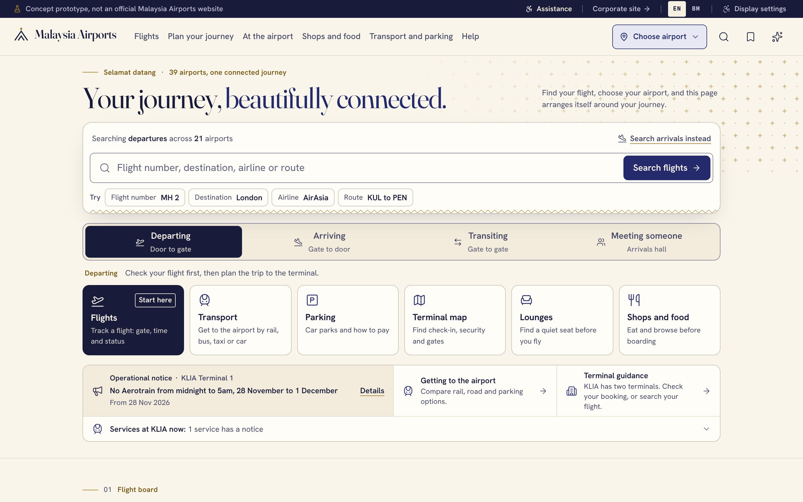</a></td><td valign="top"><a href="screenshots/01-home-mobile.jpg">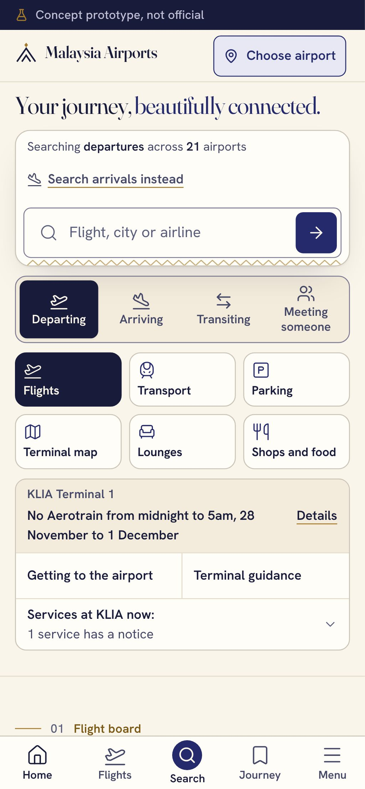</a></td></tr>
<tr><td valign="top"><a href="screenshots/01-home-desktop-2.jpg">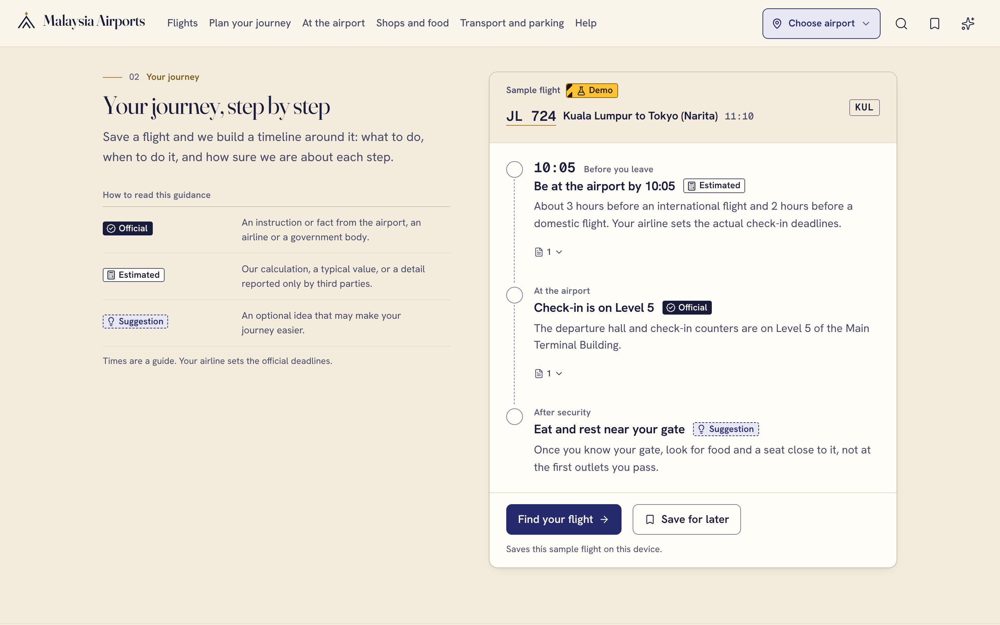</a></td><td valign="top"><a href="screenshots/01-home-mobile-2.jpg">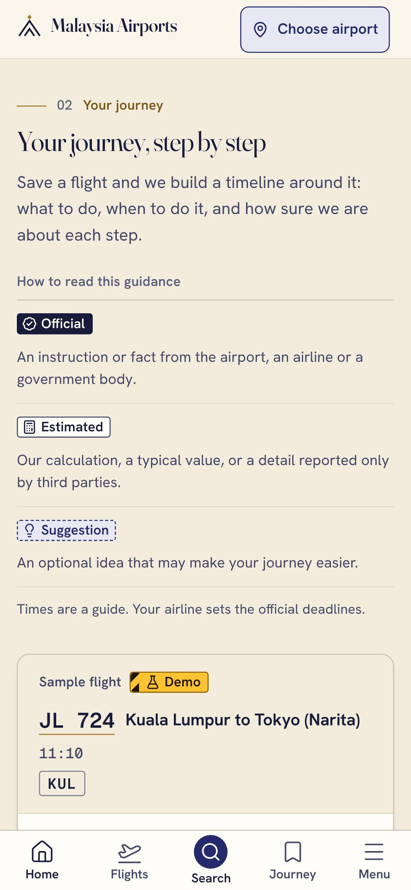</a></td></tr>
</table>

### 02 Home in Bahasa Malaysia

Route: `/ms`

**What the passenger can do:** Use the same home page in Bahasa Malaysia: navigation, search, journey modes, tasks, notices and the demonstration flight board.  
**What to notice:** The Malay headline "Semak penerbangan, rancang perjalanan anda." (written as a Malay instruction; native review pending) and the shorter phone placeholder "Penerbangan"; the EN/BM switch in the top bar keeps the page; the demonstration banner, statuses ("Menaiki pesawat", "Lewat", "Daftar masuk dibuka") and the board header are translated too; flight numbers and times stay in a fixed-width face for scanning.

<table>
<tr><th>Desktop, 1440 x 900</th><th>Phone, 390 x 844</th></tr>
<tr><td valign="top"><a href="screenshots/02-home-bahasa-malaysia-desktop.jpg">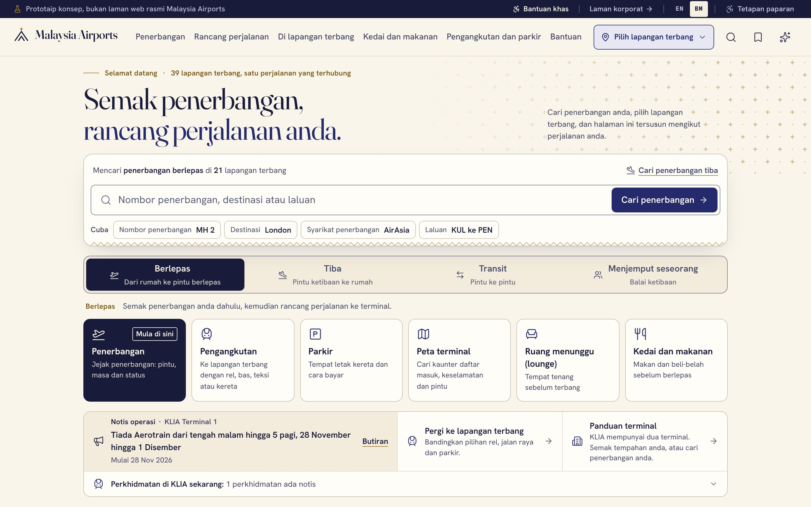</a></td><td valign="top"><a href="screenshots/02-home-bahasa-malaysia-mobile.jpg">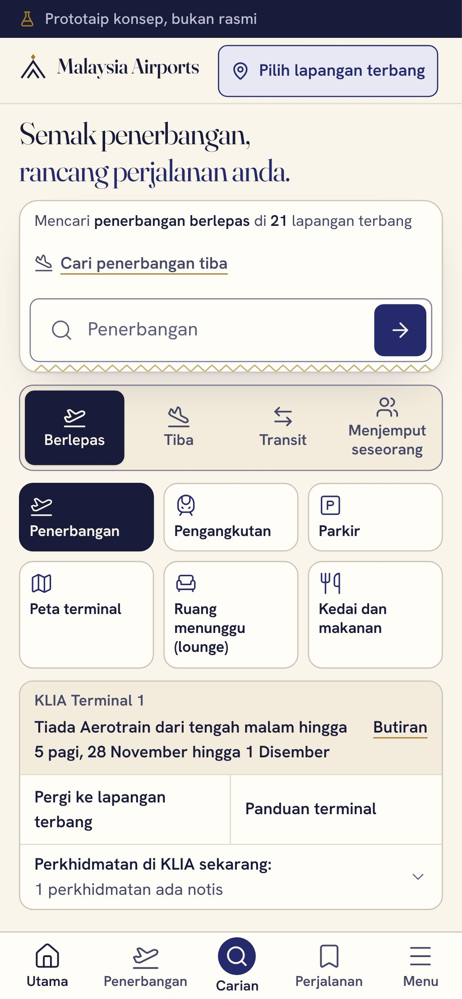</a></td></tr>
<tr><td valign="top"><a href="screenshots/02-home-bahasa-malaysia-desktop-2.jpg">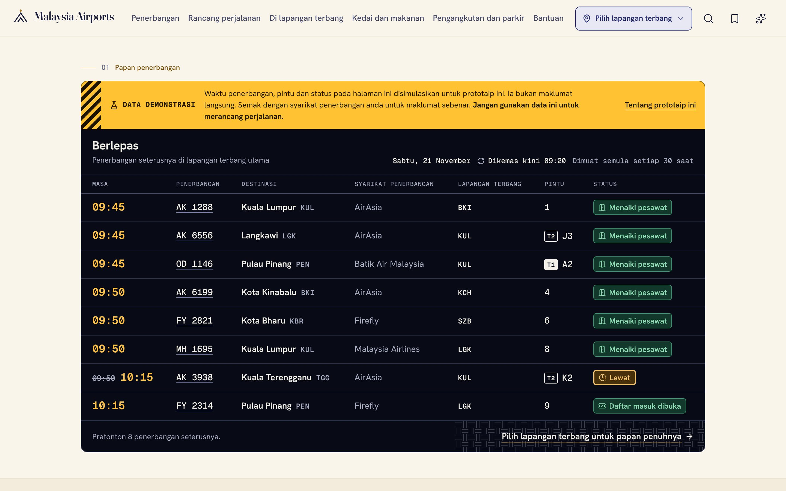</a></td><td valign="top"><a href="screenshots/02-home-bahasa-malaysia-mobile-2.jpg">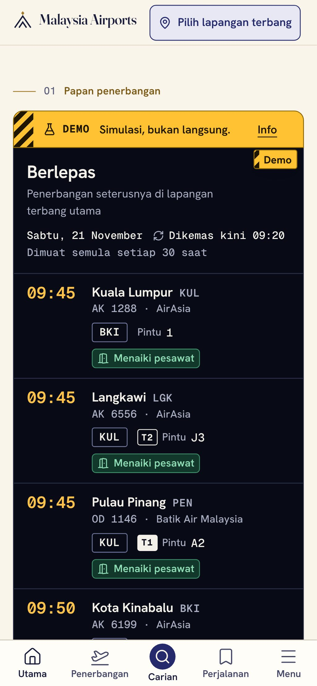</a></td></tr>
</table>

### 03 Home in dark mode

Route: `/en`. With the device set to a dark theme, or Display settings > Theme > Dark.

**What the passenger can do:** Read the site in a dark theme, taken from the device setting or chosen under Display settings.  
**What to notice:** The same layout in the dark palette; the demonstration banner keeps its yellow-and-black hazard pattern, so simulated data stays as obvious as in the light theme.

<table>
<tr><th>Desktop, 1440 x 900</th><th>Phone, 390 x 844</th></tr>
<tr><td valign="top"><a href="screenshots/03-home-dark-mode-desktop.jpg">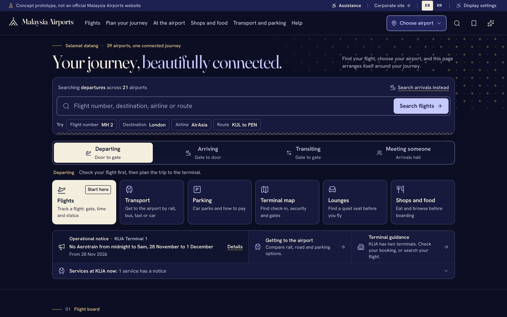</a></td><td valign="top"><a href="screenshots/03-home-dark-mode-mobile.jpg">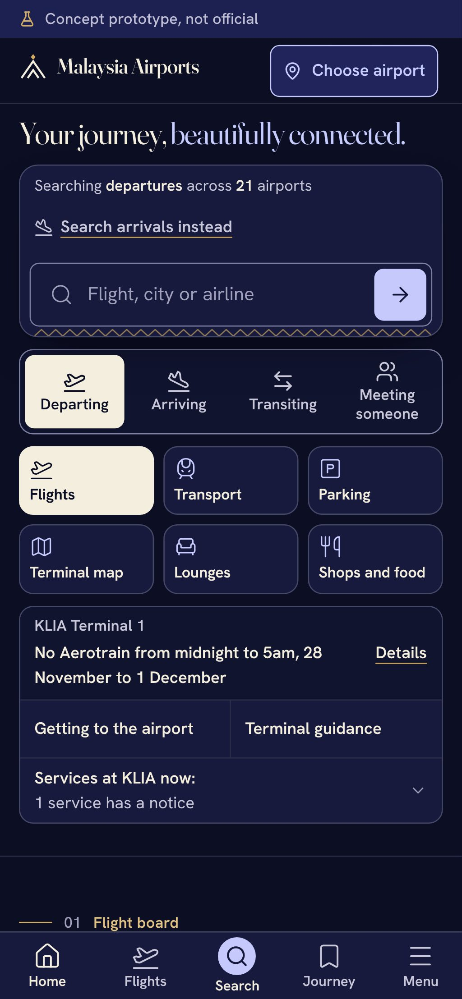</a></td></tr>
<tr><td valign="top"><a href="screenshots/03-home-dark-mode-desktop-2.jpg">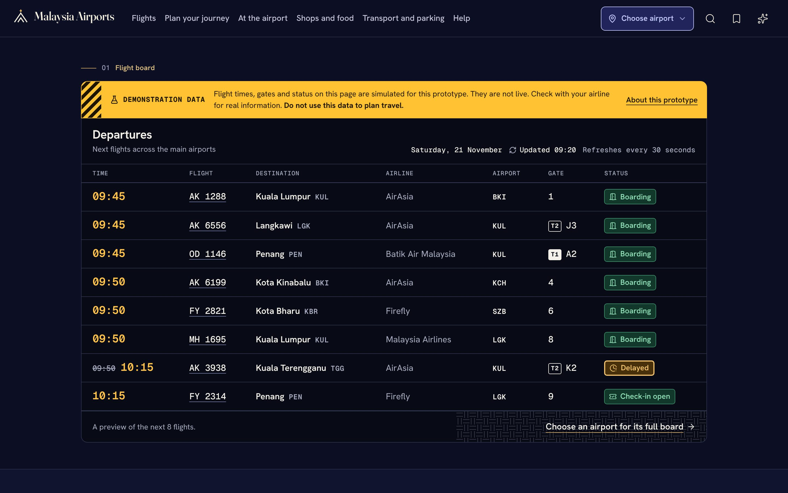</a></td><td valign="top"><a href="screenshots/03-home-dark-mode-mobile-2.jpg">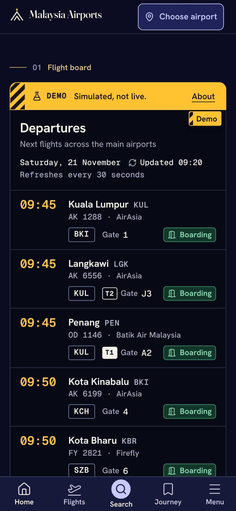</a></td></tr>
</table>

### 04 Airport chooser

Route: `/en`. Then "Choose airport" in the header.

**What the passenger can do:** Pick one of 39 airports by name, city, state or code; KLIA Terminal 1 and Terminal 2 are separate choices. The second view shows a search for "sabah" (7 airports).  
**What to notice:** IATA codes in boxed fixed-width type; the visible focus ring on the search field; "We remember your airport on this device" (stored locally, nothing sent).

<table>
<tr><th>Desktop, 1440 x 900</th><th>Phone, 390 x 844</th></tr>
<tr><td valign="top"><a href="screenshots/04-airport-chooser-desktop.jpg">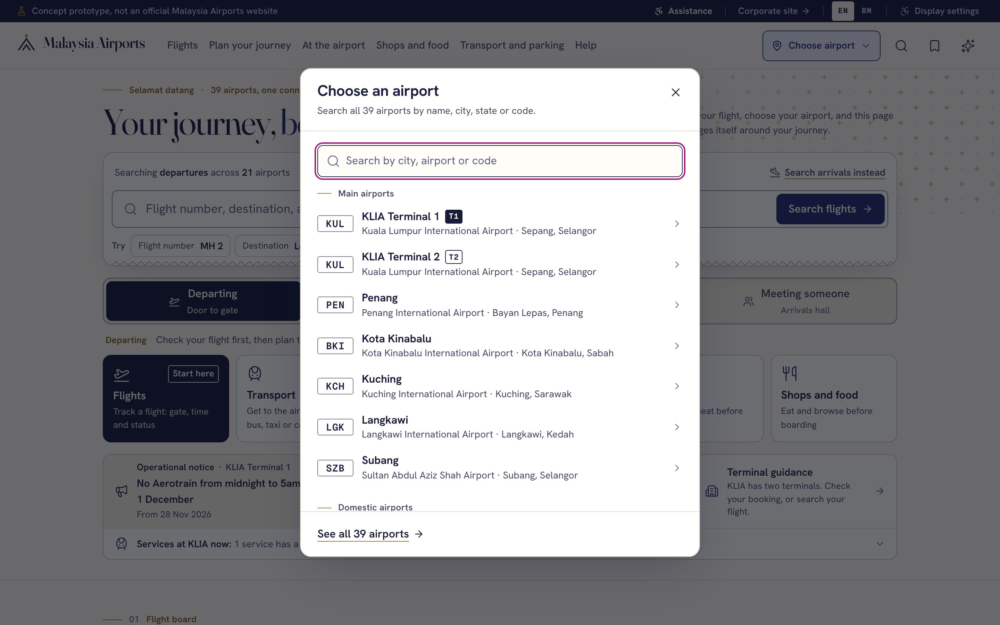</a></td><td valign="top"><a href="screenshots/04-airport-chooser-mobile.jpg">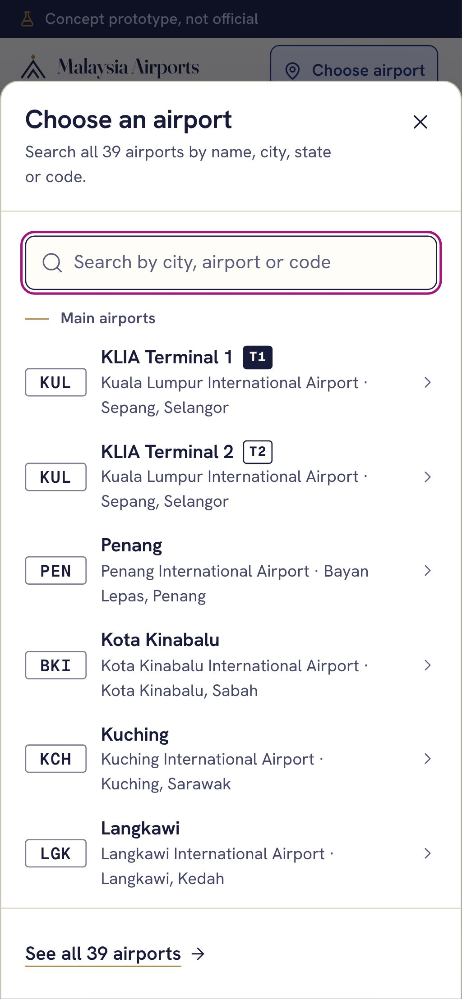</a></td></tr>
<tr><td valign="top"><a href="screenshots/04-airport-chooser-desktop-2.jpg">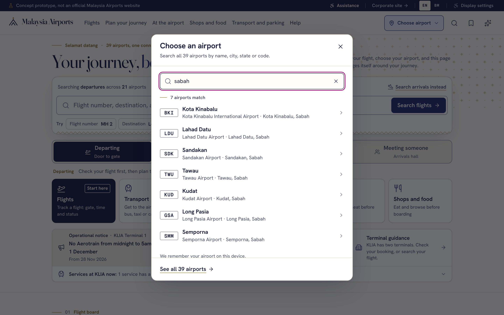</a></td><td valign="top"><a href="screenshots/04-airport-chooser-mobile-2.jpg">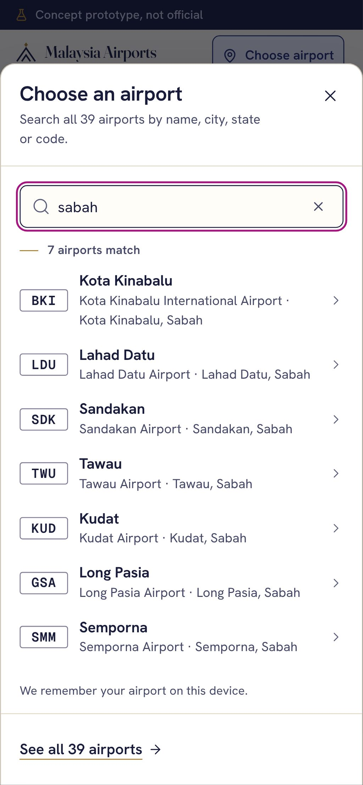</a></td></tr>
</table>

### 05 KLIA overview, Terminal 1

Route: `/en/kul?t=T1`. After choosing "KLIA Terminal 1" in the airport chooser.

**What the passenger can do:** See KLIA with airport time, terminal chips, section navigation and current notices; then the task cards and a departures preview scoped to Terminal 1.  
**What to notice:** The header now reads "KUL T1 KLIA Terminal 1"; each notice carries a provenance tag, a source count and date chips ("Coming up", "In effect now"); the board says "Kuala Lumpur International Airport, Terminal 1" under its demonstration banner. Between the notices and the flight search, below the first view, the "Services now" card reads "From notices published up to 7 Oct 2026. No live operations feed is connected yet." and shows three services as "Status not available" rather than with a checked time.

<table>
<tr><th>Desktop, 1440 x 900</th><th>Phone, 390 x 844</th></tr>
<tr><td valign="top"><a href="screenshots/05-klia-terminal-1-desktop.jpg">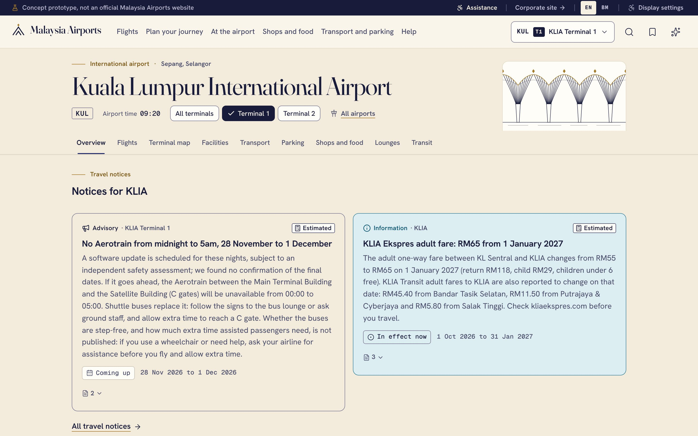</a></td><td valign="top"><a href="screenshots/05-klia-terminal-1-mobile.jpg">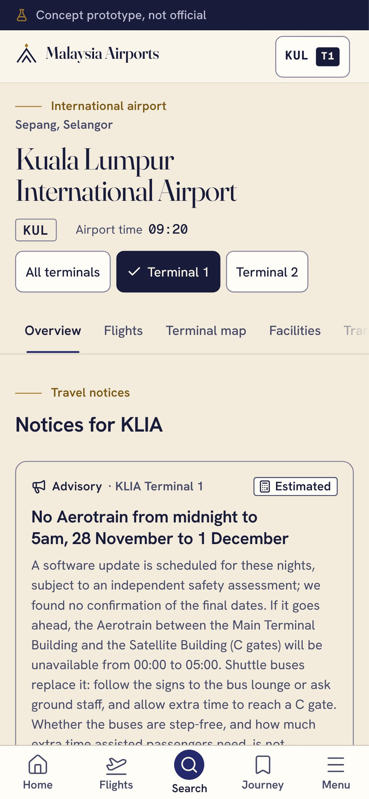</a></td></tr>
<tr><td valign="top"><a href="screenshots/05-klia-terminal-1-desktop-2.jpg">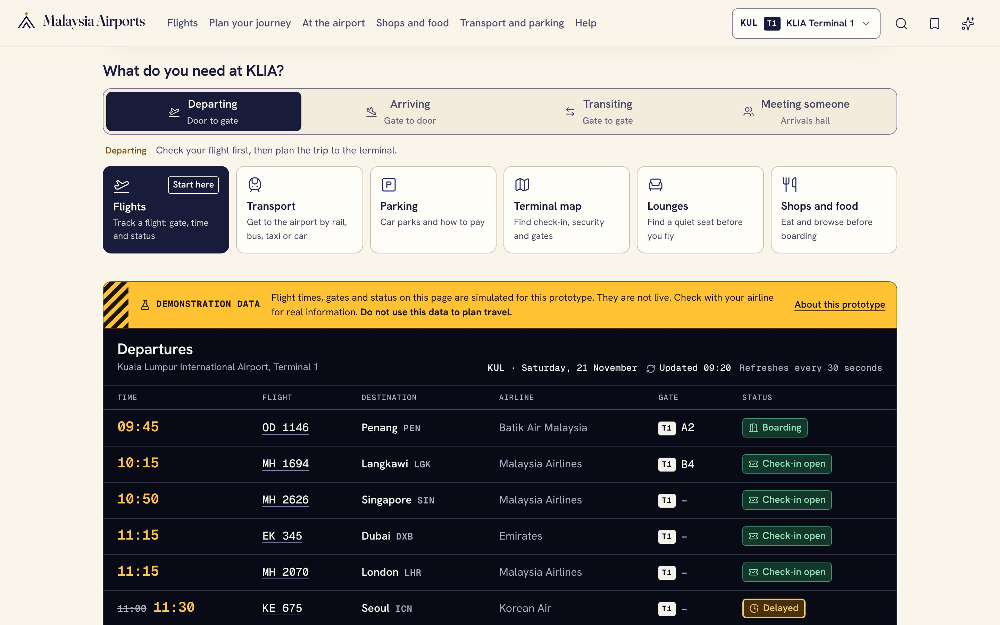</a></td><td valign="top"><a href="screenshots/05-klia-terminal-1-mobile-2.jpg">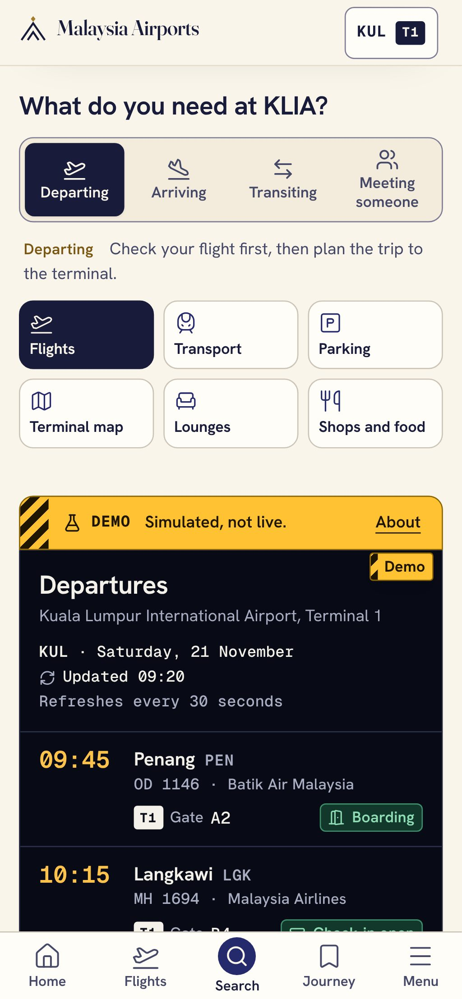</a></td></tr>
</table>

### 06 Flight search, inline results

Route: `/en`. Type "MH" in the flight search.

**What the passenger can do:** Type a flight number, airline, city or route and get matching flights at once, with status and gate, plus matching pages "On the site".  
**What to notice:** "Reading this as Airline" explains how the query was understood; the Demo chip beside "40 flights found" and the line "These flights are simulated. Do not use them to plan travel."

<table>
<tr><th>Desktop, 1440 x 900</th><th>Phone, 390 x 844</th></tr>
<tr><td valign="top"><a href="screenshots/06-flight-search-desktop.jpg">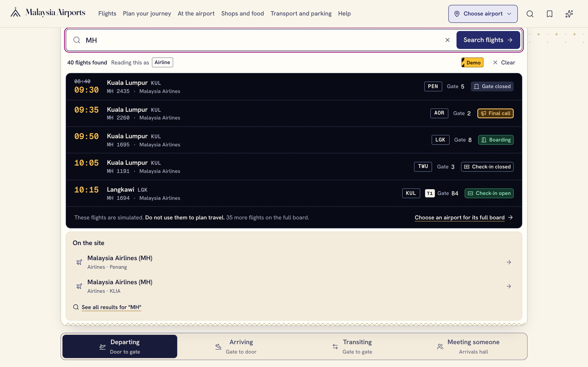</a></td><td valign="top"><a href="screenshots/06-flight-search-mobile.jpg">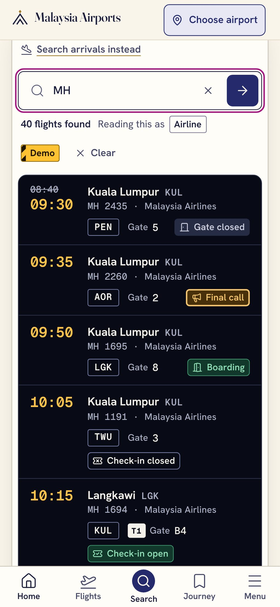</a></td></tr>
</table>

### 07 Departures board

Route: `/en/kul/flights?dir=d`

**What the passenger can do:** Switch between departures and arrivals, filter by terminal and status (with counts), search the board, step the time window, save a flight and pause live updates.  
**What to notice:** The full demonstration banner and a Demo chip on every hour group; "Updated 09:21" and "Refreshes every 30 seconds"; on desktop the board search and the status filters share one row and "1 flight has already left" shares a line with "Show earlier flights", so the first row (OD 1420, 09:30) is on the first screen; delays shown with the scheduled time struck through beside the new one; status filters and tabs expose their state to screen readers (pressed, selected), as the e2e suite checks.

<table>
<tr><th>Desktop, 1440 x 900</th><th>Phone, 390 x 844</th></tr>
<tr><td valign="top"><a href="screenshots/07-departures-board-desktop.jpg">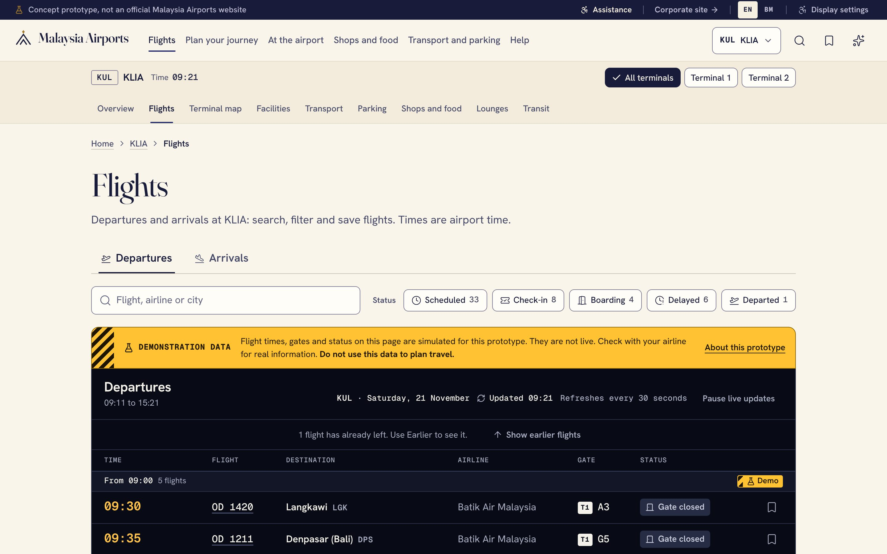</a></td><td valign="top"><a href="screenshots/07-departures-board-mobile.jpg">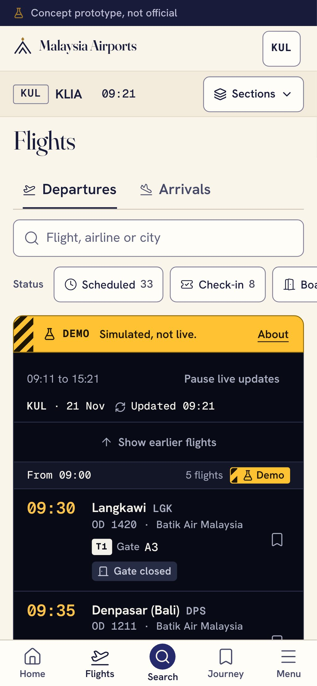</a></td></tr>
<tr><td valign="top"><a href="screenshots/07-departures-board-desktop-2.jpg">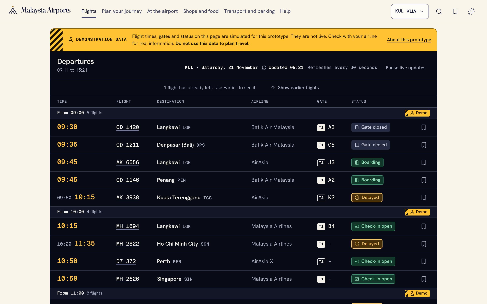</a></td><td valign="top"><a href="screenshots/07-departures-board-mobile-2.jpg">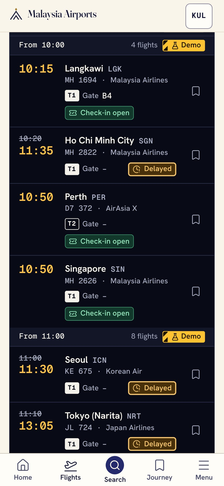</a></td></tr>
</table>

### 08 Flight detail and journey timeline

Route: `/en/kul/flights/mh2626-20261121-d`. The id carries the flight date (yyyymmdd); the gallery used 21 November 2026, when the flight runs on schedule; the e2e suite uses mh2626-20261118-d, where it is delayed to 12:00.

**What the passenger can do:** See status, terminal, check-in rows, boarding and gate-closing times, and "Your next step"; below, a timeline built around the flight, with the current step (check in) marked.  
**What to notice:** Airline facts tagged Official ("Malaysia Airlines check-in rows", "Malaysia Airlines at KLIA"); simulated times tagged Demo; "Gate not yet assigned" instead of a guess; "Your next step" names only deadlines still ahead ("Check-in closes 09:50 · Boarding 10:05"); the arrive-by step (07:50), now past, has an open marker rather than a tick, because nothing confirms it was done; the immigration line reads "Status not available" with where to check instead of a checked time, and its queue estimates are labelled Demo.

<table>
<tr><th>Desktop, 1440 x 900</th><th>Phone, 390 x 844</th></tr>
<tr><td valign="top"><a href="screenshots/08-flight-detail-desktop.jpg">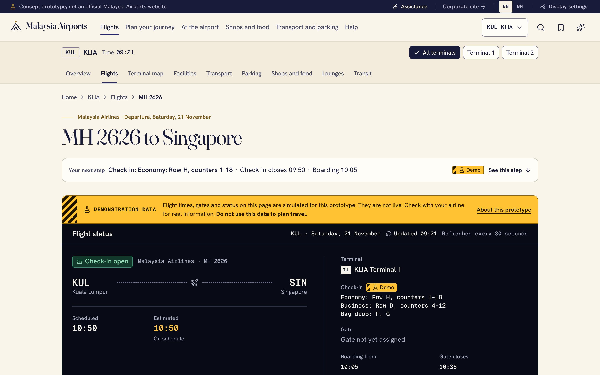</a></td><td valign="top"><a href="screenshots/08-flight-detail-mobile.jpg">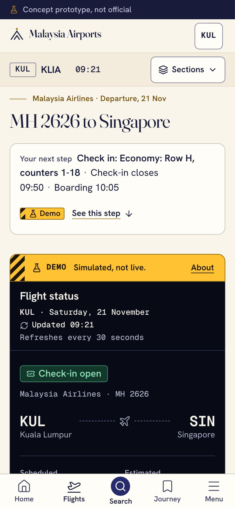</a></td></tr>
<tr><td valign="top"><a href="screenshots/08-flight-detail-desktop-2.jpg">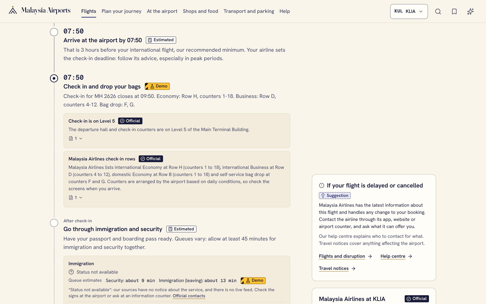</a></td><td valign="top"><a href="screenshots/08-flight-detail-mobile-2.jpg">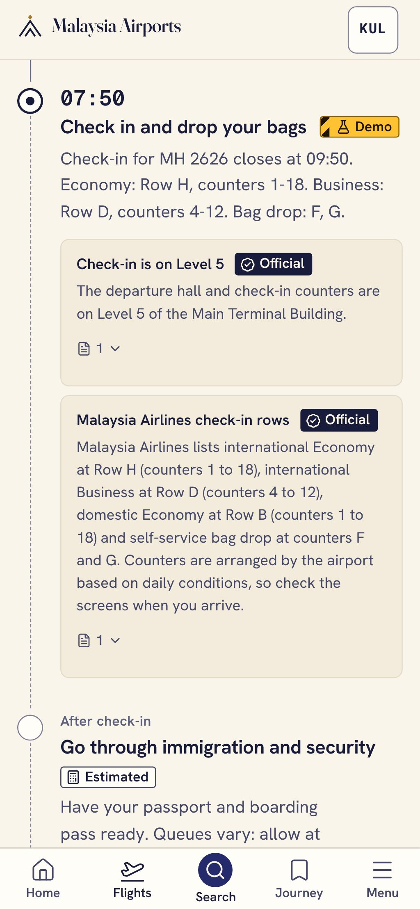</a></td></tr>
</table>

### 09 My journey: saved flight and parking note

Route: `/en/journey`. After "Save flight" on MH 2626 (journey 08) and "Note where you parked" with level 3, bay B 14.

**What the passenger can do:** Keep saved flights with their (simulated) status, refreshed every 30 seconds, and the next step, the full step list, and a note of where the car is parked (level 3, bay B 14) linked to the parking page.  
**What to notice:** "Saved on this device only. Nothing is sent to a server."; the saved card names the deadline still ahead ("Check-in closes 09:50") and the step under way ("Now: Check in and drop your bags"); the badge on the Journey icon counts the two saved items; the parking note is the passenger's own record, not airport data.

<table>
<tr><th>Desktop, 1440 x 900</th><th>Phone, 390 x 844</th></tr>
<tr><td valign="top"><a href="screenshots/09-my-journey-desktop.jpg">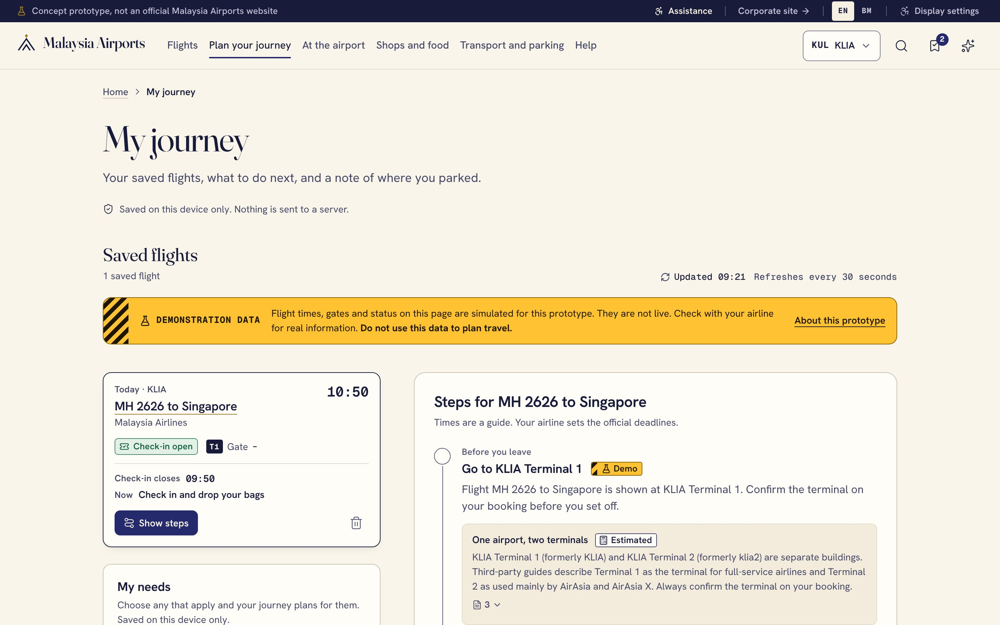</a></td><td valign="top"><a href="screenshots/09-my-journey-mobile.jpg">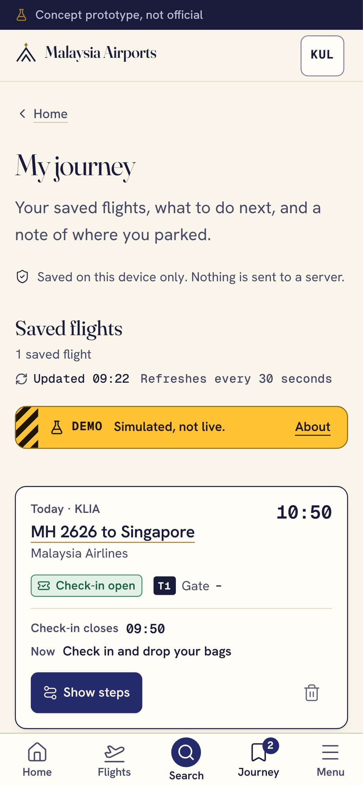</a></td></tr>
<tr><td valign="top"><a href="screenshots/09-my-journey-desktop-2.jpg">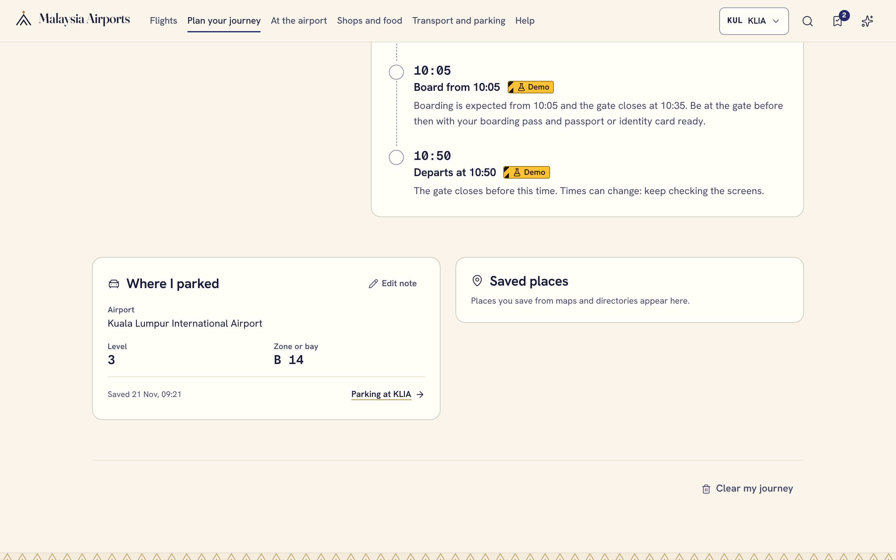</a></td><td valign="top"><a href="screenshots/09-my-journey-mobile-2.jpg">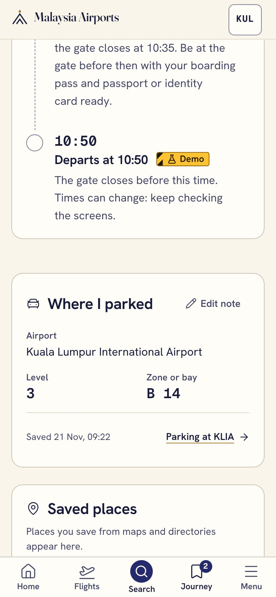</a></td></tr>
</table>

### 10 Terminal map: route to a gate

Route: `/en/kul/map?from=l5-kerb&to=g-gates-c`

**What the passenger can do:** Choose a start and a destination (here the Level 5 drop-off to Gates C), switch to step-free only, and follow the route on the map and as written steps, including the Aerotrain.  
**What to notice:** "Schematic demonstration map, not a floor plan" is now a strip above the drawing, so no label or chip can cover it; on a phone, search and the Directions controls (From, To, step-free) come before the map rather than after it; the written steps give the whole route in text, with level chips and distances, and the map pans and zooms from the keyboard (both checked by the e2e suite).

<table>
<tr><th>Desktop, 1440 x 900</th><th>Phone, 390 x 844</th></tr>
<tr><td valign="top"><a href="screenshots/10-terminal-map-route-desktop.jpg">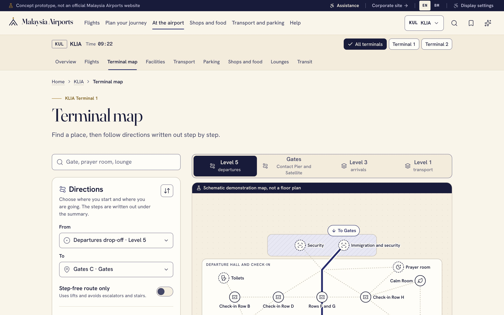</a></td><td valign="top"><a href="screenshots/10-terminal-map-route-mobile.jpg">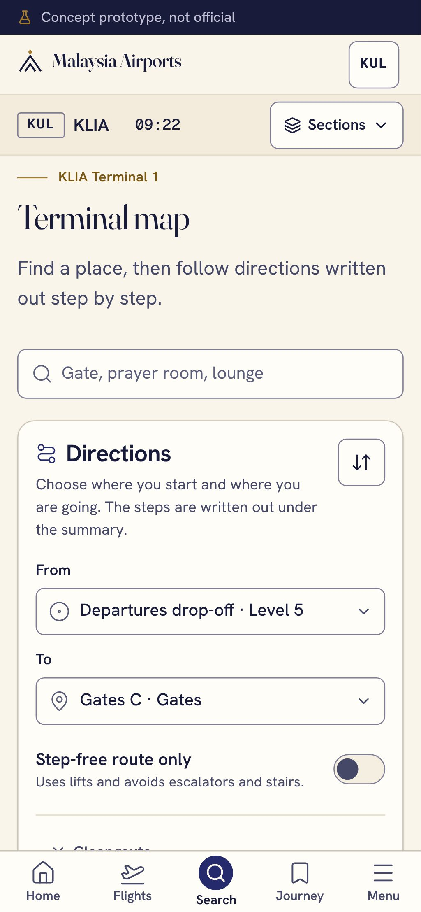</a></td></tr>
<tr><td valign="top"><a href="screenshots/10-terminal-map-route-desktop-2.jpg">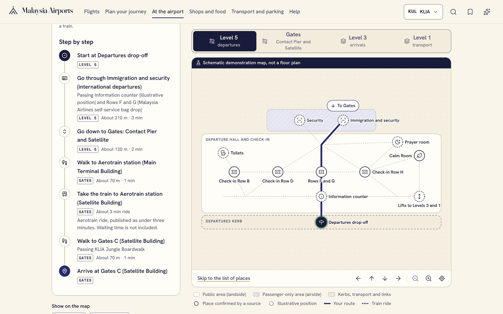</a></td><td valign="top"><a href="screenshots/10-terminal-map-route-mobile-2.jpg">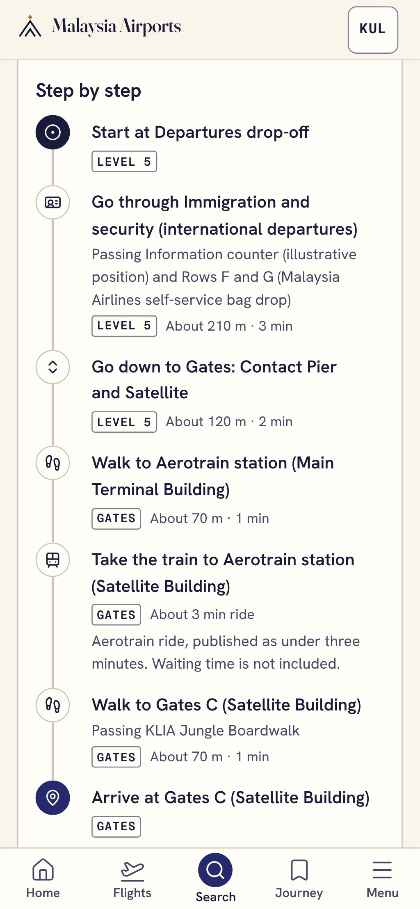</a></td></tr>
</table>

### 11 Facilities filtered to prayer rooms

Route: `/en/kul/facilities?cat=prayer-room`

**What the passenger can do:** Filter facilities by type, terminal, area and accessibility; the filters live in the URL, so a result can be shared.  
**What to notice:** The one KLIA prayer-room record is Official but its location, level, hours and accessibility are shown as "Not published", not invented; the card's tags (Official, Terminal 1) have their own row under the title; one "Sources for this section" list, dated "As of 16 Nov 2026", replaces a source toggle on each card; categories with no verified records (nursing rooms, accessible toilets, toilets) are drawn with dashed outlines.

<table>
<tr><th>Desktop, 1440 x 900</th><th>Phone, 390 x 844</th></tr>
<tr><td valign="top"><a href="screenshots/11-facilities-prayer-rooms-desktop.jpg">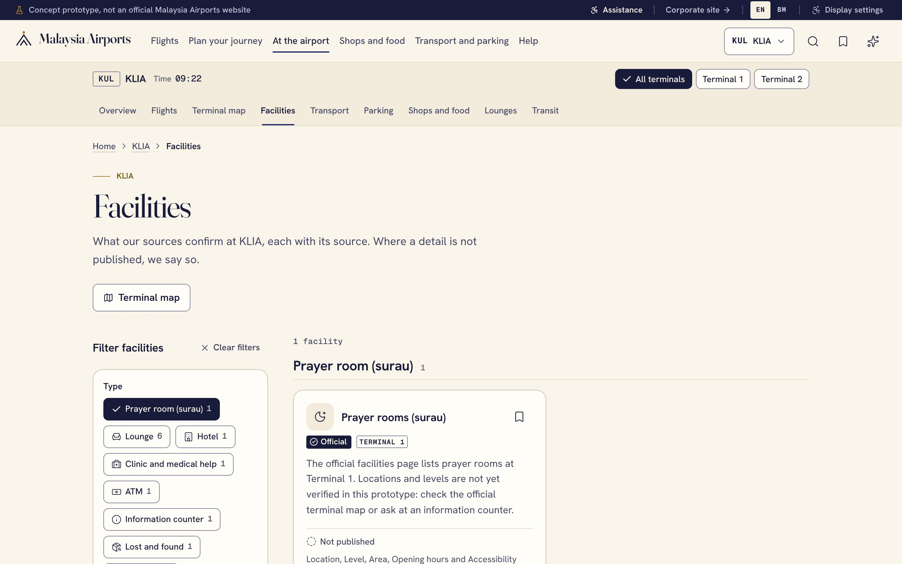</a></td><td valign="top"><a href="screenshots/11-facilities-prayer-rooms-mobile.jpg">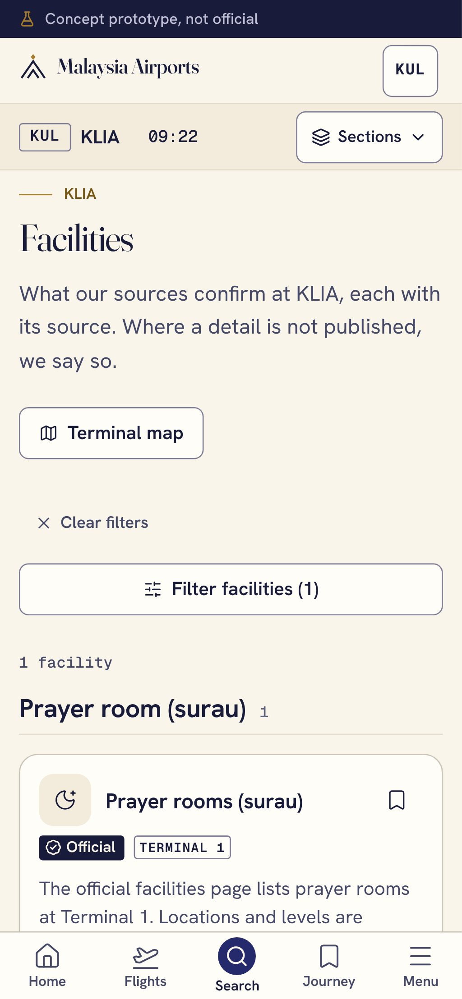</a></td></tr>
<tr><td valign="top"><a href="screenshots/11-facilities-prayer-rooms-desktop-2.jpg">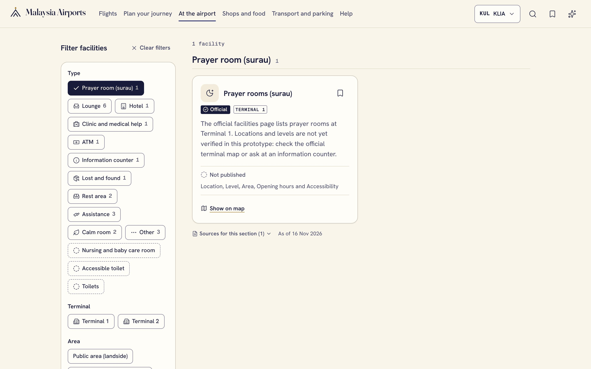</a></td><td valign="top"><a href="screenshots/11-facilities-prayer-rooms-mobile-2.jpg">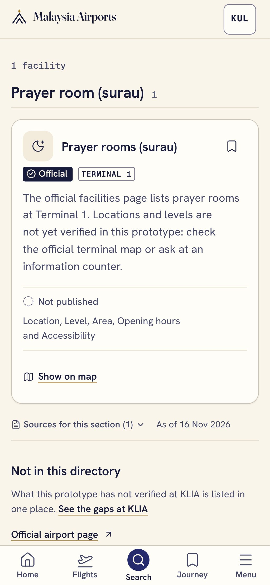</a></td></tr>
</table>

### 12 Transport planner to KL Sentral

Route: `/en/kul/transport`

**What the passenger can do:** Choose a destination and what matters most (lowest price, shortest time, least effort, step-free), then compare options as cards or as a table.  
**What to notice:** A "Published fares to KL Sentral" row under the heading answers first: KLIA Ekspres RM 55, 28 min, "Today, until 31 Dec 2026", "RM 65 from 1 Jan 2027". Taxis and e-hailing are left out of it, so the touting warning still comes before every taxi and e-hailing option. In the planner, "Estimated unless marked otherwise" is said once; options without a published fare are ranked after those with one; "Step-free access not confirmed".

<table>
<tr><th>Desktop, 1440 x 900</th><th>Phone, 390 x 844</th></tr>
<tr><td valign="top"><a href="screenshots/12-transport-kl-sentral-desktop.jpg">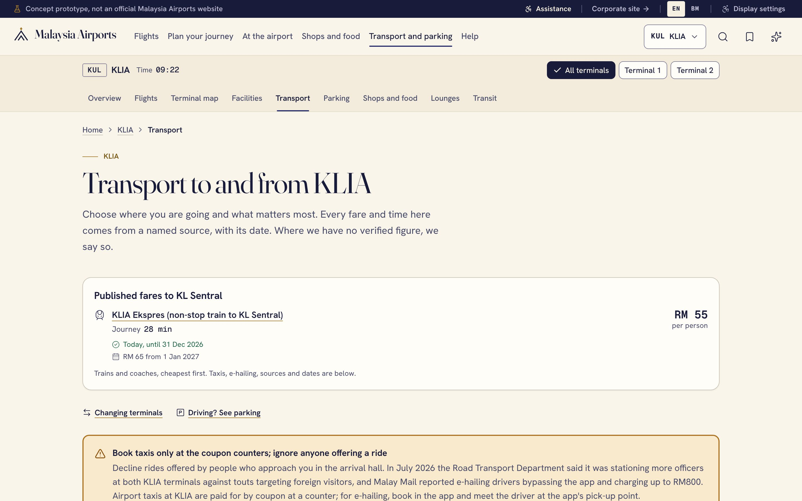</a></td><td valign="top"><a href="screenshots/12-transport-kl-sentral-mobile.jpg">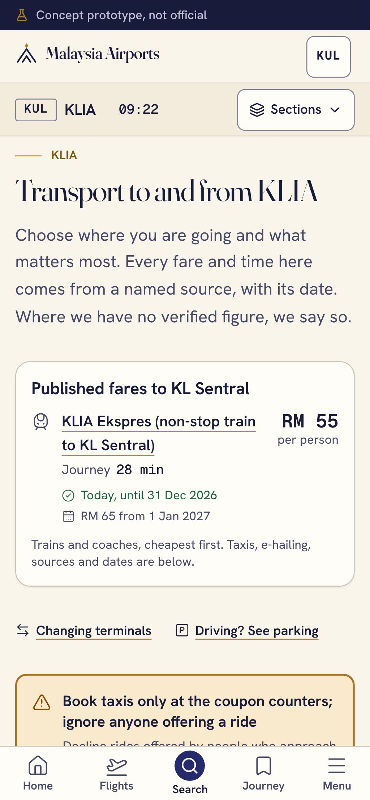</a></td></tr>
<tr><td valign="top"><a href="screenshots/12-transport-kl-sentral-desktop-2.jpg">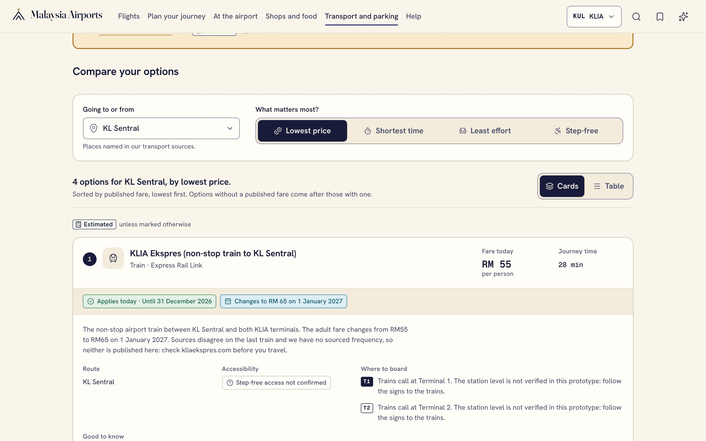</a></td><td valign="top"><a href="screenshots/12-transport-kl-sentral-mobile-2.jpg">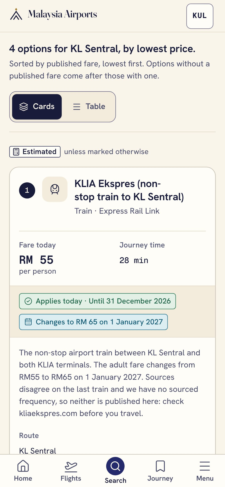</a></td></tr>
</table>

### 13 Parking

Route: `/en/kul/parking`

**What the passenger can do:** Compare car parks for 1, 3 and 7 days and estimate a stay for chosen dates, with links to the official rates and booking page.  
**What to notice:** Prices are "at most" figures tagged Estimated. Each car park has one sentence about its rates, the same one the concierge and the help answer give: "Rates not verified: klia.info (undated) gives RM 52 a day." for Terminal 1; "Rates not verified: our sources give a daily maximum of RM 32; the hourly rates are not confirmed." for the Long Term Car Park, now marked like the others; "No price published" for Preferred Parking. (The date and time fields are the browser's own controls: the capture browser drew them US-style, 11/21/2026.)

<table>
<tr><th>Desktop, 1440 x 900</th><th>Phone, 390 x 844</th></tr>
<tr><td valign="top"><a href="screenshots/13-parking-desktop.jpg">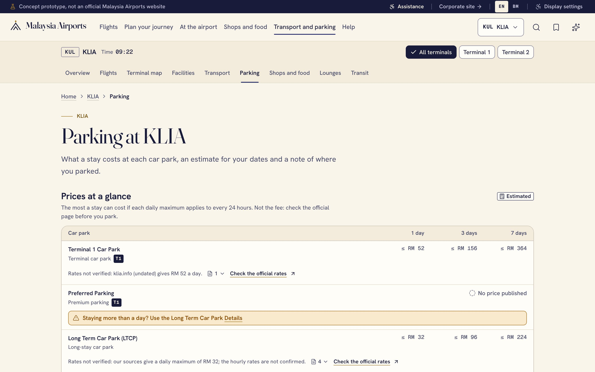</a></td><td valign="top"><a href="screenshots/13-parking-mobile.jpg">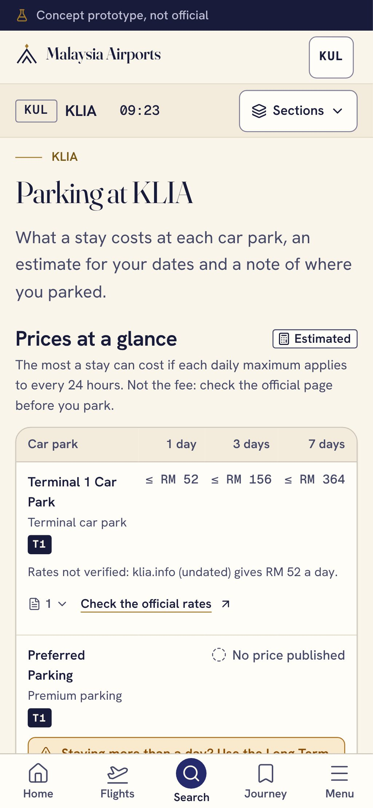</a></td></tr>
<tr><td valign="top"><a href="screenshots/13-parking-desktop-2.jpg">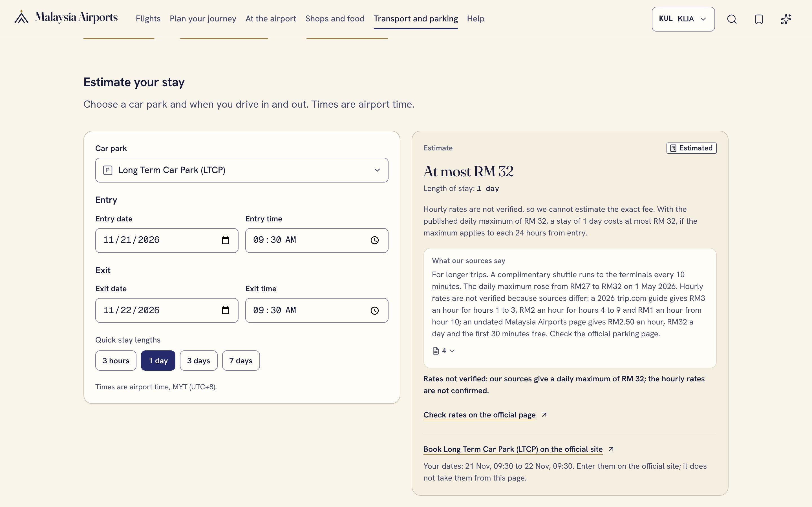</a></td><td valign="top"><a href="screenshots/13-parking-mobile-2.jpg">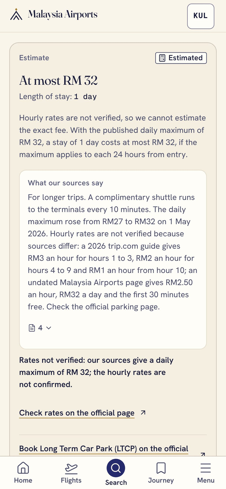</a></td></tr>
</table>

### 14 Shop and dine

Route: `/en/kul/shop-dine`

**What the passenger can do:** Search and sort outlets, filter by category, terminal, side of security and halal certification, and see what is near a chosen gate area.  
**What to notice:** "Partial directory: only what we could confirm" (8 outlets at KLIA) with links to the official directory; each card names its source and tag; "Location not published" where no source gives one; the Halal certified chip.

<table>
<tr><th>Desktop, 1440 x 900</th><th>Phone, 390 x 844</th></tr>
<tr><td valign="top"></td><td valign="top"></td></tr>
<tr><td valign="top"></td><td valign="top"></td></tr>
</table>

### 15 Lounges and rest

Route: `/en/kul/lounges`

**What the passenger can do:** Browse 6 lounges, 1 hotel and 2 rest services by terminal and by side of security, with location, hours and "Open now"; the page also explains resting airside or landside.  
**What to notice:** "Listed by lounge-network directories, not by the operator"; Estimated and Official tags side by side; "Not published: level, who may use it and price" rather than a guess.

<table>
<tr><th>Desktop, 1440 x 900</th><th>Phone, 390 x 844</th></tr>
<tr><td valign="top"></td><td valign="top"></td></tr>
<tr><td valign="top"></td><td valign="top"></td></tr>
</table>

### 16 Transit planner: Terminal 1 to Terminal 2, self-transfer

Route: `/en/kul/transit?from=T1&to=T2&ticket=self&arr=intl&dep=intl&layover=180`

**What the passenger can do:** Enter terminals, flight types, booking type and time between flights; get a verdict ("Tight": estimate 2 h 10 min to 5 h against 3 h) and the numbered steps for changing terminals.  
**What to notice:** The separate-tickets warning (the second airline need not wait or rebook); on a phone, a one-line verdict summary ("Tight · Our estimate 2 h 10 min to 5 h; your time 3 h · See the plan") heads the form and stays in view while the answers change; the steps say "Estimated unless marked otherwise" once and tag only the steps that differ (Official); the arrival-card reminder for foreign visitors; "If it is tight: what to do" links to the late-arrival advice.

<table>
<tr><th>Desktop, 1440 x 900</th><th>Phone, 390 x 844</th></tr>
<tr><td valign="top"></td><td valign="top"></td></tr>
<tr><td valign="top"></td><td valign="top"></td></tr>
</table>

### 17 Accessibility hub

Route: `/en/accessibility`

**What the passenger can do:** Find how to ask for assistance through the airline or the airport, the Butterfly Effect programme for hidden disabilities, Calm Rooms and sensory walls, and the site's own display settings.  
**What to notice:** Each item is tagged Official or Estimated with its sources; where the airport's assistance page could not be captured, the page says so instead of summarising it.

<table>
<tr><th>Desktop, 1440 x 900</th><th>Phone, 390 x 844</th></tr>
<tr><td valign="top"></td><td valign="top"></td></tr>
<tr><td valign="top"></td><td valign="top"></td></tr>
</table>

### 18 Guide: flying internationally for the first time

Route: `/en/guides/first-time`

**What the passenger can do:** Follow the whole trip in ten ordered steps, with an "On this page" list and chips saying which flights a step applies to.  
**What to notice:** "Checked 17 November 2026"; every step carries Suggestion, Official or Estimated; steps link into the KLIA map and help answers.

<table>
<tr><th>Desktop, 1440 x 900</th><th>Phone, 390 x 844</th></tr>
<tr><td valign="top"></td><td valign="top"></td></tr>
<tr><td valign="top"></td><td valign="top"></td></tr>
</table>

### 19 Help centre

Route: `/en/help`

**What the passenger can do:** Call the published numbers, search help, open common questions, see who handles what, and how to take a complaint further.  
**What to notice:** "Who handles what" sends each problem to the airline, Malaysia Airports or the Malaysian Aviation Commission, each answer tagged; the scam alert sits beside the questions.

<table>
<tr><th>Desktop, 1440 x 900</th><th>Phone, 390 x 844</th></tr>
<tr><td valign="top"></td><td valign="top"></td></tr>
<tr><td valign="top"></td><td valign="top"></td></tr>
</table>

### 20 Concierge: "How do I get from Terminal 1 to Terminal 2?"

Route: `/en/concierge`. Type the question and press Ask.

**What the passenger can do:** Ask a question in plain words; the answer lists the train (RM 2) and the free shuttle bus, a related answer on walking between terminals, and links to the transit and transport planners.  
**What to notice:** "Answered on this device: put together in your browser from verified content. Your question was not sent anywhere."; six sources behind a disclosure; Official tags; "No source we found confirms the journey time, so none is published." (desktop). On the phone the answer shows its lead and two cards and puts the rest behind "Show 5 more items"; the desktop shows all of it. The optional AI-wording mode was not used.

<table>
<tr><th>Desktop, 1440 x 900</th><th>Phone, 390 x 844</th></tr>
<tr><td valign="top"></td><td valign="top"></td></tr>
<tr><td valign="top"></td><td valign="top"></td></tr>
</table>

### 21 Search palette with results

Route: `/en`. On any page press Ctrl+K, or use the Search button (bottom bar on phones), and type "MH 2".

**What the passenger can do:** Search flights, airlines, facilities, help and pages from one box, grouped by type, and move through results with the arrow keys.  
**What to notice:** The flights group carries Demo chips and the footer "Flights are demonstration data"; key hints in the footer on desktop (arrows, Enter, Escape). Below the four flights only the airline matches (Malaysia Airlines at Penang and at KLIA); nothing matches on the digit alone any more (round three also listed, for example, "Sensory walls (Terminal 2)").

<table>
<tr><th>Desktop, 1440 x 900</th><th>Phone, 390 x 844</th></tr>
<tr><td valign="top"></td><td valign="top"></td></tr>
</table>

### 22 Travel notices

Route: `/en/notices`

**What the passenger can do:** Read advisories and operational notices for all airports, filtered by airport and severity.  
**What to notice:** Each notice shows severity, airport, provenance tag, effective dates ("Coming up", "In effect now") and its source count.

<table>
<tr><th>Desktop, 1440 x 900</th><th>Phone, 390 x 844</th></tr>
<tr><td valign="top"></td><td valign="top"></td></tr>
</table>

### 23 Corporate home

Route: `/en/corporate`

**What the passenger can do:** See the network in 2025 in figures and go to About, Our airports, Business with us, Sustainability, Careers, Media centre, Governance and Contact; "Passenger site" leads back.  
**What to notice:** Every figure carries Official, an "As of" date (20 January 2026; 19 January 2026 for the group-wide passenger movements) and its sources; the dark corporate sub-navigation separates the two sites.

<table>
<tr><th>Desktop, 1440 x 900</th><th>Phone, 390 x 844</th></tr>
<tr><td valign="top"></td><td valign="top"></td></tr>
<tr><td valign="top"></td><td valign="top"></td></tr>
</table>

### 24 About this prototype

Route: `/en/about-this-prototype`

**What the passenger can do:** Read what the prototype is and is not, which data is real and which simulated, how facts were sourced and dated, the gaps per airport and what production would need.  
**What to notice:** The "Real and demonstration data" table is the key to every other screen in this gallery.

<table>
<tr><th>Desktop, 1440 x 900</th><th>Phone, 390 x 844</th></tr>
<tr><td valign="top"></td><td valign="top"></td></tr>
<tr><td valign="top"></td><td valign="top"></td></tr>
</table>

### 25 Directory-only airport: Ipoh

Route: `/en/iph`

**What the passenger can do:** See Ipoh's notices, search its flights and open its board; sections are limited to Overview and Flights.  
**What to notice:** "Limited information in this prototype" says plainly that detailed guidance is not verified. The board preview marks the next day's departure: the third row, TR 444 at 09:25, carries "Tomorrow" (round three showed it without a date; on the phone the row is cut off by the bottom bar in the second view, so its label is not visible there).

<table>
<tr><th>Desktop, 1440 x 900</th><th>Phone, 390 x 844</th></tr>
<tr><td valign="top"></td><td valign="top"></td></tr>
<tr><td valign="top"></td><td valign="top"></td></tr>
</table>

### 26 Designed 404

Route: `/en/no-such-page`

**What the passenger can do:** Recover from a wrong address: back to home, search the site, or all airports.  
**What to notice:** The page answers with a real 404 status, and the "Page not found" heading is in the server HTML. No React error is logged any more (round three logged #419 twice; see observations); the console shows only the browser's own "Failed to load resource" lines, for this page and for the language switch's prefetch of the same address in Malay, which is also missing.

<table>
<tr><th>Desktop, 1440 x 900</th><th>Phone, 390 x 844</th></tr>
<tr><td valign="top"></td><td valign="top"></td></tr>
</table>

### 27 Offline page

Route: `/en/offline`. Then lose the connection. Captured with the real clock (pages stamped "22 Nov, 00:00", Kuala Lumpur time): the service worker stamps saved pages with the device clock, which the capture could not fix.

**What the passenger can do:** See the connection state, which pages are saved on this device and when, what works without a connection and what needs one, and remove saved pages.  
**What to notice:** The toast "You are offline: showing saved information" agrees with the status card ("You are offline. Pages you open are saved on this device for offline use."); "Saved pages stay in this browser only. Nothing about them is sent to anyone." Since round four one answer drives both: had the connection dropped before offline saving was ready, both would say that nothing is saved on this device yet (verified on the production service worker, `docs/qa/verification.md`, F4).

<table>
<tr><th>Desktop, 1440 x 900</th><th>Phone, 390 x 844</th></tr>
<tr><td valign="top"></td><td valign="top"></td></tr>
<tr><td></td><td valign="top"></td></tr>
</table>

## How the screens were captured

- **Build and server.** Served with `TRUSTED_CLIENT_IP_HEADER=x-e2e-client-ip npx next start -p 3301`. No file under `src/`, `e2e/` or the configuration was changed, and nothing was rebuilt.
  - Retaken in round four (19 journeys, 69 images: 01 to 13, 16, 20, 21, 25, 26, 27): the round-four production build left in `.next` by verification (build ID `ygqxXIFcmSWq51rkxYSGE`), on 21 November 2026 at about 23:53 to 00:01 Kuala Lumpur time.
  - Kept from round three (8 journeys, 30 images: 14, 15, 17, 18, 19, 22, 23, 24): round three's build. Each was captured again on the round-four build with the same method and compared with its round-three file, counting pixels that differ by more than 40 of 255 grey levels: 17, 18, 19, 22 and 23 have none; 14 and 15 differ only in the airport clock in the section bar; 24 differs in under 100 pixels of the Demo chips' stripes. Journey 04 differed in its boxed airport codes (the shared data type step went from 15 to 14 px), so it was replaced.
  - Round-four changes that no journey here shows: the accessibility statement (`/en/accessibility#statement`, below journey 17's views), the depth chips on `/en/airports`, thin airports such as Lawas, the "My needs" button on the flight page (below journey 08's first phone view) and the Malay name "Tanya Kami". Verification checked each on the round-four build (`docs/qa/verification.md`, F4).
- **Browser.** Playwright Chromium (`chromium.launch()` with no options), a fresh context per capture (empty storage), locale en-GB (ms-MY for Bahasa Malaysia), time zone Asia/Kuala_Lumpur, and its own client address in the trusted header so the rate limiter treats each capture as a separate visitor.
- **Viewports.** Desktop 1440 x 900 at device scale factor 2 (files 2880 x 1800). Phone: Playwright's Pixel 7 profile with the viewport set to 390 x 844 and its own scale factor of 2.625 (files 1024 x 2216). JPEG quality 82, animations settled; second views are scroll positions, not full-page captures. Desktop files were kept at full resolution because the folder stays under 25 MB (99 files, 24.1 MB after round four).
- **Clock.** The demonstration feed works out flight statuses on the server's clock, while each page reads the browser's. With the server at 18:14 Kuala Lumpur time, the feed gave all 30 KLIA departures scheduled between 09:00 and 13:00 the status "Departed", so a board viewed with a morning browser clock would have shown nothing but departed flights. So, for the capture only, the server process was started with a small preload, outside the repository, that moves its clock to Saturday 21 November 2026, 09:20 Kuala Lumpur time (the clock keeps running), and each page's clock was fixed with `page.clock.setFixedTime` to the same moment. The round-three screens span roughly 09:24 to 09:42 on that clock. Round four used the same preload and the same target, which mattered more: at the real time of its capture, about 23:53, the board's window holds no demonstration departures at all. Its screens span 09:20 to about 09:26; Ipoh was taken again at 09:25 because at 09:23 its preview listed only two flights, and from 09:25 it also listed the next morning's 09:25 departure that gallery note 2 is about. The offline page is the exception (see journey 27).
- **Review.** Every image was opened and checked; captures with a clipped heading, a half-hidden banner, a focus ring left by the script or a contradictory offline state were retaken. No screen showed a loading skeleton, a development overlay or an empty board. In round four each of the 69 new images was looked at before it was kept; none needed a retake for these reasons. The ring on the concierge's question field (journey 20) is also in round three's capture: after an answer, focus is on the field again. The round-four capture logged no page errors and no failed capture.

## Observations made while capturing

Each item gives what was seen, then a judgement. Items 1 to 4 were not in the QA documents when they were noted in round three; round four took them up (`docs/qa/fixes/round4-trust.md`, `round4-ask.md`, `round4-layout.md`) and verification confirmed each fix on the round-four build (`docs/qa/verification.md`, F4). Items 7 and 8 were noted during the round-four capture.

1. **Fixed in round four. React error #419 on not-found pages.** On `/en/no-such-page`, `/ms/tiada-halaman` and `/en/guides/no-such-guide` the browser logs "Minified React error #419" twice (React's description: the server could not finish a Suspense boundary, so it switched to client rendering). Reproduced on a second server with the real, unshifted clock; not seen on `/en/kul/no-such-section` or on `/en`. The page renders correctly and returns 404. Judgement: low impact for visitors, but worth a ticket because it costs a client render on an error path and pollutes monitoring. *Round four:* the three pages answer 404 with the "Page not found" heading in the server HTML and log no React error (checked again during this capture on the round-four build; journey 26).
2. **Fixed in round four. Next-day flights in a short preview carry no date.** Ipoh's three-flight preview lists 11:40, 15:30, then 09:25; the feed shows the 09:25 (TR 444) is on 22 November. Judgement: a "tomorrow" or "+1" marker would prevent a misreading at small airports with few flights. *Round four:* the row now reads "09:25 Tomorrow" (journey 25).
3. **Fixed in round four. Offline wording when the service worker has not finished installing.** When the connection was cut about one second after loading `/en/offline`, before the worker registered, the status card said "Offline saving is not switched on in this version of the site" while the toast said "You are offline: showing saved information". After the worker was ready the page was consistent (as shown). Judgement: the first message reads as a product decision rather than "not ready yet"; it should say that nothing has been saved on this device yet. *Round four:* in that case the card says "Nothing is saved on this device yet: the connection dropped before offline saving was ready …" and the toast "You are offline: nothing is saved on this device yet", and registration is retried on reconnect (verified on the production worker; not re-run for this capture, which shows the ready state).
4. **Fixed in round four. Search relevance.** For "MH 2" the palette ranks flights and airlines first, as expected, but lower groups include items that match only the digit (for example "Sensory walls (Terminal 2)"). Judgement: minor; fine for a prototype, worth tuning before production. *Round four:* "MH 2" returns the flights and the airline only (journey 21).
5. **Native date and time fields.** The parking calculator uses the browser's own date and time controls; the capture browser drew them US-style (11/21/2026, 09:30 AM) despite the en-GB locale setting. The site does not control this; real visitors see their own browser's format.
6. **Demonstration clock for presenters.** Because statuses follow the server clock and timelines follow the browser clock, do not fix the browser clock alone when presenting live; fix both, or neither. This matters more late in the evening: from about 22:55 to 05:05 Kuala Lumpur time the KLIA board's window holds no demonstration departures, so a live demonstration then shows an empty board.
7. **A second 404 behind the language switch.** On `/en/no-such-page`, `/ms/tiada-halaman` and `/en/guides/no-such-guide` the browser requests the same address in the other language (for example `/ms/no-such-page?_rsc=…`), a prefetch for the EN/BM switch, which also answers 404 and adds a second "Failed to load resource" line to the console. Judgement: harmless for visitors; skipping that prefetch on not-found pages would keep monitoring clean.
8. **Phone scroll position on Ipoh.** With the original scroll target, the phone's second view of journey 25 ends inside the third board row, so its "Tomorrow" label sits behind the bottom bar. The desktop view shows it. Judgement: a capture limitation, not a product defect; kept so the method stays the same as round three's.

## What is prototype-only

- Flights, gates, times, statuses, queue estimates and the board feed are generated by the prototype; nothing is connected to an airport or airline system.
- Terminal maps are schematic and illustrative positions are marked; they are not floor plans.
- Concierge answers shown here were put together in the browser from the verified content; the opt-in AI-wording mode needs a model API key on the server and was not used.
- My journey, the parking note, saved pages and settings live only in the browser that made them.
- No booking, payment or account features exist; links out go to the official sites.
