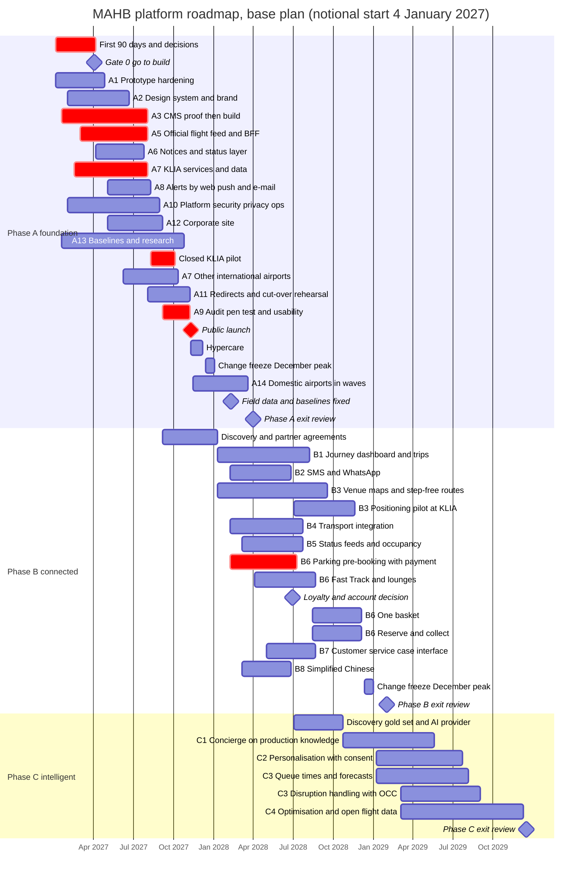

# Implementation roadmap: from concept prototype to MAHB's network platform

Deliverable 8 of the concept redesign. Date: 21 November 2026. Audience: MAHB board and executive committee;
digital, operations, commercial, IT, legal and customer-experience leadership; the delivery team.

This is an independent concept plan, not an MAHB document. The project has had no access to MAHB's operational
systems, analytics, contracts, budgets or staff. Every effort figure, duration and date below is an **estimate** that
MAHB should re-baseline in the first 90 days (section 9). Owners named at MAHB are assumptions about which function
would hold each responsibility.

## How to read this document

| Tag | Meaning |
|---|---|
| [measured] | Measured by this project: on the prototype's production build (VER, round three, 21 November 2026) or on MAHB's current site (AUD). Lab figures, not field data. |
| [judgement] | Expert judgement: sequencing, risk ratings, panel scores and projections. |
| [estimate] | Effort, duration or cost-driver range. The basis is in section 2.3. |
| [assumption] | Taken as true for planning; to be confirmed with MAHB. |
| [prior] | Background knowledge not re-confirmed by this project (standards, platform behaviour, festival dates). |
| [prototype-only] | Exists only in the concept prototype; does not carry into production. |
| [MAHB] | Depends on MAHB data, systems, people or partners. Every such open issue is traced in Appendix A. |

Source shorthand: **PS** `docs/strategy/product-strategy.md` (questions Q1 to Q16 are PS section 9); **BR**
`docs/strategy/benchmark-report.md` section 6.3 (requirements BR-01 to BR-25); **SM** `docs/strategy/sitemap.md`;
**ARCH** `docs/engineering/architecture.md` ("ARCH §9.n" is dependency n, "ARCH §10.n" is gap n); **FB**
`docs/qa/fix-backlog.md` (items A-01 to E-25; out-of-scope items OOS-01 to OOS-15); **VER** `docs/qa/verification.md`
("T5-n" is round three's ranked open issue n); **RR** `docs/qa/panel/re-review.md`; **PNL**
`docs/qa/panel/panel-summary.md`; **AUD** `docs/research/audit/mahb-audit.md`.

---

## Summary for the board

1. **Where it starts.** [measured] On its production build the concept prototype passes 504 unit tests and 348
   end-to-end tests, with zero axe violations and zero broken links; 85 of the 101 P0 and P1 backlog items are
   verified, 16 are not, none has regressed (VER T4). [judgement] The review panel scores it 74.5% on the benchmark
   rubric, against 42.5% for MAHB's current site and 79.0% for Heathrow, and finds it not ready for public launch:
   it runs on demonstration data (RR).
2. **What stands between it and launch is mostly MAHB's, not code.** The gap to Heathrow is information
   completeness, commerce and live flight data (RR section 2.1). Twelve public-launch gates need MAHB data, systems or
   partners (FB, out of scope), led by the official flight feed and a named owner for notices.
3. **Three phases over about 36 months** [estimate]. **Phase A, digital foundation** (about 15 months): one platform
   for 39 airports and the corporate site, the official flight feed, notices, essential services, release gates and
   migration; a closed KLIA pilot from August 2027 and public launch in early November 2027 in the base plan.
   **Phase B, connected passenger experience** (build January 2028 to January 2029): journey dashboards, alerts on
   more channels, venue maps and step-free routing, transport data, and commerce with payment. **Phase C, intelligent
   airport ecosystem** (build October 2028 to December 2029): the concierge on production knowledge, consented
   personalisation, queue times and disruption handling, continuous optimisation.
4. **Effort** [estimate]: about **2,900 to 4,265 person-weeks** of delivery-team change effort over three years
   (Phase A 895 to 1,295; B 1,145 to 1,675; C 860 to 1,295), plus a run team of 6 to 9 people from launch and
   MAHB's own staff time. MAHB applies its own blended rates; section 8 lists what moves the cost.
5. **The critical path runs through decisions MAHB can take now** (section 10): one accountable product owner;
   access to the AODB or FIDS feed with a test feed by week 13; a named notices owner; the CMS and hosting choices;
   one parking tariff source; the NCII scope. If the flight test feed slips past about week 19, the public launch
   moves to the window after the early-2028 festival peaks (about mid-March 2028).
6. **What the plan will not do.** No Phase A service needs an app or an account; no AI-generated fact reaches a
   passenger; nothing is sold before a partner agreement exists; no "demonstration" label is removed from a value
   until a live or approved source feeds it.

---

## 1. Starting point

### 1.1 Measured

| Area | Result | Source |
|---|---|---|
| Code checks | Types, lint, 504 unit tests, `npm audit` (production clean), build with 0 warnings | [measured] VER T2.1 |
| End-to-end and accessibility | 348 Playwright tests, 0 failed; axe 0 violations (desktop 1440x900 and Pixel 7) | [measured] VER T2.2 |
| Links and canonical | 0 broken links, 0 missing anchors; one canonical `Link` header on 276 of 276 responses | [measured] VER T2.3 |
| Backlog acceptance | 85 of 101 P0 and P1 items verified, 16 not verified, 0 regressed | [measured] VER T4 |
| Lighthouse mobile (lab, median of 3) | Performance 95 or more on 7 of 10 pages; LCP 2.5 s or less on 10 of 10; CLS at most 0.003; TBT 200 ms or less on only 3 of 10 | [measured] VER T2.4 |
| Congested airport Wi-Fi profile | LCP 2.57 s on the home and 2.68 s on the board (target 2.5 s) | [measured] VER T2.4 |
| Budgets | First-load JavaScript on `/en` 228.7 KB gzip (budget 250, pass); content pages 198.6 to 227.4 KB (target 170, fail); guidance pages 543 to 607 KB (budget 500, fail) | [measured] VER T2.4, T5 |
| Not yet run | CI workflow and WebKit; any test on a real phone, iPhone Safari or a physical screen reader; any test with passengers | [measured] VER T5-3; RR |

Lab figures come from an unloaded container with no CDN or real traffic. They are not field Core Web Vitals.

### 1.2 Judgement

- Panel median 74.5% (reviewers 74.5 to 75.5) against MAHB today 42.5%, Heathrow 79.0%, the best-of-each-dimension
  composite 83.0% and the strategy's target 90.5% [judgement, RR section 2].
- Panel projections with MAHB's launch gates closed: about 79% to 85% [judgement, RR section 2.2]. None reaches
  90.5%. This roadmap therefore treats Phase A as the route to parity with Heathrow, and Phases B and C as the route
  to the target.
- Order of work [judgement, RR section 6.2]: the team's items RR 6.1.1 to 6.1.3 plus the official flight feed and a
  notices CMS with a named owner are the conditions for a closed KLIA pilot; everything else in RR section 6 stands
  between a pilot and a public launch.

### 1.3 What carries into production and what is prototype-only

| Carries over [code, per ARCH section 1] | Prototype-only [prototype-only, per RR section 6 and ARCH §10] |
|---|---|
| Typed, validated content model with provenance on every fact (251 registered sources) | Demonstration flights, gates, belts, check-in rows, queues and alerts |
| Provider interfaces (`FlightDataProvider`, `WaitTimeProvider`, `ParkingAvailabilityProvider`) and the failure and last-known states | Illustrative map positions and demonstration lifts; no Terminal 2 map |
| Static-first rendering: guidance readable with JavaScript off and every API down | Unverified KLIA parking rates; "Not published" placeholders for missing facts |
| 300 legacy redirect rules, tested against all 276 URLs in MAHB's sitemap | Content held in git and published by engineers |
| Design tokens and components; English and Malay at interface parity (Malay still a draft) | In-memory rate limits and metric store; `noindex` everywhere |
| Deterministic concierge engine with on-device fallback; the optional AI wording path, kept switched off until C1 (section 5) | The "Concept prototype, not official" banner and all unapproved use of MAHB names |
| Security headers, service worker, test suites, CI workflow definition | Demonstration alerts that fire only while a page is open (ARCH section 5.10) |

### 1.4 The estate to be replaced [AUD]

MAHB operates 39 airports; the passenger site covers 5 of them as six cloned trees of 46 pages (276 sitemap URLs,
48 of them duplicate topics), English only. Pages render empty when the content API is unavailable. The lab homepage
moved about 34 million bytes (34.3 MB, or 32.7 MiB: one measurement in two units) over 171 requests with CLS 0.62. The estate spans at least 13 hostnames on three domains,
with the corporate site a separate application and Fast Track sold on `myairportfasttrack.com` [direct and lab, AUD
findings 1 to 9].

---

## 2. Planning basis

### 2.1 The phases at a glance

| Phase | Purpose | Base dates (notional) [estimate] | Change effort [estimate] | Ends when |
|---|---|---|---|---|
| A. Digital foundation | Replace the current passenger and corporate sites with one platform for 39 airports, fed by MAHB's own data, and close every public-launch gate | 4 Jan 2027 to 31 Mar 2028 (15 months); closed KLIA pilot 9 Aug to 4 Oct 2027; public launch 9 Nov 2027 | 895 to 1,295 person-weeks | Exit criteria in 3.9 met, three months of field data, baselines fixed |
| B. Connected passenger experience | Reach passengers before and during the journey on more channels; wayfinding; transport; revenue through contextual commerce | Discovery from Sep 2027; build 10 Jan 2028 to 31 Jan 2029 | 1,145 to 1,675 person-weeks | Exit criteria in 4.9 met |
| C. Intelligent airport ecosystem | Production concierge, consented personalisation, operational data, continuous optimisation | Discovery from Jul 2028; build 23 Oct 2028 to 17 Dec 2029 | 860 to 1,295 person-weeks | Exit criteria in 5.9 met |

Dates assume a mobilisation start on Monday 4 January 2027 and shift with it. Phases overlap deliberately: each
phase's discovery and partner negotiation run during the previous phase's build.

### 2.2 Delivery model

- **Stable product teams, not projects.** A platform team and two to three product squads (section 3.4 onwards),
  with MAHB owning the product, design authority, content and data (section 7).
- **Prototype as the starting codebase** [assumption; decision 7 in section 10]. The codebase is hardened (epic A1),
  not rewritten. If MAHB chooses to use it only as a specification for a new build, add 30% to 50% to Phase A
  engineering effort and about three months [estimate].
- **Pilot before scale.** Each new capability starts at KLIA (or one KLIA pier for positioning) and scales on
  evidence.
- **Release gates, not aspirations** (PS section 6; BR-07, BR-15, BR-17, BR-24): CI blocks a merge on a failed
  type check, unit or content test, end-to-end test (Chromium and WebKit), axe scan, Lighthouse budget, link crawl or
  high-severity security finding (ARCH section 3.5).
- **Release cadence.** Continuous delivery to staging; a fortnightly production release train after launch, with
  manual approval and automatic rollback on failed smoke tests (ARCH section 3.5); no releases in peak-period change
  freezes (section 6.2).
- **Stage-gate funding.** Gate 0 (end of the first 90 days) funds the Phase A build; the Phase A exit review funds
  Phase B; a mid-Phase-B review funds Phase C discovery.

### 2.3 Estimating assumptions

1. One person-week is five working days of one person. Ranges are judgement at roughly 80% confidence: the low end
   assumes MAHB data arrives when requested and a SaaS CMS; the high end assumes one major dependency slips by a
   quarter and a self-hosted CMS.
2. Figures cover the delivery team (MAHB staff or a delivery partner). MAHB's internal time (product owner, domain
   owners, IT integration, operations control centre, legal, DPO, CISO) is shown separately for each phase.
3. Excluded: licences, hosting, AODB vendor change requests, notification and payment fees, LLM tokens, venue
   surveys, positioning hardware, queue sensors. Section 8 describes these as budget drivers.
4. MAHB's AODB can publish flight events or snapshots through an integration platform without bespoke vendor
   development (ARCH §9, assumption 1). If bespoke work is needed, expect vendor fees and two to four months more
   [estimate].
5. Domain owners return requested data within 10 working days; content for each international airport needs about
   four to six weeks of editor time once data arrives [estimate].
6. English and Bahasa Malaysia at launch; no passenger accounts in the first release; partners accept deep links with
   a referral code before any integrated checkout (ARCH §9, assumptions 4, 6, 7); no native app work (PS section 1).
7. Durations include a 10% allowance inside each epic, not a programme contingency. Section 8 recommends contingency.

---

## 3. Phase A: digital foundation

### 3.1 Objectives

1. Replace the passenger site's six cloned trees and the separate corporate application with one platform for all
   39 airports, and redirect every legacy URL that still carries traffic.
2. Put the official flight feed and an operations-owned notices and status layer behind the prototype's provider
   interfaces, with the failure states proven against the real feed.
3. Close every public-launch gate: the 12 FB out-of-scope items marked as launch gates, the 16 items not verified in
   round three, and the panel's delivery-team list (RR section 6.1).
4. Let MAHB publish sourced, dated, bilingual content without engineers.
5. Fix baselines and measurement from launch day, so that Phases B and C can be judged.

### 3.2 Scope: epics and acceptance criteria

| Epic | Scope | Acceptance criteria |
|---|---|---|
| **A1 Production hardening of the prototype** | Close what the team can of the 16 items not verified (P0 A-09, A-14, B-09, D-04, D-07, E-01, E-02, E-03, E-06; P1 C-08, D-14, E-09, E-11, E-12, E-14, E-17) and the panel's 13 team items (RR 6.1), starting with the pilot conditions: status-line semantics, day-of-travel residuals, one fact one answer. Fix what the fixes exposed: "Checked hh:mm" on static notices, a past arrive-by time shown as "Next", "Done: Arrange assistance", the map chip over its disclaimer (RR verdict). Replace the synchronous demo calls with an asynchronous data hook (ARCH §5.2). | All 101 P0 and P1 items verified on a production build by the VER method, apart from parts that wait on MAHB (Appendix A); TBT 200 ms or less (median of 3) on the ten measured pages, or revised budgets signed by the design authority; congested-Wi-Fi LCP 2.5 s or less; the CI workflow runs with WebKit, Lighthouse, link, security, contract and chaos tests blocking merge (E-06); no status line says "No disruption reported" without a current source. |
| **A2 Design system, brand and design authority** | Promote the prototype's tokens and components to a governed design system with documentation and a contribution model; light, dark and high-contrast themes; brand approval for MAHB marks and the concept brand line (Q13, RR 6.2.7); density (A-14) and the content-page JavaScript target (E-03) settled by the design authority. | Token check blocking in CI; every component documented with states, keyboard behaviour and Malay text-length cases; zero axe violations in all three themes; brand approval recorded; concept labels removed only on surfaces fed by live or approved data. |
| **A3 Content platform and editorial workflow** | Two-week CMS proof with the real `Notice`, `TransportOption` and `Facility` types (ARCH section 4.5), then build: the typed model with the missing fields `validFrom`, `validUntil`, `reviewBy`, `Outlet.provenance` and `Offer` (ARCH §10.4); roles and workflow (ARCH section 4.6) with staff SSO and MFA; pre-publish validation; signed publish webhook; preview; audit log; migration of the git content; native Malay review and official Malay airport names (OOS-14); operator-grade sourcing with MAHB as the source for its own buildings and services, and brand and legal review of warnings (OOS-08, D-06); the emergency status path (ARCH section 5.3). | Publish to screen within 2 minutes; a warning notice live in under 5 minutes without a deploy, in both languages, with the second-person check logged within 30 minutes (RR 6.2.2); publish blocked for any fact without source and date; under 2% of facts past review date; the same fact identical in both languages (BR-15); Malay core journeys signed off by a native editor. |
| **A4 Information architecture, the 39-airport model and search** | Official network register (Q7) replacing the 27 unverified registry records (ARCH §9.18); KLIA as one airport with two terminals; depth tiers (full, essential, listing) labelled on the airports page (RR 6.1.8); airport classification confirmed (RR 6.2.5); canonical in the HTML on every route (E-14); search vocabulary and ranking (A-12) on an index rebuilt on publish; which airports have boards follows the AODB's coverage [MAHB]. | A crawl finds 39 airport entries matching the register and no duplicate topic URLs within an airport (BR-14); the BR-19 30-query test returns the right result first in at least 90% of queries, p75 under 1 s; zero-result rate under 5% on the top 200 logged queries (PS section 7). |
| **A5 Flight information from the official feed** | Data-sharing agreement; AODB or FIDS events (AIDX) or an ACRIS-style interface through MAHB's integration platform, not the public website API (ARCH section 5.2); BFF adapter with normalisation, last-good snapshots, circuit breakers and a shared cache; codeshare mapping; freshness rules (gates and statuses withheld when older than 15 minutes); the concierge answers flight questions from the feed (rest of B-09); contract and chaos tests against the test feed (OOS-01). | BR-01 (20 test flights across both KLIA terminals and two regional airports, found in two interactions); BR-02 (codeshare numbers redirect; one row per operating flight); BR-05 against the real adapter in staging (last-known data with its age within 2 s; no spinner over 10 s; Malaysia time with the device clock at UTC-10); status, gate and belt on screen within 60 s of the AODB update at the 95th percentile; demonstration labels removed from every surface fed live, and only from those. |
| **A6 Notices and operational status layer** | BR-08 framework; notices authored by operations control centre (OCC) duty editors and corporate communications; Aerotrain, inter-terminal link and shuttle status published by the OCC as structured status until machine feeds exist (B5); notice state follows validity dates (D-08, D-10); official inter-terminal link facts (Q6). | BR-08 fixture: an Aerotrain closure raises notices on the KLIA home, the transfer planner and affected flight pages; every status item shows state, time and source; "Status not available" when no current source; the emergency banner path drilled before the pilot. |
| **A7 Essential passenger services, KLIA first, then the four other international airports** | The services in table 3.2.1. | As in table 3.2.1. |
| **A8 Follow a flight: alerts by web push and e-mail** | Notification service (ARCH section 5.10): web push with a push handler in the existing service worker; e-mail from a sending domain with SPF, DKIM and DMARC; subscriptions without an account, deleted 24 hours after the flight; versioned consent text; DPO review (OOS-10, B-04). | Follow and opt-in in three interactions or fewer with no account (BR-04); a staged gate change reaches push and e-mail within 60 s; no message for an event that is no longer true; the iPhone path tested (installed web app for push [prior], otherwise e-mail). |
| **A9 Accessibility and performance release gates** | BR-07 and BR-17; independent manual WCAG 2.2 AA audit; testing with disabled users (NVDA, VoiceOver on iOS, TalkBack, magnifier); accessibility statement with contact, response time and scope including 200% and 400% zoom (RR 6.1.10); real-user monitoring of Core Web Vitals; a field test on a mid-range Android over Malaysian networks (RR 6.2.10). | Zero axe violations on every route and theme; no open WCAG 2.2 AA failure from the audit (no Level A waiver, ever); keyboard-only completion of the eight critical journeys (PS 4.2); budgets blocking in CI; field p75 LCP 2.5 s or less, INP 200 ms or less, CLS 0.1 or less three months after launch. |
| **A10 Platform, security, privacy and operations** | Hosting with a Malaysian region for personal data and a two-region web tier; CDN, WAF and edge rules (OOS-11, E-08); the client-address header declared (VER T5-14); environments (ARCH section 6.9); observability, alerting, on-call and runbooks; disaster-recovery drills (ARCH section 6.8); NCII scope under the Cyber Security Act 2024 (ARCH §9.15); licensed penetration test; `security.txt` and disclosure policy (OOS-12, E-25); decision on `'unsafe-inline'` (E-09); PDPA: DPO, bilingual privacy notice, retention, transfer assessments, breach runbook (ARCH section 7.5). | Zero third-party requests on production pages (BR-24); CSP without `'unsafe-inline'`, or a CISO-signed exception with an expiry date; penetration test with no open critical or high finding; a drill meets the RPO and RTO in ARCH section 6.8; 99.95% monthly availability of static pages under synthetic monitoring; rate limits verified from a shared address so airport Wi-Fi users are not blocked together. |
| **A11 Migration, redirects and cut-over** | The full legacy list from server logs and search console, not only the 276 sitemap URLs (SM section 8.5); export from the current CMS and content API (ARCH §9.20); decisions on old paths with no true destination (SM section 8.4, E-16); a corporate host map; DNS and TLS for the `www` and `airports` hosts (ARCH §9.2); 307 rules upgraded to 308 as pages publish; a plan to retire or consolidate the 13 or more hostnames (Fast Track's domain stays with its operator until B6); rehearsed cut-over and rollback. | Every legacy URL with traffic in the past 12 months answers in one redirect hop with a live page, or 410 by a recorded decision; the redirect map approved (ARCH §9.21); legacy 404s monitored daily for eight weeks after cut-over; organic entries to the top topics back within a band of the baseline eight weeks after cut-over (band set from the baseline). |
| **A12 Corporate site** | Replace the separate corporate application: ownership and governance after delisting and a reports archive (Q11); media centre with numbered stories redirected to slugs; monthly traffic as dated data; sustainability; procurement (vendor registration and the tender portal); careers; verified B2B enquiry channels for retail space, advertising, route development, cargo, airlines and Aeropolis (D-17, OOS-09); every corporate page in the sitemap (E-15). | Every corporate page in `sitemap.xml`; every enquiry channel verified by its owner; disclosure content approved by corporate communications and legal. |
| **A13 Measurement, baselines and research** | Baselines: analytics and Chrome UX Report history (Q5, ARCH §9.17), contact volumes by reason and channel (Q4), parking transactions and Fast Track sales by channel (PS section 7); first-party, aggregate, consent-aware analytics replacing the in-memory store (E-17); answer states for the 15 top tasks; hand-off markers and campaign parameters; partner referral codes (OOS-13); moderated usability studies at baseline, in the pilot and before launch (OOS-15; plan in `docs/qa/usability.md` section 7), with participants MAHB helps recruit (Q12). | The answered-journey rate reported from launch day; the baseline study complete before the pilot; before launch, at least 90% unaided completion of the top eight tasks and at least 80% among first-time, wheelchair-using, older and neurodivergent participants (P2, P4, P5, P6); time-on-task targets of PS section 7 met. |
| **A14 Network rollout** | The 17 domestic airports to essential depth in waves ordered by traffic (order from MAHB data); the 17 STOLports at listing depth from the official register, with the operating airline and the airport's own contact (RR 6.1.8); boards wherever the AODB covers the airport. | Every domestic airport has an overview, contacts, transport basics, facilities and parking where they exist, each fact sourced and dated or shown as "Not published" with the official channel; 39 of 39 at least at listing depth. |

#### 3.2.1 Essential passenger services (epic A7)

| Service | Scope | Acceptance criteria |
|---|---|---|
| Parking (BR-10) | Official tariff from the source the barrier uses (Q2, OOS-03, C-01), with validity dates; price-first page; calculator; long-stay warning; a dated booking deep link carrying product, entry and exit times and a referral code | Three-day total for each product visible without scrolling; the calculator equals the tariff for ten test durations; zero discrepancies between page, calculator and barrier in a monthly reconciliation; the concierge and FAQ read the same records as the page (RR 6.1.3) |
| Ground transport (BR-11) | Dated fares for rail, bus, coupon taxi and e-hailing; anti-touting guidance at the decision point (C-02); pick-up points; the greeter pick-up point and fee (B-17) | KLIA to KL Sentral shows at least four modes on one screen; every fare carries an effective date; a scheduled fare change applies on its date without a release |
| Facilities and accessibility (BR-12, BR-18) | A located facility register for KLIA Terminals 1 and 2, then the other international airports: prayer rooms, toilets including accessible toilets, nursing rooms (C-07), lifts, buggy and wheelchair points, accessible bays, step-free status of every transport mode (OOS-07, D-04); taxi counters, rail entrances and e-hailing points surveyed (C-08); the airport's assistance service, lead time, Butterfly registration and CARE chat hours (Q8, RR 6.2.6); assistance rules for AirAsia, AirAsia X, Batik Air and the other main carriers (D-04) | "Prayer room" returns facility records first, with location and hours where published; choosing "step-free" adds step-free steps to every flight timeline without an account; assistance is one interaction from any page; a route can end at the taxi counter, rail entrance or e-hailing point |
| Immigration and departure guidance | The Immigration Department's wording for departing citizens and autogates (D-07); reading level (D-14) | Wording approved by its source; guide at the agreed reading level in both languages |
| Self-transfer planner (BR-22) | KLIA Terminal 1 to Terminal 2 and KUL to domestic airports; inter-terminal link status and times (Q6) | A verdict (comfortable, tight, not advised) with steps, sources and minimum times for every KLIA terminal pair and for KUL to domestic connections |
| Greeter view (BR-23) | Hall, belt, meeting point, recommended arrival time and pick-up, shareable | From any arriving flight the greeter view shows hall, belt, meeting point and a recommended arrival time, as a link that opens without login |
| Fast Track and lounges (D-02, C-11, OOS-04) | Seller, price, hours and checkpoints covered; lounge access rules, prices and side of security; deep links with referral codes | Fast Track offered after the security step on departing flights, as the page's one labelled offer; every lounge shows its side of security, access rules and a dated price, or "Not published"; no offer above a primary answer |
| Shop and dine (OOS-05, C-05) | Concessionaire directory feed: hours, price band, halal status, location | Filters shown only where the data supports them; hours sourced and dated (offers and reserve-and-collect are Phase B) |
| Help and contacts | Contacts from MAHB as the source, one general number (AUD finding 9 found two in structured data); feedback and CARE chat links; lost property guidance | Every contact confirmed by its owner; escalation guidance names who handles what |
| Concierge, deterministic mode (BR-20) | Launch with no AI service; a fallback that names the official contact; access qualifiers and the named airline honoured in both languages (RR 6.1.4) | On a 100-question bilingual evaluation set, 100% of answers cite a source and questions outside the content layer return an escalation |
| Content minimum, international airports (OOS-06, D-16) | Transport, parking, facilities with hours and location, and lounges for Penang, Kota Kinabalu, Kuching and Langkawi (Kuching and Langkawi are the thinnest today) | Each airport meets the minimum, or shows "Not published" with the official channel for each missing item |

### 3.3 Integrations, MAHB systems and owners

| System or source | Integration | Owner at MAHB [assumption] | Data class | Needed by |
|---|---|---|---|---|
| AODB or FIDS, through MAHB's integration platform | Flight events or snapshots, one way to the web | Airport operations (OCC) with IT integration | Public | Closed pilot |
| Headless CMS | Content, notices, workflow, audit | Digital; corporate communications | Public; editor accounts personal | Closed pilot |
| Staff identity provider | SSO, MFA, roles, joiners and leavers | IT security | Personal | Closed pilot |
| Current CMS and content API (`api.myairports.com.my`, `apss-prod-cms`) | Export of content and media; legacy URL list | Digital; IT | Public | Gate 0 |
| Car park tariff source | Rate bands with validity dates | Car park operations | Public | Public launch |
| Facility, accessibility and spatial records | Located facilities, levels, zones, step-free status | Terminal operations; facilities management; special assistance team | Public | Public launch |
| Concessionaire directory | Outlets, hours, halal status, location | Commercial (retail, F&B); Malaysia Airports (Niaga) | Public | Public launch (directory) |
| Transport data | Dated fares, pick-up points, taxi coupon table | Landside operations; Express Rail Link; coach operators | Public | Public launch |
| Notification providers | Web push (own service) and an e-mail provider | Digital; IT; DPO | Personal | Public launch |
| Hosting, CDN, WAF and security monitoring | Environments, edge rules, logs to MAHB's security operations | IT; CISO | Mixed | Closed pilot |
| Analytics store | First-party aggregate measurement | Digital; DPO | Aggregate | Closed pilot |
| Partner deep links | Parking booking, Fast Track, lounges | Commercial; partners | Public | Public launch |
| Corporate systems | Vendor registration, tender portal, careers host, report archive | Procurement; human resources; corporate communications | Public | Public launch |

### 3.4 Team shape

| Side | Role | FTE at peak |
|---|---|---|
| MAHB | Product owner (single, accountable) | 1 |
| MAHB | Design authority chair (brand or digital) | 0.5 |
| MAHB | Content lead; airport content officers at the five international airports (0.3 to 0.5 each); a regional coordinator for domestic airports and STOLports | 1 + 1.5 to 2.5 + 0.5 |
| MAHB | Domain owners: parking, transport, facilities and accessibility, assistance, commercial, notices | Part-time |
| MAHB | IT integration lead; OCC duty-editor rota; DPO; CISO | 0.5 to 1; rota; part-time |
| Delivery | Delivery manager, product manager, business analyst | 3 |
| Delivery | Technical lead and architect | 1 |
| Delivery | Front-end engineers; integration and back-end engineers | 4; 3 |
| Delivery | Platform and site reliability engineers; test automation engineers | 2; 2 |
| Delivery | Lead designer, product designer | 2 |
| Delivery | Content designers and editors (bilingual); native Malay editor | 4; 1 |
| Delivery | Accessibility specialist; security engineer; user researcher; analytics engineer | 0.5; 0.5; 1; 1 |

Peak about 25 delivery FTE (May to October 2027); about 10 in the first 90 days and 8 to 12 during the domestic
waves [estimate].

### 3.5 Effort [estimate]

| Discipline | Person-weeks | Basis |
|---|---|---|
| Product management, delivery, business analysis | 110 to 150 | 2.5 FTE over about 50 active weeks |
| Architecture and technical leadership | 50 to 65 | 1 FTE throughout |
| Service, interaction and design-system design | 80 to 115 | 2 FTE for about 45 weeks |
| Content design, editing and migration, 39 airports and corporate | 160 to 240 | 3 to 5 FTE; KLIA, four international airports, 17 domestic airports in waves |
| Native Malay review and translation | 25 to 40 | 1 editor for about 30 weeks, plus agency peaks |
| Front-end engineering | 130 to 180 | 3 to 4 FTE for about 40 weeks; A1, A2, A7, A12 |
| Integration and back-end engineering | 120 to 170 | 3 FTE for about 40 weeks; BFF, AODB adapter, CMS integration, notices, notification service, search index, analytics store |
| Platform, DevOps, site reliability | 65 to 95 | 1.5 to 2 FTE; environments, CI/CD, observability, DR, edge |
| Test automation and quality | 50 to 75 | 1.5 to 2 FTE; WebKit, contract, chaos and load tests |
| Accessibility (internal specialist and independent audit) | 25 to 40 | 0.5 FTE plus an audit of about 4 to 6 person-weeks |
| Security and privacy engineering (including licensed penetration test) | 25 to 40 | 0.5 FTE plus a test of about 3 to 5 person-weeks |
| User research | 30 to 45 | Three studies (baseline, pilot, pre-launch), both languages, assistive-technology users |
| Analytics engineering | 25 to 40 | 0.5 to 1 FTE |
| **Total delivery team** | **895 to 1,295** | About 14 to 20 FTE on average over 64 weeks |
| MAHB internal time (not in the total) | 230 to 390 | Product owner, domain owners, content officers, IT integration, OCC, legal, DPO, CISO |

If the prototype is used only as a specification (section 2.2), add about 150 to 250 person-weeks of engineering
[estimate]. A self-hosted CMS adds about 15 to 30 person-weeks of platform work [estimate].

### 3.6 Duration and milestones

About 15 months [estimate]:

| Milestone | Base date (notional) | Condition |
|---|---|---|
| Gate 0: go to build | 2 Apr 2027 (week 13) | Section 9 gate criteria met |
| AODB test feed in the integration environment | Week 13; latest week 19 | Decision 2 taken; agreement drafted |
| Pilot readiness review | 30 Jul 2027 | RR order of work: team items 6.1.1 to 6.1.3, the official feed, notices CMS with a named owner |
| Closed KLIA pilot | 9 Aug to 4 Oct 2027 | Invited passengers, MAHB staff and recruited participants, including disabled travellers; `noindex`; KLIA only |
| Launch readiness review | 1 Nov 2027 | All 12 launch gates closed; exit criteria 1, 2 and 6 below met (3 to 5 can only be met after launch) |
| Public launch | 9 Nov 2027 | Cut-over of the `www` and `airports` hosts |
| Field data and baselines fixed | 9 Feb 2028 | Three months after launch (PS section 7) |
| Phase A exit review | 31 Mar 2028 | Exit criteria in 3.9 |

**Fallback.** If Gate 0 or the AODB test feed slips by more than six weeks, the pilot cannot finish before the
December peak. Public launch then moves to the first window after the Chinese New Year and Hari Raya Aidilfitri
peaks of late January and late February 2028 [prior; confirm dates against MAHB's operations calendar], about
mid-March 2028; Phase A exit moves to about July 2028 and the Phase B build start to about April 2028 [estimate].

### 3.7 Dependencies

- Decisions 1 to 12 and 14 to 17 in section 10, taken in the first 90 days (decision 13 by week 20).
- [MAHB] Flight data agreement and test feed (ARCH §9.1); notices authority (ARCH §9.6); CMS licence and named
  editors (ARCH §9.5); hosting and cloud accounts (ARCH §9.3); staff identity provider (ARCH §9.4); parking tariffs
  (ARCH §9.7); tenant directory (ARCH §9.8); transport data (ARCH §9.9); facility and accessibility data (OOS-07);
  network register (ARCH §9.18); Malay reviewers (ARCH §9.19); current CMS export and legacy traffic (ARCH §9.20,
  §9.21); DPO and privacy notice (ARCH §9.14); NCII status (ARCH §9.15); research participants (Q12).
- External: airlines for assistance rules (D-04); the Immigration Department for departure wording (D-07); the Fast
  Track operator and lounge operators for facts and deep links (D-02, OOS-04).

### 3.8 Risks and mitigations

| Risk | Likelihood / impact [judgement] | Mitigation | Owner |
|---|---|---|---|
| Access to the AODB or FIDS feed is late, partial or rate-limited | High / high | Request in week 1; technical workshop in weeks 3 to 4; snapshot polling as a second ingestion path; never scrape the public website API; the pilot does not start without the feed (fallback window, 3.6) | Product owner; IT integration |
| CMS procurement exceeds the 90 days | Medium / high | Two-week proof in weeks 3 to 6; price the tier with approvals, audit and SSO; for the pilot only, keep content in git under a reviewed editorial workflow | Digital |
| Domain owners across 39 airports cannot supply data in time | High / high | Named owner per domain and airport (section 7.4); standard data-request packs; "Not published" states; domestic airports in waves after launch | Content lead |
| Page, calculator and barrier show different parking prices | Medium / high | One tariff source; monthly reconciliation test; never compute a price after its validity ends (ARCH section 5.5) | Car park operations |
| Search traffic falls after cut-over | Medium / high | Legacy list from logs and search console; one-hop redirects; daily 404 monitoring for eight weeks; old hosts routed to the new service (SM section 8.5) | Digital |
| Real content, images and CMS delivery push pages over budget | Medium / medium | Budgets blocking in CI; image pipeline and size limits in the CMS; design authority owns exceptions | Design authority; platform lead |
| Rate limits block many passengers behind one airport Wi-Fi address | Medium / high | Declare the trusted client-address header; per-route edge buckets; tune with MAHB logs (VER T5-14, OOS-11) | IT; platform lead |
| NCII designation widens security obligations late | Medium / medium | Confirm scope before build (decision 6); align incident reporting with NACSA; licensed testers (ARCH section 7.6) | CISO |
| Malay quality or parity falls short | Medium / medium | Native editor from month 2; parity tests; Malay journeys in every usability study | Corporate communications |
| A launch or cut-over lands in a peak period | Medium / high | Change freezes (section 6.2); launch windows set from MAHB's operations calendar | Product owner |
| The concept is mistaken for an official MAHB property before approval | Low / high | Keep the "not official" labels and `noindex` until brand approval and live data (A2, A11) | Product owner |

### 3.9 Exit criteria

1. All 12 FB launch gates closed: OOS-01, -02, -03, -04, -06, -07, -08, -10, -11, -12, -14, -15.
2. All 101 P0 and P1 backlog items verified on the production build, including the parts that depended on MAHB.
3. Public launch done; four weeks of hypercare closed with no open severity-1 or severity-2 incident.
4. Every legacy URL with traffic redirected or retired by decision; the current passenger and corporate applications
   switched off or frozen read-only.
5. Five international airports at the content minimum; 39 of 39 at least at listing depth; domestic waves complete.
6. Independent WCAG 2.2 AA audit with no open failure; dated accessibility statement published.
7. Three months of field Core Web Vitals meeting the thresholds; baselines fixed for every PS section 7 metric.
8. An independent re-score with the benchmark rubric by an assessor who did not build the product, about 80%
   [judgement target, from the RR projections of 79% to 85%].

### 3.10 Metrics that prove it worked

| Metric | Target | Measured by |
|---|---|---|
| Answered-journey rate (north star) | Baseline fixed three months after launch; at least 80% twelve months after launch (PS section 7) | First-party answer states for the 15 top tasks |
| Unaided task completion, top eight tasks | At least 90% per task; at least 80% among P2, P4, P5, P6 | Moderated study before launch, both languages |
| Median time on task | Flight status 30 s; parking price 60 s; T1 to T2 plan 2 min; nearest prayer room 45 s | Same study |
| Field Core Web Vitals, mobile p75 | LCP 2.5 s or less; INP 200 ms or less; CLS 0.1 or less | Real-user monitoring |
| Page weight | Homes 1,000 KB or less; guidance pages 500 KB or less; 40 requests or fewer | CI budget step |
| Accessibility | Zero axe violations; no open AA failure | CI; independent audit |
| Search | Under 5% zero results on the top 200 queries | Aggregate search logs |
| Content accuracy | 100% sourced and dated; under 2% past review date; zero price discrepancies | Content tests; monthly audit; tariff reconciliation |
| Freshness | Flight changes on screen within 60 s at p95; notices live within 5 minutes | Synthetic checks; publish logs |
| Reliability | 99.95% monthly availability of static pages | Synthetic monitoring |
| Contacts per 100,000 passengers on covered topics | Baseline fixed; trend reported monthly | Contact-reason coding |

---

## 4. Phase B: connected passenger experience

### 4.1 Objectives

1. Turn the flight page into a journey that follows the passenger: several flights, bookings and needs, without an
   account.
2. Reach passengers when the page is closed, on the channel they choose.
3. Give step-free, measured wayfinding at the five international airports, and test indoor positioning on evidence.
4. Make transport and operational status live, from the systems that run them.
5. Start contextual revenue: parking pre-booking, Fast Track and lounges in context, then one basket; decide on
   reserve-and-collect and loyalty on evidence.

### 4.2 Scope: epics and acceptance criteria

| Epic | Scope | Acceptance criteria |
|---|---|---|
| **B1 Journey dashboard and trips** | "My journey" holding several flights (outbound and return), leave-by plans, parking and Fast Track booking references, needs and a greeter share; on-device by default; a small server-side store only for consented sync across devices. No account unless the B6 decision says so. | A trip with two flights, a parking booking reference and a Fast Track slot works with no account; a greeter link opens without login and shows only the shared flight; clearing device data removes everything on the device; every server-held item has a retention period set by the DPO. |
| **B2 Notifications across channels** | SMS (local aggregator, sender registration) and WhatsApp Business (approved templates, explicit opt-in) (ARCH section 5.10, BR-04 Should); bilingual templates; OCC notices sent to followers of affected flights; per-channel cost monitoring. | Event to device within 60 s at p95 on every channel in production monitoring; one message per change; none for an event that is no longer true; a consent text version and opt-out recorded for every subscription; spend within the monthly cap MAHB sets. |
| **B3 Advanced wayfinding and indoor positioning** | Venue data exported from MAHB's CAD or GIS as IMDF for KLIA Terminals 1 and 2, then Penang, Kota Kinabalu, Kuching and Langkawi; the map model georeferenced with real metres, doors, lifts and step-free attributes (`docs/engineering/handoffs/map.md`); "show on map" from every facility and flight step; turn-by-turn steps announced through a live region; a `PositionProvider` with the manual "I am at Gate C" mode first, then a pilot of one technology (BLE beacons, Wi-Fi RTT or visual positioning) on one KLIA pier, on the device and opt-in. | BR-13: with the map engine unavailable, a list of locations and routes renders; a step-free route from check-in to every gate at KLIA; walking times checked by survey on a sample of routes (tolerance set in the pilot); the positioning pilot reports accuracy, opt-in rate, battery use and route completion, and a scale-up decision is taken on that evidence; no location data leaves the device. |
| **B4 Transport integration** | Express Rail Link fares and timetables (GTFS and GTFS-Realtime if published, otherwise an operator interface under agreement); coach routes, boarding bays and first and last departures; taxi coupon fares and e-hailing zones from landside operations through the CMS; disruptions; ticket deep links, then ticket purchase where operators allow; car-rental desks; leave-by time tied to live transport (ARCH section 5.7). | Disruptions on screen within 5 minutes with their source; fares effective-dated; the leave-by time changes when a disruption changes the best option; zero fare discrepancies in a monthly reconciliation. |
| **B5 Machine-readable status and car-park occupancy** | Aerotrain, inter-terminal train, shuttle and baggage-reclaim status from the systems that run them (ARCH section 5.3; Q6, Q16); car-park occupancy from the parking access and revenue control system every 1 to 5 minutes (ARCH section 5.5). | Status and occupancy on screen within 5 minutes with their age; hidden when stale; available bays shown only where capacity is published; each feed has a named owner and a service level. |
| **B6 Commercial services** | (a) Parking pre-booking through the operator's booking interface (quote, hold, confirm, cancel) with payment; (b) Fast Track bought in context from the departing flight page; (c) lounges and day rooms booked; (d) one basket across parking, Fast Track and lounges (BR-21) if research confirms demand (PS section 8); (e) reserve-and-collect with Malaysia Airports (Niaga) once the duty-free concession review allows (Q14); (f) loyalty and an optional account: research and a go or no-go decision, built in C2 only if approved. Payment through a licensed Malaysian gateway with FPX, DuitNow, cards with 3-D Secure and e-wallets [prior]; hosted payment page; idempotency keys; signed webhooks; reconciliation and refunds owned by finance; a per-route CSP and payment policy (E-09, RR 6.1.12). | BR-21: from a flight page, parking and Fast Track bought in one basket with one payment; prices include mandatory fees; nothing pre-selected; at most one labelled offer per flight page and none above a primary answer (PS principle 10); no partial bookings; card data never on MAHB's servers; penetration test of the payment flow with no open critical or high finding; conversions confirmed by partners and attributed by referral code. |
| **B7 Customer service connection** | Case interface to the contact centre or CRM for feedback, lost property and assistance requests, with a case reference and status page (ARCH section 5.8); assistance requests handled as sensitive personal data with explicit consent; contact reasons coded for deflection measurement. | A case created online returns a reference at once; assistance lead-time rules enforced in the form; retention set by the DPO; contact-reason coding live for every covered topic. |
| **B8 Simplified Chinese for the core journeys** | BR-16 (Should), subject to the language research in Q9; further languages by evidence. | Core journeys available with fallback notices where a translation is missing; native-speaker review; parity tests in CI. |

### 4.3 Integrations, MAHB systems and owners

| System | Integration | Owner at MAHB [assumption] | Data class |
|---|---|---|---|
| Parking access and revenue control system; booking engine | Occupancy; quote, hold, confirm, cancel | Car park operations | Public; bookings personal and payment |
| Payment gateway | Hosted payment, webhooks, refunds | Finance; commercial | Payment |
| Fast Track operator (`myairportfasttrack.com`) | Product, availability, purchase or merchant-of-record hand-off | Commercial; operator (identity to confirm, Q3) | Personal and payment |
| Lounge and rest operators; K.L. Airport Hotel | Access rules, prices, booking | Commercial | Personal and payment |
| Malaysia Airports (Niaga) e-commerce | Reserve-and-collect, offers | Niaga; commercial | Personal and payment |
| Express Rail Link; coach operators | Timetables, fares, disruptions, tickets | Commercial; landside operations | Public; tickets personal |
| SMS aggregator; WhatsApp Business provider | Messages, templates, delivery receipts | Marketing; IT | Personal |
| CAD or GIS; floor-plan licence | IMDF venue data | Facilities management; engineering | Public |
| Aerotrain, shuttle and baggage systems | Status events | Operations; engineering | Public |
| Contact centre or CRM; lost property system | Cases, status | Customer experience | Personal; assistance requests sensitive |
| Terminal Wi-Fi or beacon network (pilot) | Positioning signal, on device | IT network | None leaves the device |

### 4.4 Team shape

| Team | Composition | FTE |
|---|---|---|
| Journey and notifications squad (B1, B2, B7) | Product manager, designer, 2 front-end, 2 back-end, test engineer | 7 |
| Commerce squad (B6) | Product manager, designer, 2 front-end, 2 back-end (payments), test engineer; MAHB partner manager alongside | 7 |
| Wayfinding and transport squad (B3, B4, B5) | Product manager, designer, 2 front-end, back-end, GIS and data engineer, test engineer | 7 |
| Shared | Architect, delivery manager, platform engineer (change work), security 0.5, accessibility 0.5, researcher, analytics engineer, 2 content and translation | 8 |
| Run team (separate budget, from launch) | Site reliability 2 to 3, support engineering 1 to 2, content operations 2 to 3, product analyst 0.5 to 1 | 6 to 9 |

Peak about 29 change FTE plus the run team [estimate].

### 4.5 Effort [estimate]

| Discipline | Person-weeks |
|---|---|
| Product management and delivery | 120 to 170 |
| Architecture | 45 to 50 |
| Service, interaction and content design | 120 to 170 |
| Front-end engineering | 250 to 340 |
| Back-end and integration (notifications, payments, transport, status, CRM) | 250 to 350 |
| GIS and spatial data | 40 to 80 |
| Platform and site reliability (change work only) | 50 to 80 |
| Test automation and quality | 80 to 120 |
| Security, privacy and payment-scope work (including a payment-flow penetration test) | 25 to 45 |
| Accessibility | 25 to 40 |
| User research | 40 to 60 |
| Analytics and experimentation | 40 to 60 |
| Content and translation (commerce, wayfinding, Simplified Chinese) | 60 to 110 |
| **Total delivery team** | **1,145 to 1,675** |
| MAHB internal time (not in the total): partner management, finance, operations, facilities, legal, DPO | 180 to 320 |
| Run team (not in the total) | 300 to 450 a year |

Excluded and material: venue survey and IMDF conversion services, positioning hardware, gateway and message fees
(section 8).

### 4.6 Duration

Discovery and partner negotiation from 6 September 2027 (overlapping Phase A); build 10 January 2028 to the exit
review on 31 January 2029, about 13 months [estimate]. Releases are incremental: SMS and WhatsApp, Simplified
Chinese and parking pre-booking by mid-2028; Fast Track and lounges in context and status feeds by August 2028; one
basket and reserve-and-collect (if approved) before the December 2028 freeze; positioning pilot readout in November
2028.

### 4.7 Dependencies

- Phase A exit criteria 1 to 4 met; three months of baselines.
- [MAHB] Partner agreements: car park booking interface (ARCH §9.7), Fast Track operator (Q3), lounge operators,
  Niaga and the concession review (Q14), transport operators (ARCH §9.9); merchant accounts, FPX and DuitNow
  enablement and PCI DSS responsibilities (ARCH §9.12); WhatsApp Business account and SMS sender (ARCH §9.13);
  CAD or GIS export and a floor-plan licence (ARCH section 5.4); status feeds from asset systems (ARCH §9.10); CRM
  access and contact volumes (ARCH §9.11); language priorities (Q9).
- The loyalty and account decision (milestone 30 June 2028) needs research evidence that passengers want them.

### 4.8 Risks and mitigations

| Risk | Likelihood / impact [judgement] | Mitigation |
|---|---|---|
| Partner agreements take longer than the build | High / high | Negotiate during Phase A; deep links with referral codes stay as the fallback; sequence B6 by the first signed partner |
| Payment scope and PCI obligations grow | Medium / high | Hosted payment page; partners as merchant of record where possible; security review of each CSP change |
| Positioning accuracy does not justify hardware | Medium / medium | One-pier pilot with a stated accuracy threshold; manual "I am at" mode works without hardware; scale only on evidence |
| CAD or GIS data is incomplete or out of date | Medium / medium | Survey a sample before conversion; list fallback always available; facility records stay the source of truth for what and when |
| Message costs rise with SMS and WhatsApp volume | Medium / medium | Web push and e-mail by default; per-channel caps; one message per change |
| Push on iPhone works only for an installed web app [prior] | High / low | E-mail and, later, SMS or WhatsApp as alternatives; clear guidance at opt-in |
| Commercial pressure breaks principle 10 or the budgets | Medium / medium | Automated check that no offer sits above a primary answer; budgets in CI; design authority sign-off on offer slots |
| The concession review delays reserve-and-collect | Medium / low | Keep it out of the critical path; directory and offers continue |
| Pressure to rebuild as an app or behind a login | Medium / medium | Q10 decision recorded; every Phase B feature specified to work on the open web first |

### 4.9 Exit criteria

1. B1 to B5, B7 and B8 accepted; B6 (a) to (c) live at KLIA; (d) and (e) live or closed by a recorded decision.
2. A step-free route from check-in to every gate at KLIA, and venue maps for the five international airports.
3. At least one messaging channel beyond push and e-mail live, within its cost cap.
4. The positioning pilot read out with a scale or stop decision.
5. Movement against the Phase A baselines on the metrics below; independent re-score about 85% [judgement target].

### 4.10 Metrics that prove it worked

| Metric | Target |
|---|---|
| Follow and alert opt-in, share of flight-page views | Set after the Phase A baseline |
| Alert delivery, event to device | 60 s or less at p95, every channel |
| Parking pre-booking share of car-park transactions | Set after baseline; rising quarter on quarter |
| Fast Track and lounge attach from flight pages; basket completion; booking error and refund rates | Set after baseline |
| Step-free route coverage | 100% of KLIA gates; all five international airports by exit |
| Transport disruption latency | 5 minutes or less |
| Contacts per 100,000 passengers on parking, transport, flight status, lost property and assistance | A measurable fall against baseline (hypothesis, PS section 7) |
| Answered-journey rate | At least 80% (twelve months after launch falls in this phase) |

---

## 5. Phase C: intelligent airport ecosystem

### 5.1 Objectives

1. Answer passengers' questions from MAHB's production knowledge and live data, with evidence that the answers are
   right.
2. Personalise in context, with consent, without profiling for advertising.
3. Bring operations into the passenger's plan: measured queue times and a coordinated response to disruption.
4. Improve continuously on evidence, and open flight data to partners.

### 5.2 Scope: epics and acceptance criteria

| Epic | Scope | Acceptance criteria |
|---|---|---|
| **C1 AI concierge on production knowledge** | A gold set of at least 300 real, anonymised questions per language from contact-centre reasons and search logs (ARCH section 8.5); hybrid retrieval over CMS publish events, re-indexed within 5 minutes, with numbers (fares, rates, hours, gates) from structured fields only (ARCH section 8.8); optional LLM wording under a processor agreement, a transfer assessment and a monthly spend cap; the fact guard, question redaction and spend caps already in the code (E-10, verified) re-tested against production retrieval and a red-team set; hand-off to a live agent through B7 with the passenger's consent; a feedback control on each answer; weekly human review of a sample. | On the gold set, 100% of answers cite a source and none contains a number or name absent from its sources; escalation where the label expects it at or above a rate set after baseline; a release is blocked on any regression; the deterministic answer stands whenever the AI service fails, refuses or fails the guard; spend cap enforced; p95 latency target set in the pilot. |
| **C2 Contextual personalisation with consent** | On-device by default (journey mode, airport, saved flights, needs, language); server-side preferences only for consented sync; offers chosen from journey context, not from profiling, with no third-party advertising technology; an account and loyalty only if the B6 decision approved them; first-party consent records; a data-portability route (ARCH section 7.5). | Every personalised element says why it is shown and can be switched off; no personal data shared for advertising; withdrawal of consent takes effect at once; experiments show better task time or answered-journey rate without harming the guardrails (content accuracy, contact volume). |
| **C3 Operational integrations: queue times and disruption handling** | (a) Queue times for check-in, security, departure and arrival immigration, customs and the taxi queue from MAHB sensors or Immigration data (Q16), with trend and a two-hour forecast (BR-09); the leave-by time follows the forecast; nothing shown without a measured source. (b) An irregular-operations mode agreed with the OCC for events such as an Aerotrain failure, a baggage-system failure (as on 18 April 2026 [search, AUD finding 8]) or an immigration outage: one declaration publishes the notice, the status, banners on affected flights and messages to their followers, with guidance on rebooking (airlines), rest and transport; post-incident review. | BR-09 wherever data exists; forecast error reported weekly against measured waits; no queue time older than 5 minutes; from OCC declaration to notice on screen and messages to followers within 5 minutes; two drills a year. |
| **C4 Continuous optimisation and open flight data** | First-party experimentation; quarterly search and content reviews from logs; field Core Web Vitals monitoring against budgets; an annual independent accessibility audit and an annual re-score with the benchmark rubric by an assessor who did not build the product (BR section 6.1); a versioned open flight data feed for partners with a changelog and sandbox (BR-25); further languages by evidence. | Experiments run on a documented cadence and feed product decisions; BR-25 specification published with version and changelog, and partner integrations use it; annual audit and re-score published internally. |

### 5.3 Integrations, MAHB systems and owners

| System | Integration | Owner at MAHB [assumption] | Data class |
|---|---|---|---|
| LLM provider (optional wording) | Short, guarded rewording calls | Digital; legal; DPO | Questions personal by content; transfer assessment |
| Retrieval index | Built from CMS publish events | Digital (platform team) | Public |
| Contact centre or CRM | Live-agent hand-off with consent | Customer experience | Personal |
| Queue sensors; Immigration data | Waits by checkpoint | Operations; Immigration liaison | Public once aggregated |
| OCC systems and procedures | Irregular-operations declaration | Operations control centre | Public |
| Consent records | First-party consent store | Digital; DPO | Personal |
| API gateway and developer portal | Open flight data feed | IT integration; airline relations | Public |

### 5.4 Team shape

| Team | Composition | FTE |
|---|---|---|
| AI and knowledge squad (C1) | Product manager, conversation designer, 2 AI and search engineers, back-end, front-end, evaluation lead, knowledge curator, test engineer | 9 |
| Operations squad (C3) | Product manager 0.5, designer 0.5, 2 to 3 integration engineers, data scientist, front-end, test engineer | 6 to 7 |
| Personalisation and optimisation (C2, C4) | Product manager 0.5, designer, front-end, back-end, 1 to 2 analytics and experimentation | 4.5 to 5.5 |
| Shared | Architect, delivery manager, security and privacy 0.5, accessibility 0.25, researcher | 3.75 |
| Run team (separate budget) | As in Phase B | 6 to 9 |

### 5.5 Effort [estimate]

| Discipline | Person-weeks |
|---|---|
| Product management and delivery | 100 to 140 |
| Architecture | 40 to 50 |
| Conversation, service and interaction design | 70 to 100 |
| Front-end engineering | 120 to 170 |
| Back-end and integration (operations data, disruption, consent) | 160 to 230 |
| AI and search engineering (retrieval, guardrails, evaluation harness) | 90 to 140 |
| Evaluation and knowledge curation (gold set, human review) | 50 to 90 |
| Data science (queue forecasting) and experimentation | 60 to 100 |
| Platform and site reliability (change work only) | 40 to 70 |
| Test automation and quality | 60 to 90 |
| Security and privacy (LLM red-teaming, transfer assessments) | 25 to 45 |
| Accessibility | 15 to 25 |
| User research | 30 to 45 |
| **Total delivery team** | **860 to 1,295** |
| MAHB internal time (not in the total): OCC, operations, customer experience, legal, DPO | 150 to 280 |

### 5.6 Duration

Discovery from 3 July 2028 (gold set, provider decision, queue-data feasibility); build 23 October 2028 to the exit
review on 17 December 2029, about 14 months [estimate]. C3 (a) depends on measured queue data: if sensors or
Immigration data exist earlier, it can move forward, because the `WaitTimeProvider` contract already exists (ARCH
section 5.3).

### 5.7 Dependencies

- B7 live (for hand-off); at least six months of production search and contact-reason logs (for the gold set).
- [MAHB] LLM provider decision, processor agreement and budget (ARCH §9.16); queue data from MAHB sensors or the
  Immigration Department (Q16, ARCH §9.10); OCC agreement to an irregular-operations procedure; the loyalty and
  account decision from B6.

### 5.8 Risks and mitigations

| Risk | Likelihood / impact [judgement] | Mitigation |
|---|---|---|
| The concierge gives a wrong answer | Medium / high | Retrieval over approved content only; numbers from fields; fact guard; evaluation gate on every engine, content and model change; deterministic fallback |
| Questions leave Malaysia when processed abroad | Medium / medium | Transfer assessment; provider residency controls or a nearby-region platform [assumption, ARCH section 8.6]; deterministic mode needs no provider |
| AI cost grows with use | Medium / low | Spend cap; smaller model chosen on evaluation evidence; deterministic answer returned first |
| Queue data is unavailable or not shareable | High / medium | Show nothing rather than estimates; start with MAHB-owned checkpoints (security, taxi queue); agree publication rules with the data owner |
| Forecasts mislead passengers into arriving late | Medium / high | Publish the forecast's error band internally first; conservative leave-by rule; forecast shown only after it meets the agreed accuracy |
| Personalisation drifts into profiling | Medium / high | DPO review of every new signal; contextual-only offers; no advertising use of personal data |
| The OCC does not adopt the irregular-operations procedure | Medium / high | Co-design with OCC; drills twice a year; one declaration replaces several manual steps rather than adding one |
| Model or provider changes alter behaviour | Medium / medium | Model as configuration; evaluation run on every change; pinned versions |

### 5.9 Exit criteria

1. C1 in production with the evaluation gate enforced, and the AI wording either live under its cap or closed by a
   recorded decision.
2. C2 live with consent records and an opt-out on every personalised element.
3. Queue times live at KLIA for every checkpoint with a measured source; the irregular-operations mode drilled twice.
4. BR-25 feed published with at least one partner using it.
5. Independent re-score at the strategy's target of 90.5% [judgement target, not a forecast].

### 5.10 Metrics that prove it worked

| Metric | Target |
|---|---|
| Concierge answers citing a source (gold set) | 100% |
| Invented numbers or names (gold set) | Zero |
| Concierge answered rate, escalation rate, "not verified" rate | Set after baseline; reported weekly |
| Queue forecast error | Within a band agreed with operations before display |
| OCC declaration to passenger notice and messages | 5 minutes or less |
| Personalised features switched off by users; consent withdrawals honoured | Reported; withdrawals honoured at once |
| Contacts per 100,000 passengers on covered topics | Further fall against the Phase B level |
| Answered-journey rate | At least 80%, sustained |

---

## 6. Timeline

### 6.1 Gantt (base plan)

### 6.2 Reading the timeline

- **Critical path** [judgement]: decisions in the first 90 days → AODB test feed → A5 adapter and A3 notices →
  closed pilot → launch gates (A9) → public launch. KLIA parking tariff and facility data (A7) run close to it.
- **Change freezes** [assumption]: no launch, cut-over or non-urgent release in the December school-holiday peak,
  the Chinese New Year week or the Hari Raya Aidilfitri weeks; MAHB's operations calendar sets the exact dates. The
  bars show only the December freezes. Content publishing and urgent fixes continue during freezes.
- **Not drawn.** Epic A4 (information architecture, the 39-airport model and search) has no bar; its dates are to be
  set at the Gate 0 re-baseline. Its register and AODB-coverage inputs are due by Gate 0 and its output by public
  launch (Appendix A, items 2, 13 and 15).
- **Overlap is intentional.** Phase B discovery starts during the pilot; Phase C discovery starts once Phase B's
  first releases produce logs.

---

## 7. Governance

### 7.1 Forums

| Forum | Chair [assumption] | Members | Cadence | Decides |
|---|---|---|---|---|
| Steering committee | Executive sponsor (MAHB executive committee member) | Product owner; heads of operations, commercial, IT, customer experience, corporate communications; CISO; DPO; delivery partner lead | Quarterly and at each gate | Funding, phase gates, scope changes above the threshold in 7.8, launch dates |
| Product council | Product owner | Domain owners, content lead, design authority chair, architect, delivery manager | Monthly | Roadmap priorities, cross-domain conflicts, metric targets after baseline |
| Design authority | Design authority chair | Lead designer, accessibility lead, content lead, front-end lead | Fortnightly | Design system, principles, budgets, offer slots, brand use |
| Technical design authority | Architect | IT integration, platform lead, CISO delegate, data owners as needed | Fortnightly | Architecture decision records, integrations, security exceptions to escalate |
| Content board | Content lead | Airport content officers, domain owners, Malay editor | Monthly | Standards, review-date compliance, source policy |
| Release and change board | Delivery manager | Product owner, site reliability lead, OCC delegate | Weekly after launch | Releases, freezes, emergency changes |
| Data governance | Head of IT or a data office [assumption] | Data owners in 7.5, DPO | Quarterly | Data-sharing agreements, service levels, retention |

### 7.2 Product ownership

One accountable MAHB product owner for the passenger and corporate platform, with authority over the backlog and
the release go or no-go within the approved scope. The product owner does not own facts: domain owners do (7.5). A
delivery partner's product managers work under the product owner, not in parallel with them.

### 7.3 Design authority

Owns the design system, the ten product principles (PS section 6) as decision rules, the weight and JavaScript
budgets (jointly with the platform lead), offer placement under principle 10, and brand application. It signs any
budget change (for example the content-page JavaScript target in E-03) and any density decision (A-14). Components
enter the system only with accessibility criteria, both-language text cases and tests.

### 7.4 Content governance across 39 airports

Hub and spoke [judgement]:

- **Hub**: a central content team sets standards, the source policy, Malay review and the provenance rules; it owns
  network pages, guides and the corporate site.
- **Spokes**: an airport content officer at each international airport and a regional coordinator for domestic
  airports and STOLports; they draft and keep airport facts current.
- **Domain owners** approve facts in their domain (parking, transport, assistance, retail, facilities, notices) and
  confirm sources and validity (ARCH section 4.6).
- **Notices**: OCC duty editors publish warning and critical notices at once, with a second person confirming
  within 30 minutes; the emergency status path covers a CMS outage (ARCH section 5.3).
- **Rules**: no publish without a source and date; review dates on every changeable fact, with automatic warnings
  to the owner; under 2% past review; both languages reviewed for passenger-safety content; a URL once published is
  permanent and changes need a redirect (SM section 8).

### 7.5 Data owners

| Domain | Owner [assumption] | Systems | Service level [proposed, ARCH section 5.1] |
|---|---|---|---|
| Flights | Airport operations (OCC) with IT integration | AODB, FIDS, integration platform | On screen within 60 s of an AODB update (p95) |
| Notices and status | OCC; corporate communications | CMS; asset systems (Phase B) | Notices within 2 minutes of publish; status within 5 minutes |
| Parking | Car park operations | Tariff tables; parking access and revenue control; booking engine | Tariffs on change with validity; occupancy within 5 minutes |
| Facilities, accessibility and spatial data | Terminal operations; facilities management; special assistance | Facility register; CAD or GIS | Daily; closures as notices |
| Retail and dining | Commercial; Niaga | Leasing system; tenant updates | Daily; offers expire automatically |
| Ground transport | Landside operations; commercial | Operator data | Fares on change; disruptions within 5 minutes |
| Customer service | Customer experience | Contact centre, CRM, lost property | Case creation immediate |
| Network register | Corporate; operations | Register of the 39 airports | On change |
| Measurement | Digital | First-party analytics | Daily aggregates |

Each owner signs a data-sharing note with the format, refresh, quality checks and the contact for incidents.

### 7.6 Accessibility sign-off

An MAHB-appointed accessibility lead signs every gate. Criteria: zero axe violations on every route and theme;
keyboard-only completion of the eight critical journeys; no open WCAG 2.2 AA failure from an independent manual
audit (before launch and yearly); testing with disabled participants in each usability study; a dated statement in
both languages. An AA exception needs a dated remediation plan signed by the lead; a Level A failure is never waived.

### 7.7 Security and privacy sign-off

The CISO signs security at each gate: NCII scope confirmed; penetration test by a licensed provider with no open
critical or high finding; WAF and edge rules deployed; `security.txt` live; incident reporting aligned with NACSA
(ARCH section 7.6). The DPO signs privacy: notice in both languages; retention schedule; a transfer assessment for
every processor abroad (e-mail, SMS, WhatsApp, SaaS CMS editor data, LLM provider); breach runbook tested (ARCH
section 7.5). Security exceptions (for example `'unsafe-inline'`, E-09) carry an expiry date.

### 7.8 Change control

- **Within scope**: the product owner reprioritises the backlog; no forum needed.
- **Scope, budget or gate-date change**: product council recommends; the steering committee decides when the change
  moves a gate by more than four weeks or a phase budget by more than 10% [judgement thresholds].
- **Architecture**: decision records reviewed by the technical design authority.
- **Releases**: preview per pull request, staging, protected production with manual approval and automatic
  rollback (ARCH section 3.5); fortnightly release train after launch; freezes as in 6.2; an emergency path with
  retrospective review.
- **Content** goes through the CMS workflow, not change control.

### 7.9 Vendor model

| Option | For | Against |
|---|---|---|
| MAHB-owned product with a delivery partner providing squads (recommended [judgement]) | MAHB keeps product, design authority, content, data and code; partner scales capacity; knowledge transfers | Needs a strong MAHB product owner from week 1 |
| Single prime contractor for all phases | One contract, one accountable party | Lock-in; product decisions drift to the contractor; weaker capability built in MAHB |
| Separate vendors per stream | Specialist depth | Integration risk and gaps in accountability across the flight, content and commerce seams |

Contract principles [judgement]: MAHB owns repositories, code, content, data and domains; outcome-based statements of
work per phase, funded gate by gate; portable or open-source components where they meet the need (ARCH section 4.5);
exit and handover clauses; licensed providers for penetration testing; specialist suppliers contracted by MAHB for
the CMS, hosting, AODB interface, notification channels, payment gateway, accessibility audit, research recruitment,
venue surveys and positioning; MAHB staff in at least the product owner, design authority, content lead and
site-reliability lead roles by the end of Phase B.

---

## 8. Budget drivers

No MAHB rates, contracts or quotes were available, so this section gives ranges and what moves them, not prices.

| Driver | Phase | Range or basis [estimate unless marked] | What moves it | How to control it |
|---|---|---|---|---|
| Delivery-team effort | A, B, C | 2,900 to 4,265 person-weeks of change over three years | Data arriving late; adopting or replacing the prototype codebase; CMS hosting model | Decisions in section 10; stage-gate funding; prototype as the starting codebase |
| Run team | From launch | 6 to 9 FTE, about 300 to 450 person-weeks a year | 24-hour support of the flight-data path; number of airports in depth | Static-first design keeps operations light; MAHB IT first-line support |
| MAHB internal time | A, B, C | 230 to 390; 180 to 320; 150 to 280 person-weeks | Number of domain owners involved; data quality | Named owners; standard data-request packs |
| AODB and integration platform work | A | Unknown until the week 3 to 4 workshop; largest single uncertainty | Whether the AODB already publishes events or snapshots; vendor change requests | Accept AIDX or ACRIS-style interfaces as offered; one-way flow |
| CMS licence or operation | A onward | SaaS enterprise tier versus self-hosted operation; approvals, audit and SSO often sit on higher tiers [prior, ARCH section 4.5] | Residency position; number of editors | Two-week proof; price the tier that includes approvals and audit |
| Hosting, CDN, WAF, observability | A onward | Scales with peak traffic (KLIA's record was 12,437 passengers in one hour [search, PS section 2.2]) and with flight-page requests | Two regions; log retention; bot traffic | Static-first pages and cached JSON at the edge; rate limits |
| Content operations and translation | A onward | 3 to 5 editors in Phase A, then content operations in the run team; agency translation for further languages | Number of airports at depth; languages | Hub and spoke; review dates; one fact stored once for both languages |
| Research and independent assurance | A onward | Usability studies (three in Phase A, then about two a year), accessibility audits, penetration tests, benchmark re-scores | Recruitment of disabled participants; scope | Fixed annual programme |
| Notifications | A (push, e-mail), B (SMS, WhatsApp) | Push and e-mail have low marginal cost; SMS and WhatsApp are charged per message or conversation [prior] | Channel mix; disruption volume | Push and e-mail by default; per-channel caps; one message per change |
| Payments | B | Gateway fees per transaction under each commercial agreement; finance reconciliation effort | Merchant model (partner or MAHB) | Partner as merchant of record where possible; hosted payment page |
| Wayfinding | B | Venue survey and IMDF conversion services; positioning hardware and its maintenance if scaled | Number of terminals; technology chosen | Manual positioning first; one-pier pilot; scale on evidence |
| AI | C | Rewording at about US$25 to US$1,000 per 100,000 rewordings depending on model, at November 2026 list prices [prior, ARCH section 8.6, to confirm in a pilot]; evaluation and human review cost more than tokens | Model choice; volume; review sample size | Spend cap; model chosen on evaluation evidence; deterministic answer first |
| Queue sensing | C | Capital spend owned by operations, outside the web budget, but it gates C3 (a) | Checkpoints covered; data source | Start with existing MAHB data; Immigration data under agreement |
| Contingency | All | 15% to 20% on Phase A; 20% to 25% on Phases B and C [judgement] | Partner dependence | Release by gate, not up front |

---

## 9. The first 90 days

Notional dates from Monday 4 January 2027. "Team" is the delivery team; owners at MAHB are assumptions.

| Weeks | MAHB does | Team does | Outputs |
|---|---|---|---|
| 1 to 2 (4 to 15 Jan) | Names the product owner and executive sponsor; confirms the vendor model; sends data-request packs for flights (ARCH §9.1), parking tariffs (§9.7), network register (§9.18), facility and accessibility data (OOS-07), tenant directory (§9.8), transport (§9.9), contact volumes (§9.11, Q4), analytics and Chrome UX Report (§9.17, Q5), current CMS export and server logs (§9.20, §9.21); asks the CISO for the NCII position (§9.15); names the DPO contact (§9.14) | Mobilises about 10 people; runs the CI workflow on a runner with WebKit (E-06); starts A1 with the pilot conditions (RR 6.1.1 to 6.1.3) | Governance in place; requests logged with due dates; CI running |
| 3 to 4 (18 to 29 Jan) | Hosts the AODB technical workshop with the AODB vendor and IT: interface (AIDX, ACRIS or other), test feed, data dictionary, status codes, codeshares, coverage of the 39 airports, rate limits; starts recruiting baseline-study participants, including disabled travellers (Q12) | Starts the two-week CMS proof with two shortlisted products (ARCH section 4.5); writes the hosting options paper (residency, two regions, CDN, WAF, client-address header) | Workshop record with an AODB integration plan and date; CMS proof under way |
| 5 to 6 (1 to 12 Feb) | Agrees the content operating model (7.4) and names domain owners and airport content officers; starts hiring or contracting the native Malay editor (§9.19) | Reads out the CMS proof; builds the full legacy URL list from logs and search console (SM section 8.5); drafts the redirect decisions for old paths with no destination (SM section 8.4) | CMS recommendation; content operating model; legacy URL list |
| 7 to 8 (15 to 26 Feb) | Decides the CMS, hosting and residency position (decisions 4, 5); starts procurement; drafts the flight data-sharing agreement; confirms the single parking tariff source (decision 9); sets the analytics policy (Q15) | Runs the baseline usability study on the current site and the prototype, in English and Malay, with assistive-technology users; designs the measurement plan for the 15 answer states | Decisions recorded; baseline study fieldwork done |
| 9 to 10 (1 to 12 Mar) | Provides cloud accounts and staff SSO (§9.3, §9.4); names the notices owner and designs the duty-editor rota (§9.6); confirms brand use and domains (§9.2, Q13) | Provisions integration and staging environments; connects SSO; CI/CD to staging; defines the pilot (participants, support, success criteria) | Environments live; notices owner named; pilot plan |
| 11 to 13 (15 Mar to 2 Apr) | Delivers the AODB test feed to the integration environment (target); approves the Phase A plan and budget; holds Gate 0 | Connects the adapter skeleton to the test feed; re-baselines this roadmap with real dates and estimates; records the baselines received so far (task completion and time on task on the current site, Chrome UX Report history, contact volumes) | Gate 0 decision; re-baselined plan |

**Gate 0 criteria** (2 April 2027):

1. Decisions 1 to 12 and 14 to 17 in section 10 taken and recorded (decision 13 is due by week 20).
2. AODB test feed available, or a committed date no later than week 19 with the interface agreed.
3. CMS and hosting contracted or in final procurement with a signature date.
4. Named owners for flights, notices, parking, facilities and accessibility, assistance, transport and commercial
   data, and an airport content officer at each international airport.
5. The pilot conditions on the team's side (RR 6.1.1 to 6.1.3) closed, and CI green with WebKit.
6. Baseline usability study complete; contact volumes and analytics received or dated.

If Gate 0 is missed by more than six weeks, the plan moves to the fallback window in 3.6.

---

## 10. Decisions MAHB must take now

| # | Decision | Recommendation [judgement] | Owner [assumption] | Needed by | If it slips |
|---|---|---|---|---|---|
| 1 | One accountable product owner and an executive sponsor | Appoint both before mobilisation | Executive committee | Before week 1 | No one can make the trade-offs below; the delivery partner fills the gap |
| 2 | Access to AODB or FIDS data through the integration platform, with a test feed (Q1, ARCH §9.1) | Authorise now; data-sharing agreement drafted in weeks 7 to 8 | Airport operations; IT | Week 2 (authorisation); week 13 (test feed) | No pilot; launch moves to the 2028 fallback window |
| 3 | Notices authority: who publishes what, the emergency path, the second-person check (ARCH §9.6) | OCC duty editors plus corporate communications | Operations; corporate communications | Week 10 | No pilot (RR order of work) |
| 4 | CMS product and tier, after the two-week proof (ARCH §9.5) | Choose on residency, approvals and audit; price the tier that includes them | Digital; IT | Week 8 | Pilot runs on git content; launch at risk |
| 5 | Hosting, Malaysian region for personal data, CDN and WAF (ARCH §9.3; OOS-11) | Two-region web tier behind a CDN; personal data in Malaysia | IT; CISO | Week 8 | Environments, edge rules and the client-address header slip |
| 6 | NCII status and applicable security requirements (ARCH §9.15) | Confirm scope before build | CISO; legal | Week 6 | Late rework of controls and reporting |
| 7 | Use the prototype as the starting codebase or only as a specification | Starting codebase, hardened (A1) | Digital; IT | Week 4 | Add about 150 to 250 person-weeks and about three months |
| 8 | Web as the primary channel; the future of the MYairports app (Q10) | Web first; the app, if kept, as an upgrade, not a gate | Digital; executive committee | Week 6 | Duplicate investment; Phase B features specified twice |
| 9 | One parking tariff source for page, calculator and barrier (Q2, ARCH §9.7) | The source the barrier uses, published with validity dates | Car park operations | Week 8 | Price-first parking cannot launch (OOS-03) |
| 10 | Privacy position: DPO, analytics tool, consent and retention (Q15, ARCH §9.14) | First-party, aggregate, consent-aware analytics | Legal; DPO | Week 8 | No baselines; metrics unmeasurable from launch |
| 11 | Brand marks, domains and the concept brand line (Q13, ARCH §9.2, RR 6.2.7) | Approve use, or set the changes needed | Corporate communications | Week 10 | Pilot cannot run on MAHB hosts |
| 12 | Phase A budget envelope and stage-gate funding for B and C | Fund A in full at Gate 0; fund B and C at their gates | Executive committee; finance | Week 13 | Team cannot scale for the build |
| 13 | Corporate disclosure after delisting (Q11) | An ownership and governance page and a reports archive | Corporate communications; legal | Week 20 | Corporate site launches without them |
| 14 | Languages after English and Malay; who reviews Malay (Q9, ARCH §9.19) | Native Malay editor now; Simplified Chinese next on research | Corporate communications | Week 6 (Malay); Phase B (others) | Malay sign-off (OOS-14) blocks launch |
| 15 | Research access, including disabled travellers at KLIA and a regional airport (Q12) | Approve recruitment and incentives | Customer experience; digital | Week 4 | No baseline; OOS-15 blocks launch |
| 16 | Commercial phasing and partner terms for Fast Track and lounges (Q3; OOS-04, OOS-13) | Deep links with referral codes at launch; checkout in Phase B | Commercial | Week 13 (terms for deep links) | Launch without Fast Track facts or attribution |
| 17 | Launch windows and change freezes | Base: November 2027; fallback: after the early-2028 festival peaks | Product owner; operations | Week 13 | Launch lands in a peak |

---

## Appendix A. Open issues that depend on MAHB data, systems or partners

Every open issue in the source documents that depends on MAHB, and where this plan closes it. Owners are
assumptions; "gate" is the point by which it must be closed.

| # | Open issue | References | Owner at MAHB [assumption] | Closed in | Gate |
|---|---|---|---|---|---|
| 1 | Official flight feed (AODB or FIDS), agreement, test feed, data dictionary, codeshares; failure states proven against it | OOS-01, B-09, VER T5-7, RR 6.2.1, PNL list 2, ARCH §9.1, Q1 | Airport operations (OCC); IT integration | A5 | Closed pilot |
| 2 | Coverage of the 39 airports by the AODB (sets which boards exist) | New question from this plan; ARCH section 5.2 | Airport operations; IT | First 90 days; A4, A14 | Gate 0 |
| 3 | Notices CMS with bilingual approvals, scheduling, audit; a notice live in under 5 minutes; a named operations owner | OOS-02, B-01, RR 6.2.2, ARCH §9.6 | OCC; corporate communications | A3, A6 | Closed pilot |
| 4 | Status of the Aerotrain, inter-terminal train and shuttle; whether the inter-terminal link has launched and its official times | OOS-02, B-01, Q6, Q16, ARCH §9.10 | Operations; engineering | A6 (OCC-published status), B5 (machine feeds) | Public launch (manual); Phase B (feeds) |
| 5 | Queue data for security and immigration | B-01, BR-09, Q16, ARCH §9.10 | Operations; Immigration liaison | C3 | Phase C |
| 6 | Official parking tariff from the barrier's rate source; dated booking deep link with product, dates and referral code | OOS-03, C-01, VER T5-15, RR 6.2.3, ARCH §9.7, Q2 | Car park operations | A7 | Public launch |
| 7 | Car-park occupancy feed and booking interface | ARCH §9.7, ARCH section 5.5 | Car park operations | B5, B6 | Phase B |
| 8 | Fast Track seller, price, hours and checkpoints; operator identity and terms | D-02, VER T5-15, RR 6.2.4, Q3 | Commercial; Fast Track operator | A7 (facts, deep link), B6 (purchase) | Public launch (facts) |
| 9 | Lounge access rules, prices and booking | OOS-04, C-11 (P2), RR 6.2.4 | Lounge operators; commercial | A7, B6 | Public launch (rules and prices) |
| 10 | Partner referral codes and partner-confirmed bookings | OOS-13, E-17, VER T5-10, RR 6.2.4 | Commercial; partners | A13, B6 | Not a launch gate |
| 11 | Concessionaire directory, hours, price bands, images, offers; reserve-and-collect | OOS-05, C-05, ARCH §9.8 | Commercial; Niaga | A7 (directory), B6 (offers, reserve-and-collect) | Not a launch gate |
| 12 | Duty-free concession review timetable and scope | Q14 | Commercial; Niaga | B6 | Phase B |
| 13 | Content minimum for every international airport (Kuching and Langkawi thinnest); airport classification confirmed | OOS-06, D-16 (P2), RR 6.2.5 | Airport management; content owners | A7, A4 | Public launch |
| 14 | Content for the 17 domestic airports and the STOLports | D-16, RR 6.1.8, ARCH §10.3 | Airport management; regional coordinator | A14 | Phase A exit |
| 15 | Official network register of the 39 airports | ARCH §9.18, Q7 | Corporate; operations | A4 | Public launch |
| 16 | Located accessibility facts for KLIA Terminals 1 and 2: accessible toilets, lifts, wheelchair and buggy points, accessible bays, step-free status of every transport mode | OOS-07, D-04, VER T5-15, RR 6.2.6 | Facilities management; special assistance | A7 | Public launch |
| 17 | The airport's assistance service, request process and lead time, Butterfly registration, CARE chat hours | Q8, RR 6.2.6 | Customer experience; special assistance | A7 | Public launch |
| 18 | Assistance rules for AirAsia, AirAsia X, Batik Air and the other main carriers | D-04, VER T5-15, RR 6.2.6, PNL list 1 | Airline relations; the airlines | A7 | Public launch |
| 19 | The Immigration Department's wording for departing citizens; autogate guidance | D-07, VER T5-15, RR 6.2.6 | Government liaison; Immigration Department | A7 | Public launch |
| 20 | Taxi counter, rail entrance and e-hailing places on a surveyed map | C-08, VER T5-15, RR 6.2.6 | Landside operations; facilities management | A7 (located points), B3 (routes) | Public launch (points) |
| 21 | Greeter pick-up point and fee | B-17, VER T5-15 | Landside operations | A7 | Public launch [judgement] |
| 22 | Floor-plan licence and CAD or GIS export | ARCH section 5.4 | Facilities management; engineering | B3 | Phase B |
| 23 | Ground transport data agreements: Express Rail Link, coach operators, taxi counters, e-hailing rules | ARCH §9.9 | Commercial; landside operations | A7 (fares), B4 (timetables, disruptions, tickets) | Public launch (fares) |
| 24 | Operator-grade sourcing with MAHB as the source for its own services; brand and legal review of warnings; approval of the concept brand line | OOS-08, D-06, RR 6.2.7, PNL list 2 | Brand; legal; content owners | A2, A3 | Public launch |
| 25 | Native Malay review of interface and content; official Malay airport names | OOS-14, A-25, D-03, D-09, VER T5-12, ARCH §9.19, Q9 | Corporate communications | A3 | Public launch |
| 26 | Languages beyond English and Malay | Q9, BR-16 | Corporate communications; marketing | B8 | Phase B |
| 27 | Alerts delivered when the page is closed (web push including iOS, e-mail); hosting and data-protection review; sending domain | OOS-10, B-04, RR 6.2.8, ARCH §9.13 | Digital; IT; DPO | A8 | Public launch |
| 28 | WhatsApp Business account and SMS sender | ARCH §9.13, BR-04 | Marketing; IT | B2 | Phase B |
| 29 | Verified B2B enquiry channels: retail space, advertising, route development, cargo, airlines, Aeropolis | OOS-09, D-17 (P2), RR 6.2.9 | Commercial; media sales; airline marketing | A12 | Not a launch gate |
| 30 | Corporate disclosure after delisting | Q11 | Corporate communications; legal | A12 | Public launch |
| 31 | Edge and WAF rules on the chosen host; client-address header declared (`TRUSTED_CLIENT_IP_HEADER` or `TRUSTED_PROXY_HOPS`) | OOS-11, E-08, VER T5-14, RR 6.2.10, ARCH §9.3 | IT; CISO | A10 | Closed pilot (header); public launch (edge rules) |
| 32 | `security.txt` with a real disclosure contact and policy | OOS-12, E-25 (P2), RR 6.2.10 | CISO | A10 | Public launch |
| 33 | Field Core Web Vitals on a mid-range Android over Malaysian networks | RR 6.2.10, PNL list 3 | Digital (needs hosting) | A9 | Before launch (field test); three months after (field data) |
| 34 | Moderated usability study in both languages with screen-reader and magnifier users; participants recruited in Malaysia | OOS-15, RR 6.1.13, Q12 | Digital; customer experience | A13 | Public launch |
| 35 | Brand marks, domains, DNS and TLS | ARCH §9.2, Q13 | Corporate communications; IT | A2, A11 | Closed pilot (domains); public launch (marks) |
| 36 | Staff identity provider, roles, joiner and leaver process | ARCH §9.4 | IT security | A3, A10 | Closed pilot |
| 37 | CMS decision, licences, named editors and domain owners | ARCH §9.5 | Digital; corporate communications | Decision 4; A3 | Gate 0 (decision) |
| 38 | DPO confirmation, privacy notice in both languages, retention, transfer assessments, analytics policy | ARCH §9.14, Q15 | Legal; DPO | Decision 10; A10, A13 | Closed pilot |
| 39 | NCII status under the Cyber Security Act 2024 | ARCH §9.15 | CISO; legal | Decision 6; A10 | Gate 0 |
| 40 | LLM provider, processor agreement, monthly budget | ARCH §9.16 | Digital; legal | C1 (not needed for the deterministic concierge in A7) | Phase C |
| 41 | Analytics baselines and Chrome UX Report access | ARCH §9.17, Q5 | Digital | A13 (first 90 days) | Before the pilot |
| 42 | Contact volumes by reason and channel; CRM case interface; lost property system | ARCH §9.11, Q4 | Customer experience | A13 (volumes), B7 (cases), C1 (hand-off) | Volumes before launch |
| 43 | Payment gateway merchant accounts, FPX and DuitNow, PCI DSS responsibilities | ARCH §9.12 | Finance; commercial | B6 | Phase B |
| 44 | Current CMS and content API: product, ownership, export of content and media | ARCH §9.20 | Digital; IT | A11 | Gate 0 |
| 45 | Legacy redirect map approval; old-URL traffic, server logs and search console; decisions on old paths with no destination; corporate host map | ARCH §9.21, SM sections 8.4 and 8.5, E-16 | Digital | A11 | Public launch |
| 46 | The future of the MYairports app | Q10 | Digital; executive committee | Decision 8 | Gate 0 |

Team-fixable open issues (VER T5-1 to T5-6, T5-8, T5-9, T5-11, T5-13; the rest of T5-7, T5-10 and T5-12; RR 6.1.1
to 6.1.12) are closed in A1, with A9 for the performance gates.

## Appendix B. Benchmark requirements by phase

| Requirement | Phase and epic |
|---|---|
| BR-01 one flight search; BR-02 a page per operating flight; BR-05 freshness and failure states | A5 |
| BR-03 journey timeline | A1, A5, A7 (queue-time steps: C3) |
| BR-04 follow and alerts | A8 (web push, e-mail); B2 (SMS, WhatsApp) |
| BR-06 guidance without scripts or API; BR-24 no third-party requests, CSP, HSTS, rate limiting | A1, A10 |
| BR-07 weight and speed budgets; BR-17 accessibility release gate | A9 |
| BR-08 operational status layer | A6 (framework, OCC-published status); B5 (machine feeds) |
| BR-09 queue times and forecast | C3 |
| BR-10 price-first parking; BR-11 transport comparison; BR-12 facilities as structured data; BR-18 assistance hub; BR-22 self-transfer planner; BR-23 greeter view | A7 (live transport and tickets: B4) |
| BR-13 first-party map with list fallback | A7 (list fallback, located points); B3 (venue maps, step-free routes, positioning) |
| BR-14 one network model and redirects | A4, A11, A14 |
| BR-15 provenance | A3 |
| BR-16 languages | A3 (English, Malay); B8 (Simplified Chinese) |
| BR-19 one site search | A4 |
| BR-20 concierge | A7 (deterministic); C1 (production retrieval, optional AI wording) |
| BR-21 services in context with one basket | B6 |
| BR-25 open flight data feed | C4 |

---

*Prepared from the project's documents as they stood on 21 November 2026. Measured results come from
`docs/qa/verification.md` (round three) and `docs/research/audit/mahb-audit.md`; scores and projections are the
panel's judgement; effort, durations, dates and budget ranges are this plan's estimates and must be re-baselined with
MAHB at Gate 0.*
