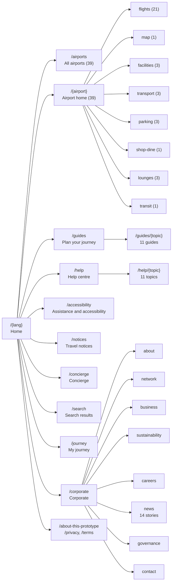

# Sitemap and information architecture

Deliverable 3 of the concept redesign. Date: 18 November 2026. Audience: MAHB digital leadership, solution and
content architects, and vendors who would build or run the production platform.

This is an independent concept. It is not an official MAHB document. It describes the information architecture (IA)
as it is implemented in the concept prototype in this repository, and states separately what a production service
needs. Every statement about the prototype was checked against the code on 18 November 2026; where a number comes from
running the code's own registry functions, the function is named.

## How to read this document

| Label | Meaning |
|---|---|
| **Prototype** | True of the code in this repository today. File paths are given so it can be checked. |
| **Production** | What a live MAHB service needs. Not built. Some items depend on MAHB systems, data or decisions. |
| **Finding** | A gap or defect found in the prototype while preparing this document. Each one is listed again in the summary of findings at the end. |

Method. The route tree was listed from `src/app` (38 page files, 5 route handlers). Section availability, the
`sitemap.xml` path list, the legacy redirect table and the search index were produced by calling the code's own
functions (`airportSections`, `sitemapPaths`, `legacyMappings`, `legacyRedirects`, `buildSearchDocuments`) against the
content layer as it stands. No build, development server or crawl was run for this document. Interaction counts in
section 7 are read from the code paths, not measured with users.

Abbreviations: `{lang}` is `en` or `ms`; `{airport}` (or `{a}`) is a lower-case IATA code such as `kul`. Paths are
written without the host.

## Contents

1. IA principles
2. The URL scheme
3. The passenger sitemap
4. The corporate sitemap
5. Global utilities and where they live
6. Navigation model
7. Interaction counts for the 15 highest-frequency tasks
8. Mapping from the current MAHB site
9. Search scope
10. Governance
11. Summary of findings

## Top two levels at a glance

Paths are shown without the `/{lang}` prefix. Under the airport home, the count in brackets is the number of airports
that have the section today (section 3.3). Every node exists under both `/en` and `/ms`.



---

## 1. IA principles

Five principles govern the structure. Each has a rule, how the prototype implements it, and what production must add.

### 1.1 Task first

**Rule.** The structure follows what passengers come to do (check a flight, get there, park, find a place, get help),
not MAHB's organisation or programme names. Labels name the task in plain words.

**Prototype.**
- Primary navigation is six task labels: Flights, Plan your journey, At the airport, Shop & dine, Transport & parking,
  Help (`PRIMARY_NAV` in `src/components/shell/sections.ts`). Programme names such as "The Butterfly Effect" appear only
  inside the task they serve (`/guides/neurodivergent`, `/accessibility`, the KLIA facilities directory), not as menu
  items.
- The home page leads with one flight search, four journey modes (departing, arriving, transiting, meeting) and six
  quick actions that are reordered and renamed per mode (`JOURNEY_ACTIONS` in `src/components/home/journey-actions.ts`).
- The audit's catch-all groups "Air Travel" and "Booking Services" are not reproduced. Their 31 paths are redistributed
  by task (section 8).

**Production.** Confirm the task list and label wording with MAHB analytics and contact-centre reasons (strategy
questions Q4 and Q5), and run tree tests on the labels in both languages before launch.

### 1.2 One airport model

**Rule.** All 39 MAHB airports share one model and one set of URLs. KLIA is one airport (`kul`) with two terminals;
the terminal is a filter (`?t=T1` or `?t=T2`), never a separate site tree. An airport gets a section only when there is
verified content for it.

**Prototype.**
- The registry holds all 39 airports (5 international, 17 domestic, 17 STOLports) in `src/content/airports.ts`.
- Nine airport sections are defined once, in order, in `AIRPORT_SECTIONS` (`src/components/shell/sections.ts`).
- Availability is computed from content by `sectionsForContent()` and served to the client shell as one map
  (`sectionAvailability()` in `src/components/shell/sections.server.ts`). Navigation, the airport overview cards, the
  section bar, the airport switcher, `generateStaticParams` and `sitemap.xml` all read the same rule, so they cannot
  disagree. The map and transit pages are deliberate exceptions (section 3.4).
- The old site's two KLIA trees (`klia1`, `klia2`) and four regional trees redirect into this model (section 8).

**Production.** Replace the demonstration flight provider as the source of the "flights" rule with the official
flight feed (an airport has a board when the feed covers it), and publish content for the other airports through the
same content model.

### 1.3 One canonical URL per topic

**Rule.** Each topic has one address. Network-wide topics (baggage, security, immigration, help, assistance) live once
at network level; airport-specific topics live once per airport. Filters, terminals and anchors are views of the same
page, not new pages.

**Prototype.**
- The old site's duplicates collapse: three Butterfly Effect URLs to `/guides/neurodivergent`; two parking URLs to
  `/{a}/parking`; two special assistance URLs to `/accessibility`; two facilities URLs to `/{a}/facilities`; four
  transfer URLs to `/{a}/transit`; six copies of the baggage, security and immigration pages to one guide each
  (`src/lib/seo/legacy-redirects.ts`).
- Only the lower-case slug is a page: `/en/KUL` answers 404 (`loadAirportPage` in
  `src/components/airport/section-page.ts`).
- **Finding F2.** No page except `/offline` emits a `<link rel="canonical">` or `hreflang` alternates in its `<head>`;
  the helper exists (`pageMetadata` in `src/lib/seo/metadata.ts`) but is not adopted. Filtered views such as
  `/en/kul/shop-dine?halal=1` therefore carry no canonical. The hreflang pairs exist only in `sitemap.xml`.
- **Watchpoints.** Lounges and hotels are listed both in the facilities directory (`facilityViews` returns every
  facility) and on `/{a}/lounges`; search sends them to `/lounges`. Assistance appears as a hub (`/accessibility`), a help
  topic (`/help/accessibility`) and two guides. These are different facets of one topic and should cross-link to one
  owner page rather than repeat content (section 10).

**Production.** Adopt `pageMetadata` on every page (canonical without query parameters, `hreflang` for `en`, `ms` and
`x-default`); redirect upper-case airport codes to lower case instead of answering 404.

### 1.4 Bilingual parity

**Rule.** Every page exists in English and Bahasa Malaysia at the same path, differing only in the locale prefix.
Interface labels exist in both languages. Where long-form content has no Malay text yet, the page says so.

**Prototype.**
- All pages live under `src/app/[lang]/`; `generateStaticParams` returns both locales. Slugs are not translated:
  `/en/kul/parking` and `/ms/kul/parking`.
- A path without a locale is redirected (307) by `src/proxy.ts` to the visitor's language: the `lang` cookie, then
  `Accept-Language`, then English.
- Interface strings come from typed dictionaries; `src/lib/i18n/i18n.test.ts` fails if English and Malay keys or
  placeholders differ. Content is `LocalizedText { en, ms? }`; a Malay page that falls back to English shows a
  translation notice.
- `sitemap.xml` lists each page in both languages with `hreflang` alternates and `x-default` (English).
- The language switch keeps the path (and, once the page has hydrated, the query and anchor), and remembers the
  choice in the `lang` cookie for one year (`src/components/shell/language-switch.tsx`).
- Malay copy is a draft pending native review (every hand-off says so). **Finding F9.** The concierge is labelled
  "Konsierj" in Malay navigation (`nav.concierge`) but "Concierge" as the Malay page title and "Tanya concierge" as its
  Malay meta title (`src/lib/i18n/features/concierge.ts`).

**Production.** A named Malay editor signs off every core journey; untranslated slugs remain the rule (a translated
slug doubles redirect and analytics work for little gain); decide further languages (strategy Q9) before adding locale
segments.

### 1.5 Provenance

**Rule.** Every published fact carries its source and retrieval date and a guidance label: `official`, `estimated`,
`suggestion` or `demo`. Simulated data is never presented as live. Where a fact is not known, the page says "Not
published" and points to the official channel.

**Prototype.**
- Every content item has `sources: string[]` resolving to a `Source` with a `retrieved` date; `validateAllContent()`
  in `src/content/index.ts` (run by `src/content/content.test.ts`) fails on unknown or missing sources.
- `Provenance` is the four-value enum in `src/content/types.ts`. Demo flights, gates and belts carry the
  "Demonstration data" label on every surface, including search results and concierge answers.
- Provenance shapes the IA directly: a section is not shown for an airport that has no verified records for it
  (principle 1.2), rather than shown empty.

**Production.** Keep the same fields in the content management system, add a review-by date and a named owner per
item (section 10), and switch flight surfaces from `demo` to the live feed's own freshness.

---

## 2. The URL scheme

### 2.1 Grammar

```
/{lang}                                   network home
/{lang}/{network-page}[/{topic}]          network pages: guides, help, accessibility, notices, ...
/{lang}/{airport}                         airport home (overview)
/{lang}/{airport}/{section}               airport section
/{lang}/{airport}/{section}/{item}        an item inside a section (flight, outlet)
/{lang}/corporate[/{section}[/{slug}]]    corporate section
                    [?{filters}][#{anchor}]
```

| Segment | Values | Rule | Where enforced |
|---|---|---|---|
| `{lang}` | `en`, `ms` | Always present. Missing: 307 to the visitor's language. Unknown (`/fr/kul`): becomes `/{visitor's language}/fr/kul`, which answers the localised 404. | `src/proxy.ts`, `src/app/[lang]/layout.tsx` |
| `{airport}` | 39 lower-case IATA codes (`kul`, `pen`, `bki`, `kch`, `lgk`, `szb`, ...) | Upper-case or unknown codes answer 404. | `loadAirportPage`, `src/content/airports.ts` |
| `{section}` | `flights`, `map`, `facilities`, `transport`, `parking`, `shop-dine`, `lounges`, `transit` | Fixed list and order. A section the airport lacks answers 404 (except `map` and `transit`, section 3.4). | `AIRPORT_SECTIONS`, `sectionStaticParams` |
| `{item}` | Flight id `<airline><number>-<yyyymmdd>-<d\|a>`; outlet slug | Flight ids are per operating day and direction. | `src/lib/flights/id.ts`, outlet `slug` in content |
| `{topic}` | Guide slugs (11), help topic slugs (11) | From the content registries. | `src/content/guides.ts`, `src/content/faqs.ts` |

### 2.2 Examples

| URL | Page |
|---|---|
| `/en` | Network home in English |
| `/ms/airports?then=parking` | "Choose an airport" step, in Malay, continuing to parking |
| `/en/kul?t=T2` | KLIA home, Terminal 2 view |
| `/en/kul/flights?dir=a&t=T1&q=MH&s=delayed` | KLIA arrivals board, Terminal 1, Malaysia Airlines, delayed only |
| `/en/kul/flights/mh2610-20261117-d` | One departure on one day (demonstration data in the prototype) |
| `/en/kul/facilities?cat=prayer-room,calm-room&area=airside&access=1` | KLIA facilities, filtered |
| `/en/kul/map?t=T1&from=…&to=…&sf=1` | KLIA Terminal 1 schematic map with a step-free route |
| `/en/kul/transport?to=…&by=price&view=table` | KLIA transport planner sorted by price, as a table |
| `/en/kul/shop-dine?kind=dine&halal=1&area=airside&sort=gate&gate=kul-t1-c` | Halal dining after security, nearest the C gates |
| `/en/kul/shop-dine/paul-le-cafe` | One outlet |
| `/en/kul/transit?from=T1&to=T2&ticket=self&arr=intl&dep=dom&layover=180` | KLIA transfer planner, prefilled |
| `/en/guides/immigration-customs` | Network guide |
| `/en/help/lost-property#lost-property-details` | One answer inside a help topic |
| `/ms/corporate/news/malaysia-airports-delisted` | One corporate story, in Malay |

### 2.3 Query parameters

Query parameters are view state on a canonical page. They are shareable and survive the language switch once the page
has hydrated. Each reader drops invalid values rather than failing.

| Page | Parameters (prototype) | Reader |
|---|---|---|
| Any KLIA page | `t=T1\|T2` (ignored at single-terminal airports) | `src/components/airport/use-terminal-filter.ts` |
| `/airports` | `then=<section>` | `src/components/airport/airport-directory.tsx` |
| `/{a}/flights` | `dir=d\|a`, `t`, `q` (flight number, airline or city), `s` (status groups, comma list) | `src/components/flights/board-model.ts` |
| `/{a}/facilities` | `cat` (categories, comma list), `t`, `area=landside\|airside`, `access=1` | `src/components/facilities/facility-view.ts` |
| `/{a}/map` | `t`, `level`, `poi`, `from`, `to`, `sf=1` (step-free), `cat`, `gate` | `src/components/map/map-logic.ts` |
| `/{a}/transport` | `to` (place), `by=price\|time\|convenience\|accessibility`, `view=cards\|table`, `t` | `src/components/transport/transport-planner-url.tsx` |
| `/{a}/parking` | `t` | `src/components/parking/car-park-list-url.tsx` |
| `/{a}/shop-dine` | `q`, `kind=dine\|shop\|service`, `cat`, `cuisine`, `t`, `area`, `halal=1`, `open=1`, `price=1,2,…`, `sort=suggested\|name\|gate`, `gate`; legacy `filters=open-now,halal,landside,airside` | `src/components/commerce/commerce-view.ts` |
| `/{a}/lounges` | `t` | commerce hand-off |
| `/kul/transit` | `from`, `to` (`T1\|T2`), `ticket=self\|protected`, `arr`, `dep` (`intl\|dom`), `layover` (minutes) | `src/components/guides/transit-logic.ts` |
| `/search` | `q` | `src/components/search/search-results.tsx` |
| `/offline` | `from=<path>` (set by the service worker) | `src/components/platform/offline-status.tsx` |

Anchors are stable record ids: `#<facility-id>` on facilities and lounges, `#transport-<id>`, `#car-park-<id>`,
`#<faq-id>` on help topics, `#<notice-id>` on notices. The search index links to these anchors (section 9).

### 2.4 Addresses that are not pages

| Address | Purpose |
|---|---|
| `/sitemap.xml`, `/robots.txt`, `/manifest.webmanifest` | Generated by `src/app/sitemap.ts`, `robots.ts`, `manifest.ts` |
| `/{lang}/search/index.json` | Static search documents per language, fetched on first use of search |
| `/{lang}/concierge/knowledge.json` | Static concierge knowledge pack, used when the API cannot be reached |
| `/api/flights`, `/api/concierge`, `/api/health` | Route handlers (not localised); the flight API serves demonstration data |

### 2.5 Indexing rules (prototype)

- The whole prototype is `noindex` (layout robots meta and an `X-Robots-Tag` header) unless the owner sets
  `SITE_INDEXING=allow` (`next.config.ts`). It must not be mistaken for the official site.
- `robots.txt` disallows `/api/`, and per language `/search`, `/journey`, `/offline`, `/design-system` and flight
  detail pages (`/{lang}/*/flights/`). The flight boards themselves are allowed.
- `sitemap.xml` lists 120 paths in both languages, 240 URLs (`sitemapPaths()`): 7 network pages, 11 guides, 11 help
  topics, 83 airport pages (including 8 outlet pages), 5 corporate pages and 3 transparency pages. It leaves out search,
  My journey, offline, the design system and flight details on purpose. **Finding F1**: it also leaves out 18 corporate
  pages by accident (section 4.3).

---

## 3. The passenger sitemap

### 3.1 Tree

Every path below exists under `/en` and `/ms` with the same slug. "On demand" means rendered at first request rather
than at build time.

```
/{lang}                                  Home: flight search, journey modes, quick actions, headline notice,
│                                        board preview, network, shop and dine, concierge entry
├── /airports                            All 39 airports by classification and region; ?then=<section>
├── /{airport}                           Airport home (39): header, KLIA terminal chips, section bar,
│   │                                    flight tools, that airport's notices, contacts
│   ├── /flights                         Departures and arrivals board, search, filters (21 airports)
│   │   └── /{flightId}                  One flight on one day: timeline, gate, belt (per request; demo)
│   ├── /map                             Schematic terminal map, search, routes (KLIA T1 only; honest page elsewhere)
│   ├── /facilities                      Facilities and services directory (KUL, PEN, BKI)
│   ├── /transport                       Getting to and from: planner and comparison (KUL, PEN, BKI)
│   ├── /parking                         Car parks, published rates, calculator, parked-car note (KUL, PEN, BKI)
│   ├── /shop-dine                       Shop and dine discovery (KUL)
│   │   └── /{outlet}                    One outlet (8 at KUL)
│   ├── /lounges                         Lounges, hotels, rest and showers (KUL, PEN, BKI)
│   └── /transit                         Connections: KLIA transfer planner; honest page elsewhere (KUL listed)
├── /guides                              Plan your journey: 11 guides in three groups, "applies to" filter
│   └── /{topic}                         departing, arriving, check-in, security, immigration-customs, baggage,
│                                        families, first-time, reduced-mobility, neurodivergent, older-travellers
├── /help                                Help centre: FAQ search, topics, scam alert, who handles what, contacts
│   └── /{topic}                         terminals, flights, baggage, lost-property, accessibility,
│                                        parking-transport, contact, about-this-site, feedback, scams, privacy
├── /accessibility                       Assistance hub, accessible facilities, display settings, statement
├── /notices                             Travel notices, network-wide and per airport
├── /concierge                           Concierge full page (also a panel on every page)
├── /search?q=                           Search results (not indexed)
├── /journey                             My journey: saved flights, places, parked-car note (on this device)
├── /offline                             Offline access and saved pages (not indexed)
├── /about-this-prototype                What this prototype is and is not
├── /privacy                             What this site stores, and MAHB's own notice
├── /terms                               Terms of use
├── /design-system                       Living style guide (internal; not indexed)
└── /{anything else}                     Localised 404 (src/app/[lang]/[...rest]/page.tsx)
```

### 3.2 Network pages

| Path | Purpose | English label | Malay label | In `sitemap.xml` |
|---|---|---|---|---|
| `/` | Network home; no airport assumed | Home | Laman utama | Yes |
| `/airports` | Directory of all 39 airports; also the "choose first" step (`?then=`) | All airports | Semua lapangan terbang | Yes |
| `/guides` | Hub of the 11 guides | Plan your journey | Rancang perjalanan | Yes |
| `/guides/{topic}` | Step-by-step guide with provenance per step and airport notes | (guide title) | (guide title) | Yes, 11 |
| `/help` | Help centre | Help centre (page), Help (menu) | Pusat bantuan, Bantuan | Yes |
| `/help/{topic}` | One topic: lead block, FAQ answers with anchors | (topic title) | (topic title) | Yes, 11 |
| `/accessibility` | Assistance hub and accessibility statement | Assistance and accessibility | Bantuan dan kebolehcapaian | Yes |
| `/notices` | Travel notices | Travel notices | Notis perjalanan | Yes |
| `/concierge` | Grounded question answering | Concierge | Konsierj (nav); Concierge (page title) | Yes |
| `/search` | Full search results | Search | Carian | No (personal, unbounded) |
| `/journey` | Saved items on this device | My journey | Perjalanan saya | No (personal) |
| `/offline` | Offline status and saved pages | Offline access | Akses luar talian | No (utility) |
| `/about-this-prototype` | Transparency | About this prototype | Tentang prototaip ini | Yes |
| `/privacy` | Storage keys, clear-all, MAHB notice | Privacy | Privasi | Yes |
| `/terms` | Terms of use | Terms of use | Terma penggunaan | Yes |
| `/design-system` | Internal style guide | Design system | Sistem reka bentuk | No (internal) |

Guide titles, English and Malay: Departing: from your door to the gate / Berlepas: dari rumah ke pintu berlepas;
Arriving: from the aircraft door to your onward journey / Ketibaan: dari pintu pesawat ke perjalanan seterusnya;
Check-in and bag drop / Daftar masuk dan serahan bagasi; Security screening / Saringan keselamatan; Immigration and
customs / Imigresen dan kastam; Baggage / Bagasi; Travelling with babies and children / Melancong bersama bayi dan
kanak-kanak; Flying internationally for the first time / Terbang ke luar negara buat kali pertama; Reduced mobility and
wheelchair assistance / Pergerakan terhad dan bantuan kerusi roda; Autism, ADHD and other hidden disabilities /
Autisme, ADHD dan ketidakupayaan tersembunyi lain; Older travellers / Pengembara warga emas.

Help topics, English and Malay: Terminals and finding your way / Terminal dan mencari arah; Flights and disruption /
Penerbangan dan gangguan; Baggage / Bagasi; Lost property / Barang hilang; Assistance and accessibility / Bantuan dan
kebolehcapaian; Parking and transport / Parkir dan pengangkutan; Contact Malaysia Airports / Hubungi Malaysia Airports;
About this prototype / Tentang prototaip ini; Feedback and complaints / Maklum balas dan aduan; Scam alerts / Amaran
penipuan; Privacy and your data / Privasi dan data anda.

### 3.3 Airport sections and content-driven availability

The rule (`sectionsForContent` in `src/components/shell/sections.ts`) decides which sections an airport has. It is the
only place that decides it.

| Section | Segment | English label | Malay label | Shown when | Airports today |
|---|---|---|---|---|---|
| Overview | (none) | Overview | Gambaran keseluruhan | Always | All 39 |
| Flights | `flights` | Flights | Penerbangan | The flight provider has a board for the airport | 21: KUL, PEN, LGK, BKI, KCH, SZB, AOR, IPH, KBR, TGG, KUA, LBU, LDU, SDK, TWU, BTU, LMN, MYY, MKM, MZV, SBW |
| Terminal map | `map` | Terminal map | Peta terminal | At least one map model | 1: KUL (Terminal 1 schematic only) |
| Facilities | `facilities` | Facilities and services | Kemudahan dan perkhidmatan | At least one facility | 3: KUL, PEN, BKI |
| Transport | `transport` | Getting to and from | Pergi dan balik | At least one transport option | 3: KUL, PEN, BKI |
| Parking | `parking` | Parking | Parkir | At least one car park | 3: KUL, PEN, BKI |
| Shop and dine | `shop-dine` | Shop & dine | Beli-belah & makan | At least one outlet | 1: KUL |
| Lounges | `lounges` | Lounges and hotels | Lounge dan hotel | A lounge or hotel facility | 3: KUL, PEN, BKI |
| Transit | `transit` | Connections and transit | Sambungan dan transit | A transit note or an inter-terminal transport option | 1: KUL |

Why each airport has what it has (content counts from `getAirportContent`, 18 November 2026):

| Airports | Sections | Why |
|---|---|---|
| KUL (KLIA, two terminals) | All nine | Content file with 20 facilities, 8 outlets, 9 transport options, 4 car parks, 1 map (Terminal 1), 17 guide notes |
| PEN, BKI | Overview, flights, facilities, transport, parking, lounges | Content files: PEN 3 facilities, 6 transport options, 2 car parks; BKI 2 facilities, 2 transport options, 1 car park. No outlets, map or transit content |
| KCH, LGK, SZB | Overview, flights | Content files hold guide notes only (KCH 2, LGK 1, SZB 3); no facility, transport or car park records were verified |
| AOR, IPH, KBR, TGG, KUA, LBU, LDU, SDK, TWU, BTU, LMN, MYY, MKM, MZV, SBW | Overview, flights | Registry record only (no content file); the demonstration provider has routes for them |
| MKZ (Melaka) | Overview | No demonstration routes: the generator gives none to airports without reliable scheduled service (`src/lib/providers/demo-routes.ts`) |
| 17 STOLports (PKG, RDN, TOD, KUD, GSA, SMM, BKM, BBN, BLG, KPI, LWY, LKH, LBP, LGL, LSM, ODN, MUR) | Overview | Registry listing; the overview says the listing is limited (`depth: 'listing'`) |

Notes:
- The registry's `depth` (`full`, `essential`, `listing`) changes wording on the directory and overview; it does not
  decide sections. Content presence does.
- Prerendering follows the same rule: `sectionStaticParams(section)` builds only airports that have the section; the
  others answer 404 through `loadAirportPage`.
- KLIA terminal views (`?t=T1`, `?t=T2`) apply to every KLIA section; the section bar keeps `?t=` when moving between
  sections (`src/components/airport/section-nav.tsx`).
- **Production.** The flights rule must come from the official feed, not from `hasDemoRoutes`. Some STOLports may then
  gain boards; the IA needs no change for that.

### 3.4 Pages that answer but are not listed

**Finding F6.** Two section routes answer for any registered airport, with an honest page, even where the section is not
in that airport's navigation or in `sitemap.xml`:

- `/{a}/map` renders "No map for … yet" with links to the facilities directory and the official site. Prerendered for
  KUL, PEN and BKI; other airports render on demand (`src/app/[lang]/[airport]/map/page.tsx`; tested for `/en/pen/map`
  in `e2e/map.spec.ts`).
- `/{a}/transit` renders the KLIA planner only at KLIA; elsewhere it shows the airport's sourced notes, an empty state
  and a link to `/kul/transit` (`src/app/[lang]/[airport]/transit/page.tsx`; tested for `/en/pen/transit`).

They give a typed or shared URL a useful answer instead of a 404; the navigation and the journey timeline do not link
to them where the section is not listed (the timeline filters its links with `hasSection`). **Production:** mark them
`noindex` where the section is not listed, or return 404, so search engines do not index thin pages.

### 3.5 Items inside sections

| Item | Count today | Indexed in `sitemap.xml` | Notes |
|---|---|---|---|
| Flight pages `/{a}/flights/{flightId}` | Unbounded (one per demo flight per day) | No; disallowed in `robots.txt` | Rendered per request. Unknown ids answer 200 with `noindex` and not-found content (integration hand-off, issue 5) |
| Outlet pages `/{a}/shop-dine/{outlet}` | 8 (KLIA) | Yes | Only outlets confirmed by a source |
| Guide topics, help topics | 11 and 11 | Yes | |

**Production.** Flight pages need stable, shareable URLs per operating flight with codeshare numbers resolving to them
(benchmark requirement BR-02), and a decision on whether they are indexed.

---

## 4. The corporate sitemap

### 4.1 Tree

```
/{lang}/corporate                    Corporate home: four sourced figures, vision, section index, latest stories
├── /about                           History, ownership after privatisation, leadership, brand, group companies,
│                                    Operating Agreements, recognition
├── /network                         Our airports: classification, the five international airports (linking to
│                                    their passenger pages), 2025 traffic, projects
├── /business                        Seven lines of business; dedicated channels "Not published"; vendor scam warning
├── /sustainability                  Targets, Airport Carbon Accreditation table, related stories
├── /careers                         Official careers portal and leaders page; apply-safely advice
├── /news                            Media centre: traffic statistics table and 14 stories
│   └── /{slug}                      One story (release or press coverage), sources open
├── /governance                      Ownership and board, Operating Agreements, privacy notice, scam alerts
└── /contact                         Sourced channels only, corporate office, media, investors, passenger help
```

The corporate band (`src/components/corporate/corporate-nav.tsx`) shows the sections in this order, with a "Passenger
site" link back to `/`. Labels, English and Malay (`corporatePages.nav`): Overview / Gambaran keseluruhan; About /
Perihal; Our airports / Lapangan terbang kami; Business with us / Berniaga dengan kami; Sustainability / Kelestarian;
Careers / Kerjaya; Media centre / Pusat media; Governance / Tadbir urus; Contact / Hubungi.

Stories at `/corporate/news/{slug}` (newest first): `september-2026-passenger-traffic`, `august-2026-group-traffic`,
`chairman-appointed-md-tenure-extended`, `klia-aerotrain-24-hour-service-resumes`,
`penang-kuching-carbon-accreditation`, `kota-bharu-expanded-terminal-full-operation`,
`visit-malaysia-2026-january-traffic`, `klia-aeropolis-solar-farm-unveiled`, `strong-2025-passenger-growth`,
`klia-aerotrain-returns`, `klia-skytrax-2025`, `klia-asq-2024-top-10`, `malaysia-airports-delisted`,
`kota-kinabalu-langkawi-carbon-accreditation`.

Breadcrumbs: Home > Corporate > page; stories add Media centre.

### 4.2 Mapping from the audit's corporate inventory

| Audit item (`mahb-audit.md` section 1.3) | Today | Prototype destination | Production |
|---|---|---|---|
| C1 About us: profile, brand, management, board | `corporate.malaysiaairports.com.my/en/about-us/...` | `/corporate/about` | Full board and remaining officers (not in the research) |
| C2 Sustainability | `.../en/sustainability/...` | `/corporate/sustainability` | |
| C3 Media centre: news, monthly traffic | `.../en/media-centre/news/{number}` | `/corporate/news`, `/corporate/news/{slug}` | Redirect each numbered story to its slug |
| C4 Annual reports | Separate microsite | None as a page; the 2023 annual report appears only as a cited source | A reports archive page under `/corporate/governance` or `/corporate/about` |
| C5 Careers | `careers.malaysiaairports.com.my` | `/corporate/careers` (links out) | Keep the portal; link, do not replicate |
| C6 Procurement | `vms.malaysiaairports.com.my`, Procurehere | `/corporate/business` (procurement area; channel "Not published") | Link the vendor portal once MAHB confirms it |
| C7 Corporate contact | `www.malaysiaairports.com.my/contact-us/corporate` | `/corporate/contact` | |
| C8 Corporate magazine | `convergence.malaysiaairports.com.my` | None | Decide whether to keep, link or retire |
| C9 Ownership and governance | Not located | `/corporate/governance`, `/corporate/about#ownership` | Content per strategy Q11 |
| C10 Link to passenger flight boards | Corporate navigation | Corporate band "Passenger site"; `/corporate/network` links to airport pages | |

No redirect rules exist for the corporate host. **Production** needs a host-level map from
`corporate.malaysiaairports.com.my` paths to `/{lang}/corporate/...`.

### 4.3 Finding F1: corporate pages missing from `sitemap.xml`

`pendingPaths()` in `src/lib/seo/site-routes.ts` lists `/corporate` plus `CORPORATE_PAGES` (which holds only
`network`) and `NEWS_ITEMS` (2 stories). The corporate team's pages and stories live elsewhere (`CORPORATE_SECTIONS`,
`MEDIA_ITEMS`). As a result `sitemap.xml` omits `/corporate/about`, `/business`, `/sustainability`, `/careers`,
`/governance`, `/contact` and 12 of the 14 stories: 18 paths, 36 URLs. Fix: build the corporate paths from
`CORPORATE_SECTIONS` and `mediaSlugs()`, the same sources the routes use.

---

## 5. Global utilities and where they live

"Desktop" is 768 px and wider (`md`); "phone" is below. The header's primary navigation row appears only when the
header is at least 73 rem wide in English or 84 rem in Malay; below that the Menu holds it.

| Utility | Desktop | Phone | State and URL | Production needs |
|---|---|---|---|---|
| Airport switcher | Header button; inside the home flight search | Header button; first row of the Menu | Remembered on the device (`airportStore`); visiting an airport page updates it. Offers the last choice, then the featured six (KLIA T1 and T2 as separate rows, PEN, BKI, KCH, LGK, SZB), then all airports by classification, then a link to `/airports`. Choosing while on `/kul/parking` goes to `/pen/parking` if Penang has parking, else `/pen` (`sameSectionPath`). | None structural |
| Flight search | Home hero (with airport selector), airport overview, board page | Same; bottom bar "Flights" goes to the board, or to the choose-first step | Results appear as you type; departures or arrivals toggle; without an airport it searches every airport with a board and names the terminal. Board filters in the URL (`?dir`, `?q`, `?t`, `?s`). | Live feed; codeshare resolution |
| Language | Utility bar switch; footer | Menu "Language"; footer | `/en` or `/ms` prefix; `lang` cookie for the next visit to a locale-less URL | Malay review |
| Display and accessibility preferences | Utility bar "Display settings"; `/accessibility` | Menu "Display and accessibility"; `/accessibility` | Text size 100, 112 or 125%, high contrast, reduced motion, theme; local storage; applied before first paint | None structural |
| My journey (saved flights, places, parked-car note) | Header link with count; footer; Menu | Bottom bar "Journey" with badge; Menu; footer | `/journey`; local storage only; opt-in demonstration notifications | Optional account sync with consent; real notifications |
| Site search and command palette | Header button (`/` hint); keys `/` and Ctrl or Cmd + K | Raised "Search" in the bottom bar | Palette with quick links and recent searches; full results at `/search?q=`; scoped to the remembered airport with an "everywhere" switch | See section 9 |
| Concierge | Header button "Ask the concierge"; home section with example questions; `/concierge` | Menu "Ask the concierge"; home section; `/concierge` | Panel on every page; first-use consent; conversation kept in this tab only; `POST /api/concierge`, with an on-device fallback from `/{lang}/concierge/knowledge.json` | Service limits at a gateway; analytics of unanswered questions |
| Notices | Home hero strip (one headline notice, the remembered airport's first, demo last); airport overview (that airport's notices); `/notices` | Same; Menu "Travel notices" | Authored content with `validFrom` and `validTo`; date filtering in the browser | An operational status feed and a site-wide banner for severe disruption (section 7, task 8) |
| Offline and update | Indicator and "new version" prompt on every page | Same | Service worker; `/offline` | None structural |
| Prototype marker | Utility bar, every page | Utility bar (short text) | Links to `/about-this-prototype` | Removed at launch |
| Corporate link | Utility bar "Corporate site"; footer | Menu "Corporate site"; footer | `/corporate` | |

---

## 6. Navigation model

### 6.1 Primary navigation

The same six items everywhere (`PRIMARY_NAV`). With no airport chosen, airport-scoped items go to the "choose first"
step and continue to the section in one tap. With an airport chosen they go to that airport's section, or to the first
available fallback, or to the airport home.

| Item (English / Malay) | No airport chosen | KUL chosen (T1) | PEN or BKI chosen | KCH, LGK, SZB or another domestic airport | MKZ or a STOLport | Marked current on |
|---|---|---|---|---|---|---|
| Flights / Penerbangan | `/airports?then=flights` | `/kul/flights?t=T1` | `/pen/flights` | `/kch/flights` | `/mkz` (no board) | `/{a}/flights…` |
| Plan your journey / Rancang perjalanan | `/guides` | `/guides` | `/guides` | `/guides` | `/guides` | `/guides`, `/journey` |
| At the airport / Di lapangan terbang | `/airports?then=facilities` | `/kul/facilities?t=T1` | `/pen/facilities` | `/kch` (no facilities, map, lounges or transit) | `/mkz` | `/{a}/map`, `facilities`, `lounges`, `transit` |
| Shop & dine / Beli-belah & makan | `/airports?then=shop-dine` | `/kul/shop-dine?t=T1` | `/pen` (no outlets) | `/kch` | `/mkz` | `/{a}/shop-dine` |
| Transport & parking / Pengangkutan & parkir | `/airports?then=transport` | `/kul/transport?t=T1` | `/pen/transport` | `/kch` | `/mkz` | `/{a}/transport`, `/{a}/parking` |
| Help / Bantuan | `/help` | `/help` | `/help` | `/help` | `/help` | `/help`, `/accessibility`, `/notices` |

Fallback order: At the airport tries facilities, map, lounges, transit; Transport & parking tries transport, parking.
Note: the `?then=` step on `/airports` uses only the item's first section, not the fallbacks. No airport today has
parking without transport, or map without facilities, so the difference is not visible yet.

### 6.2 Header, utility bar and menu

- **Utility bar** (scrolls away; desktop items hidden on phones): prototype marker, Corporate site, language switch,
  display settings.
- **Sticky header**: wordmark (to `/`), primary navigation (wide screens), airport switcher, search, My journey,
  concierge, Menu (when the navigation row does not fit). On phones only the wordmark and the airport switcher show; the
  rest moves to the bottom bar and the Menu.
- **Menu sheet** (`src/components/shell/panels.tsx`): airport switcher row; "Explore" with the six primary items;
  "More" with My journey, Travel notices, All airports, Assistance and accessibility, Ask the concierge, Corporate site,
  About this prototype; Language; "Display and accessibility" (the same controls as the utility bar's Display settings).

### 6.3 Phone bottom bar

Five items, fixed, below 768 px (`src/components/shell/mobile-bar.tsx`): Home (`/`), Flights (same rule as the primary
item), a raised Search (opens the palette), Journey (`/journey`, with a saved-item badge), Menu (opens the sheet). Malay
labels: Laman utama, Penerbangan, Carian, Perjalanan, Menu.

### 6.4 Footer

| Column (English / Malay) | Links |
|---|---|
| Passengers / Penumpang | All airports, Plan your journey, My journey, Travel notices, Assistance and accessibility, Help centre |
| Company / Syarikat | Corporate, The network (`/corporate/network`) |
| Transparency and legal / Ketelusan dan perundangan | About this prototype, Privacy, Terms, Accessibility, Design system |
| Official contacts | The two group contacts from the content layer (phone and email) with the note that they are group lines |

Beside the columns, a "What this prototype is" panel links to `/about-this-prototype` and the official MAHB site.
Below them, the language switch as plain links and "Back to top".

### 6.5 Breadcrumbs

Every page except the home, the airport overview and the offline page has a trail starting at Home
(`src/components/common/breadcrumbs.tsx`). On phones only the parent shows, as a back link.

| Page | Trail |
|---|---|
| Airport section | Home > {airport short name} > {section} |
| Flight | Home > {airport} > Flights > {flight number} |
| Outlet | Home > {airport} > Shop & dine > {outlet} |
| Guide | Home > Plan your journey > {guide} |
| Help topic | Home > Help > {topic} |
| Accessibility | Home > Help > Assistance and accessibility |
| Network page, transparency page | Home > {page} |
| Corporate | Home > Corporate > {page}; stories add Media centre |

The airport crumb links to `/{a}` without the terminal filter. **Production:** emit `BreadcrumbList` structured data;
the helper `breadcrumbJsonLd` exists in `src/lib/seo` but is not used (Finding F8).

### 6.6 Section navigation

- **Airport section bar** under the airport header: the sections the airport has, in registry order, with the current
  one marked; scrolls sideways on narrow screens; KLIA adds terminal chips (all, T1, T2) that keep the current section.
- **Corporate band**: section links on desktop, a disclosure on phones, "Passenger site" link.
- **In-page**: "On this page" jump lists on guides and corporate pages; related guides and topics at the foot.

---

## 7. Interaction counts for the 15 highest-frequency tasks

Counting rule (strategy section 4.1): an interaction is a tap, click or submitted entry; typing a query and choosing a
suggestion counts as one; counted at 360 px from the network home with nothing saved (default journey mode: departing).
Scrolling is not counted. The prototype column is the shortest path in this IA, read from the code. The MAHB column
uses the audit's friction log where the audit logged the task (Tasks 1 to 5 of `mahb-audit.md` section 2, "steps"
being the audit's own unit, reconstructed rather than completed end to end because of the access block) and the
strategy's "current friction" evidence otherwise.

| # | Task | Shortest path in this IA (prototype) | Prototype | Target | MAHB site today |
|---|---|---|---|---|---|
| 1 | Check a flight's status, terminal and gate | Type the flight number in the home flight search: the result row shows status, terminal and gate (1). Open the flight page for the timeline (2). For an arrival, tap the Arrivals toggle first. | 1; 2 to the flight page; 2 to 3 for an arrival | 2 | Audit Task 1: 4 steps; widget departures-only and preset to Terminal 1; arrivals or Terminal 2 via Flight Information > Arrivals or switching to `klia2`; "Loading..." when the API failed |
| 2 | Find which KLIA terminal an airline uses | With a flight number: home flight search shows the terminal (1). Without: Search (1), "AirAsia terminal" to the FAQ on the two terminals (2), which gives the general rule; or the concierge asked "Where do I check in for AirAsia at KLIA?" answers "AirAsia flies from KLIA Terminal 2" (2). No airline directory page. | 1 with a flight number; 2 otherwise | 1 | No airline-to-terminal directory found (strategy, search negative) |
| 3 | Plan the trip to the airport and when to leave | Type the flight (1), open the flight page (2): "Arrive at the airport by hh:mm" (3 h international, 2 h domestic, labelled as guidance) and a travel step; its transport link (3). | 3 | 3 | Not logged in the audit; modes on separate tabs, no leave-by guidance seen (strategy) |
| 4 | Get from KLIA to the city on an official option | Search (1); "KL Sentral" to the KLIA Ekspres card on `/kul/transport` (2). By navigation: Menu, Transport & parking, KLIA (3). | 2 | 2 | Audit Task 4: 3 steps; modes as `?tab=` tabs; page errored under the block; rail fares not in indexed text |
| 5 | Find the parking price for a stay, then pre-book | Home quick action "Parking" (1), KLIA in the directory (2): car parks with what is published. Calculator entry and exit (3). Official booking link on the car park card (4). | 2 to the page; 3 to a calculated price where rates are published; 4 to booking | 3; 5 to booking | Audit Task 2: 4 steps; no rate table on the page; a price only from the booking form or third parties |
| 6 | Meet an arriving passenger | Journey mode "Meeting" (1) switches the search to arrivals; type the flight (2): expected time and status; flight page (3): landing, baggage and onward steps. | 3 | 3 | Not logged; arrivals separate, no baggage status layer (strategy) |
| 7 | Find a facility near me (prayer room) | Search (1); "surau" or "prayer room" to `/kul/facilities#kul-t1-prayer-rooms` (2). Routes on the KLIA Terminal 1 schematic map via `?from=&to=`. | 2 | 2 | Audit Task 3: 4 steps; no "prayer room" label; two facilities pages; map separate |
| 8 | See disruption or service status | The home notice strip shows the current headline notice (0). For the full list, the strip's link or the footer "Travel notices" (1). | 0 when a notice is current; 1 otherwise | 0 or 1 | Not logged; no status layer seen; a 2021 Aerotrain item still surfaces in search (strategy) |
| 9 | Change terminals at KLIA on a self-transfer | Journey mode "Transiting" (1), "Connections" (2), KLIA (3): the transfer planner. A text answer: Search (1), "change terminal" to the FAQ (2). | 3 to the planner; 2 to an answer | 3 | Not logged; duplicate pages, conflicting shuttle frequency (strategy) |
| 10 | Arrange or understand special assistance | Search (1), "wheelchair" to `/guides/reduced-mobility` (2); or Menu (1), Assistance and accessibility (2). | 2 | 2 | Not logged; Butterfly Effect under "Booking Services" at three URLs; special assistance at two |
| 11 | Check entry requirements before landing | Search (1), "immigration" to `/guides/immigration-customs` (2), then the official Immigration link. | 2, then hand-off | 2, then hand-off | Not logged; rules sit with Immigration (strategy) |
| 12 | Check what can be carried | Search (1), "liquids" to `/guides/security` or the liquids FAQ (2). | 2 | 2 | Not logged; the same rules duplicated under six trees |
| 13 | Find food or shops (halal, open now) | Home "Shop & dine" block: "Choose an airport" (1), KLIA Terminal 1 (2) to `/kul/shop-dine?t=T1`; Halal filter (3). | 2 to the listing; 3 with a filter | 2 | Not logged; homepage leads with promotions; directories unread under the block |
| 14 | Report lost property or contact help | Search (1), "lost" to the Lost and Found entry or `/help/lost-property` (2). By navigation: Menu, Help, Lost property (3). | 2 | 2 | Audit Task 5: help reached in 1 step, but contact details only on third-party sites; page errored under the block |
| 15 | Book Fast Track, a lounge or a rest facility | Lounge: home quick action "Lounges" (1), KLIA (2) to `/kul/lounges`; operator link (3). Fast Track: no page and no search result. | 3 for a lounge; not available for Fast Track | 3 to the partner hand-off | Not logged; Fast Track on a separate domain, no price seen |

What the counts do not show, and what production must fix:

- **Answers behind the path.** The path is short but the answer is partial where content is missing: KLIA parking
  rates are not verified, so the calculator gives no KLIA price (Penang Premium Parking has rate bands); only 1 of 8
  outlets has a halal status and none has hours, so "open now" finds nothing; only 1 of 20 KLIA facilities has a
  published level. These are content tasks, not IA tasks.
- **Finding F3 (task 2).** There is no airline directory. The concierge answers airline-to-terminal only when the
  question is phrased as a check-in question; "Which terminal does AirAsia use at KLIA?" was not recognised when run
  against the engine on 18 November 2026. Production: add an "Airlines" view for KLIA (airline, terminal, check-in
  row, source) as a section or a block on `/kul`, index airlines in search, and add the intent to the concierge.
- **Finding F4 (task 13).** Filters ticked on the home "Shop & dine" block before an airport is chosen are dropped:
  "Choose an airport" opens the switcher, which navigates with `sectionHref` and no query
  (`src/components/home/shop-dine-strip.tsx`). Once an airport is remembered, the block's link does carry the filters.
- **Task 8.** Notices are authored content (six today: five official, one demonstration), not an operational feed, and
  flight pages link to `/notices` on cancellation rather than showing the relevant notice. Production: an operations
  status source, a site-wide banner for severe disruption, and notices shown on the affected flight and section pages.
- **Task 15.** Fast Track has no destination at all (section 8.4).
- On desktop the header navigation replaces the Menu, so navigation paths are one interaction shorter.

---

## 8. Mapping from the current MAHB site

### 8.1 How the redirects work (prototype, verified)

- Source: `src/lib/seo/legacy-redirects.ts`, loaded by `next.config.ts` `redirects()`. Checked by
  `src/lib/seo/legacy-redirects.test.ts` with Next.js's own path matcher: every one of the 276 URLs in
  `docs/research/direct/mahb-sitemap-urls-2026-11-16.txt` has an explicit rule, every destination is a page that
  exists, and every section claimed for an old airport is one it has.
- The old site had six identical trees of 46 paths: `klia1`, `klia2`, `penang`, `kota-kinabalu`, `kuching`,
  `langkawi`. The rules add the three flight board paths (`flight-information`, `/departures`, `/arrivals`), which are
  linked in the old navigation but missing from its sitemap. That is 49 topics per tree.
- `legacyRedirects()` returns 300 rules: 294 explicit (6 trees x 49 topics) and 6 catch-alls (anything else under an
  old airport goes to its home, 307).
- Old airport to new: `klia1` to `kul?t=T1`, `klia2` to `kul?t=T2`, `penang` to `pen`, `kota-kinabalu` to `bki`,
  `kuching` to `kch`, `langkawi` to `lgk`.
- Each rule accepts `/en/…` and `/ms/…` and keeps the locale. A locale-less old path (`/klia1/parking`) first gets a
  locale from `src/proxy.ts` (307), then matches: two hops.
- Status codes: **308** (permanent) when the destination is a true equivalent; **307** (temporary) when it is the
  closest page for now, so the mapping can improve without browsers caching a fallback. Of the 276 sitemap URLs, 140
  are 308 and 136 are 307. The benchmark requirement BR-14 asks for 301s; 308 is the method-preserving permanent
  equivalent and is treated as permanent by search engines.
- An old topic whose section an airport lacks falls to the next listed section or the airport home, always as 307, and
  drops topic filters such as `?dir=`.
- Next.js passes the request's query string through to the destination, so an old `?tab=bus` reaches `/kul/transport`
  and is ignored.

### 8.2 The 46 KLIA Terminal 1 paths, plus the flight boards

Old paths are relative to `/en/klia1`. `klia2` is identical with `?t=T2`. Destinations are given without the locale.

| # | Old path (under `/en/klia1`) | New destination | Code | Equivalence and content today |
|---|---|---|---|---|
| 1 | (airport home) | `/kul?t=T1` | 308 | Equivalent |
| 2 | `/air-travel` | `/guides` | 308 | Equivalent hub |
| 3 | `/air-travel/airport-facilities` | `/kul/facilities?t=T1` | 308 | Duplicate collapsed |
| 4 | `/air-travel/facilities` | `/kul/facilities?t=T1` | 308 | Duplicate collapsed |
| 5 | `/air-travel/services` | `/kul/facilities?t=T1` | 308 | Equivalent |
| 6 | `/air-travel/services/airport-care-ambassadors` | `/help` | 307 | Closest; no CARE Ambassadors content |
| 7 | `/air-travel/services/butterfly-effect` | `/guides/neurodivergent` | 308 | Duplicate collapsed |
| 8 | `/air-travel/services/fast-track` | `/kul?t=T1` | 307 | No destination for the topic (8.4) |
| 9 | `/air-travel/services/lost-and-found` | `/help/lost-property` | 308 | Equivalent |
| 10 | `/air-travel/services/special-assistance` | `/accessibility` | 308 | Duplicate collapsed |
| 11 | `/air-travel/services/wifi` | `/kul/facilities?t=T1` | 308 | Marked equivalent, but no Wi-Fi record is published (8.4) |
| 12 | `/air-travel/special-assistance` | `/accessibility` | 308 | Duplicate collapsed |
| 13 | `/air-travel/flight-transfer` | `/kul/transit?t=T1` | 308 | Duplicate collapsed |
| 14 | `/air-travel/inter-terminal-transfer` | `/kul/transit?t=T1` | 308 | Duplicate collapsed |
| 15 | `/air-travel/baggage` | `/guides/baggage` | 308 | Network-wide guide |
| 16 | `/air-travel/customs-and-immigration` | `/guides/immigration-customs` | 308 | Network-wide guide |
| 17 | `/air-travel/facial-recognition` | `/guides/immigration-customs` | 307 | Closest; no biometric content |
| 18 | `/air-travel/lag-restricted-items` | `/guides/security` | 308 | Network-wide guide |
| 19 | `/air-travel/security-screening` | `/guides/security` | 308 | Network-wide guide |
| 20 | `/air-travel/vehicle-access-management-system` | `/kul/transport?t=T1` | 307 | Closest; no VAMS content |
| 21 | `/air-travel/parking` | `/kul/parking?t=T1` | 308 | Duplicate collapsed |
| 22 | `/air-travel/public-transport` | `/kul/transport?t=T1` | 308 | Equivalent |
| 23 | `/air-travel/rental-services` | `/kul/transport?t=T1` | 308 | Marked equivalent, but KLIA has no car hire record published (Penang has one); equipment and wheelchair rental not published (8.4) |
| 24 | `/air-travel/location-map` | `/kul/map?t=T1` | 308 | Duplicate collapsed |
| 25 | `/air-travel/passenger-services-charges` | `/help` | 307 | Closest; no charges content |
| 26 | `/air-travel/travel-health-sops` | `/notices` | 307 | Closest; probably obsolete topic |
| 27 | `/air-travel/visa` | `/guides/immigration-customs` | 308 | Network-wide guide |
| 28 | `/booking-services` | `/kul/lounges?t=T1` | 307 | Closest; the old group mixed bookable services |
| 29 | `/booking-services/butterfly-effect` | `/guides/neurodivergent` | 308 | Duplicate collapsed |
| 30 | `/booking-services/film-and-photography` | `/help/contact` | 307 | Closest; permits are a corporate or operations process |
| 31 | `/booking-services/things-to-do` | `/kul/shop-dine?t=T1` | 307 | Closest |
| 32 | `/booking-services/visitation-kul` | `/help/contact` | 307 | Closest; no visits content |
| 33 | `/butterfly-effect` | `/guides/neurodivergent` | 308 | Duplicate collapsed |
| 34 | `/mobile-app` | `/offline` | 307 | Closest (install and offline access); no app page |
| 35 | `/myairports` | `/offline` | 307 | Closest; no app page |
| 36 | `/parking` | `/kul/parking?t=T1` | 308 | Equivalent |
| 37 | `/help` | `/help` | 308 | Equivalent, network-wide |
| 38 | `/map` | `/kul/map?t=T1` | 308 | Equivalent (schematic); from `klia2` the page has no Terminal 2 map to show |
| 39 | `/shop-dine-services` | `/kul/shop-dine?t=T1` | 308 | Equivalent |
| 40 | `/shop-dine-services/all` | `/kul/shop-dine?t=T1` | 308 | Equivalent |
| 41 | `/shop-dine-services/dine` | `/kul/shop-dine?t=T1` | 308 | Equivalent (no `kind=dine` filter is added) |
| 42 | `/shop-dine-services/services` | `/kul/facilities?t=T1` | 308 | Equivalent |
| 43 | `/shop-dine-services/shop` | `/kul/shop-dine?t=T1` | 308 | Equivalent (no `kind=shop` filter is added) |
| 44 | `/transit/flight-transfers` | `/kul/transit?t=T1` | 308 | Duplicate collapsed |
| 45 | `/transit/inter-terminal-transfer` | `/kul/transit?t=T1` | 308 | Duplicate collapsed |
| 46 | `/transit/things-do` | `/kul/shop-dine?t=T1` | 307 | Closest |
| + | `/flight-information` | `/kul/flights?t=T1` | 308 | Equivalent (not in the old sitemap) |
| + | `/flight-information/departures` | `/kul/flights?t=T1&dir=d` | 308 | Equivalent |
| + | `/flight-information/arrivals` | `/kul/flights?t=T1&dir=a` | 308 | Equivalent |
| + | anything else under `/klia1/` | `/kul?t=T1` | 307 | Catch-all |

Improvement for rows 41 and 43: add `kind=dine` and `kind=shop` to the destination so the old dine and shop pages land
filtered.

### 8.3 The other four trees

Network-wide destinations (guides, help, accessibility, notices, offline) are the same for every tree. Airport
destinations follow each airport's sections:

| Old topic group | PEN, BKI | KCH, LGK |
|---|---|---|
| Home, flight boards | `/{a}`, `/{a}/flights` (308) | Same (308) |
| `parking`, `air-travel/parking` | `/{a}/parking` (308) | `/{a}` (307) |
| `map`, `air-travel/location-map` | `/{a}/facilities` (307) | `/{a}` (307) |
| Facilities group (`airport-facilities`, `facilities`, `services`, `services/wifi`, `shop-dine-services/services`) | `/{a}/facilities` (308) | `/{a}` (307) |
| `public-transport`, `rental-services` | `/{a}/transport` (308) | `/{a}` (307) |
| `vehicle-access-management-system` | `/{a}/transport` (307) | `/{a}` (307) |
| Transfer group (`flight-transfer`, `inter-terminal-transfer`, `transit/flight-transfers`, `transit/inter-terminal-transfer`) | `/{a}` (307) | `/{a}` (307) |
| Shop and dine group, `things-to-do`, `transit/things-do` | `/{a}` (307) | `/{a}` (307) |
| `booking-services` | `/{a}/lounges` (307) | `/{a}` (307) |

KLIA-only topics that the old template cloned to every airport (`visitation-kul`, the inter-terminal pages,
`vehicle-access-management-system`) go to the airport home or a network page; they have no airport-specific
equivalent, which is correct.

### 8.4 Old paths with no true destination

No URL from the old sitemap is left without a rule. These topics reach only a stand-in because the prototype has no
content for them, and need a decision. Most stand-ins are 307; two are marked 308 although the destination lacks the
topic (Finding F7):

| Old topic | Stand-in today | Why there is no destination | Production decision |
|---|---|---|---|
| Fast Track (`/air-travel/services/fast-track`, menu item) | Airport home | Bookable on a separate domain; no price or product facts in the research; site search returns nothing for "fast track" | A Fast Track entry on `/{a}/lounges` (or a "Services you can book" block) linking to the partner, once facts are sourced |
| Airport CARE Ambassadors | `/help` | No sourced content | Add to `/accessibility` or `/help` as a facility or FAQ |
| Wi-Fi (`/air-travel/services/wifi`, marked 308) | `/{a}/facilities` | Wi-Fi details are listed as unverified in KLIA content | Publish a Wi-Fi facility record, or downgrade the rule to 307 |
| Passenger service charges | `/help` | No sourced content | A help topic or FAQ |
| Facial recognition | `/guides/immigration-customs` | Content unread under the access block | A step in the immigration guide once sourced |
| Vehicle Access Management System | `/{a}/transport` | No sourced content | A block on KLIA transport or parking |
| Car, equipment and wheelchair rental (marked 308 at KLIA) | `/{a}/transport` | Only Penang has a car hire record; no equipment or wheelchair rental is published | Car hire records for KLIA; wheelchair hire as a facility record under assistance; mark the KLIA rule inexact until then |
| Filming and photography permits; Visit @ KUL | `/help/contact` | Corporate or operations processes, not passenger tasks | `/corporate/business` or `/corporate/contact` |
| Things to do | `/{a}/shop-dine` | No sourced content | Part of shop and dine or transit |
| Mobile app, MYairports | `/offline` | The prototype is web-first; no app page | An app page if MAHB keeps the app |
| Travel health SOPs | `/notices` | Probably pandemic-era and obsolete | Retire with a 410, or keep the 307 |

Old URLs that are not in the sitemap have no rule and answer the localised 404 today. Known examples from the audit:
`/getting-around-transport-car/taxi/metered-taxi`, `/airport-amenities/services/lost-found` (still the official
Lost & Found link used in KLIA content), `www.malaysiaairports.com.my/contact-us/corporate`, and every
`corporate.malaysiaairports.com.my` path.

### 8.5 Production redirect work

1. Host routing: point `www.malaysiaairports.com.my` and `airports.malaysiaairports.com.my` at the new service so the
   rules above apply to the real hosts in one hop.
2. Build the full legacy list from MAHB's server logs and search console, not only the sitemap (the sitemap omitted the
   flight boards and every legacy path above).
3. A corporate host map (section 4.2).
4. Upgrade each 307 to 308 when its equivalent page is published; the unit test already warns when an old airport
   gains a section.

---

## 9. Search scope

### 9.1 What the global search indexes (prototype)

One MiniSearch index per language, built at build time by `buildSearchDocuments(lang)` in
`src/lib/search/documents.ts`, served as static JSON at `/{lang}/search/index.json` and loaded on first use. 165
documents per language on 18 November 2026:

| Type | Count | Source | Links to |
|---|---|---|---|
| Airport | 41 | All 39 airports, plus KLIA Terminal 1 and Terminal 2 | `/{a}`, `/kul?t=T1`, `/kul?t=T2` |
| Facility | 25 | Facilities of airports with a content file (KUL 20, PEN 3, BKI 2) | `/{a}/facilities#{id}`; lounges, hotels, rest and showers to `/{a}/lounges#{id}` |
| Outlet | 8 | KLIA outlets | `/{a}/shop-dine/{slug}` |
| Transport | 17 | Transport options (KUL 9, PEN 6, BKI 2); keywords include destinations | `/{a}/transport#transport-{id}` |
| Parking | 7 | Car parks (KUL 4, PEN 2, BKI 1) | `/{a}/parking#car-park-{id}` |
| Guide | 11 | Guides; keywords include section and step titles | `/guides/{slug}` |
| FAQ | 28 | Help answers | `/help/{topic}#{faq-id}` |
| Notice | 6 | Network and airport notices | `/notices#{id}` |
| Corporate | 22 | 1 corporate page, 2 news items, 12 media items, 7 corporate sections | `/corporate/...` |

Flights are not indexed: flight-shaped queries are looked up live in the flight provider and shown first, with the
demonstration label.

Matching and ranking (`src/lib/search/engine.ts`): fields title (boost 3), keywords (boost 2) and summary; prefix
matching from two characters; fuzzy matching for terms longer than four characters; type weights (facility 1.3,
transport 1.25, airport and parking 1.2, outlet 1.15, guide 1.1, FAQ and notice 1, corporate 0.7); 24 synonym groups,
most of them in both languages (for example surau, prayer room, musolla; tandas, toilet; teksi, taxi). Keywords carry both languages, so
"surau" works on the English site and "prayer" on the Malay one. With an airport remembered, results are limited to
that airport plus network-wide items, with an "everywhere" switch. Recent searches stay on the device.

### 9.2 What it does not index

- Pages as pages: airport section pages (for example `/kul/transit`, `/kul/map`, `/pen/lounges`), help topic pages
  (only their FAQs), guide hub, `/accessibility`, `/notices`, `/airports`, `/concierge`, `/journey`, the corporate home
  and the transparency pages.
- Map points of interest, airline facts (`AirportContent.airlines`), guide steps as separate results, airport guide
  notes.
- Spot checks against the engine on 18 November 2026: "fast track" returns nothing; for "halal" the first group is two
  FAQs (scams, missing bag) ahead of the one halal-certified outlet (**Finding F5**).

### 9.3 Production

- Generate the index from the content management system on publish, with `lastModified` per document.
- Add page-level documents for every section and topic page, airline records, and map points.
- Feed flight lookups from the live provider, including codeshares.
- Log zero-result and abandoned queries (without personal data) and review them monthly with content owners.
- Review Malay synonyms with the Malay editor.

---

## 10. Governance

### 10.1 Who owns which section

Prototype owners are the build teams named in `docs/engineering/build-spec.md` section 4. Production owners are a
proposal for MAHB to confirm; they are described by role because MAHB's internal structure was not in scope.

| Area | Paths | Prototype owner | Proposed production owner |
|---|---|---|---|
| Shell, home, airport directory and overview, notices page, search | `/`, `/airports`, `/{a}`, `/notices`, `/search` | foundation-ui | MAHB digital product team |
| Flights, flight pages, My journey | `/{a}/flights/**`, `/journey` | flights | Digital product team with the owner of the flight data feed |
| Map, facilities | `/{a}/map`, `/{a}/facilities` | map | Each airport's terminal operations or customer service team, through content editors |
| Transport, parking | `/{a}/transport`, `/{a}/parking` | transport | Airport landside operations; car park operator for tariffs |
| Shop and dine, outlets, lounges | `/{a}/shop-dine/**`, `/{a}/lounges` | commerce | Commercial (retail, food and beverage) with concession partners |
| Transit, guides, accessibility, help | `/{a}/transit`, `/guides/**`, `/accessibility`, `/help/**` | guides | Customer experience lead; accessibility lead for `/accessibility` |
| Notices | content in `src/content/notices.ts` and airport files | domain (content) | Airport operations control, with corporate communications |
| Concierge | `/concierge`, `/api/concierge` | concierge | Digital product team with customer experience |
| Corporate | `/corporate/**` | corporate-network | Corporate communications; governance with company secretarial and legal; sustainability, careers and business with their functions |
| Transparency and legal | `/about-this-prototype`, `/privacy`, `/terms` | corporate-network | Legal and the data protection officer |
| Content model, registry, providers, search index | `src/content`, `src/lib` | domain | Digital architecture |
| URLs, redirects, sitemap, robots, headers, offline | `next.config.ts`, `src/lib/seo`, `src/app/sitemap.ts` | platform | Digital architecture (search engine optimisation and platform) |
| Malay text | dictionaries and `ms` content fields | all teams (draft) | A named Bahasa Malaysia editor |

Topic ownership across pages (principle 1.3): each topic has one owner page and others link to it. Proposed owners:
assistance `/accessibility`; lost property process `/help/lost-property` (the facility record holds the location);
lounges `/{a}/lounges` (the facilities directory links to it); terminal change `/kul/transit` (the FAQ links to it).

### 10.2 Content lifecycle

| Stage | Prototype | Production |
|---|---|---|
| Source | Every item cites source ids; each source has a `retrieved` date and optional `asOf` (`src/content/types.ts`) | Same, plus the editor who checked it |
| Verify | Airports carry `verification` and `unverifiedFields`; car parks carry `rateStatus` (`published` or `not-verified`); unknown fields stay empty and render "Not published" | Same, with a second-person check for prices, fares and contact numbers |
| Translate | `LocalizedText { en, ms? }`; dictionary parity test; translation notice on fallback | Malay sign-off before publishing core journeys |
| Validate | `validateAllContent()` in tests: unknown sources, wrong terminals or levels, duplicate ids, contradictory rates, disconnected map graphs | The same checks as a publishing gate in the content system |
| Publish | Build-time import; sections, sitemap, search and redirects follow automatically | Publish from the content system; incremental rebuild or revalidation |
| Time-box | Notices have `validFrom` and `validTo`; fares with dated validity are parsed from names (integration issue 6) | `validFrom`, `validUntil` and a review-by date on every fact that can change (fares, rates, hours, pick-up points); automated expiry warnings; target under 2% of items past review date (strategy section 7) |
| Retire | Removing content removes the section, its sitemap entries and its navigation, and the route answers 404 | Never remove a published URL without a redirect; 410 for retired topics |

### 10.3 How to add an airport's content (prototype procedure)

All 39 airports are already in the registry. To publish content for one of them:

1. Create `src/content/airports/<code>.ts` with `defineAirportContent({ airport: '<code>', ... })`, copying the shape of
   `kul.ts`; add sources used only there to its `sources` array.
2. Register it in the one map `AIRPORT_CONTENT` in `src/content/index.ts`.
3. Run the tests. `validateAllContent()` checks the records.
4. Nothing else is needed for the IA: sections appear when their collections are not empty; navigation, the section
   bar, prerendering, `sitemap.xml` and the search index follow.
5. If the airport had an old MAHB tree, update its `sections` in `LEGACY_AIRPORTS` (`src/lib/seo/legacy-redirects.ts`);
   the test warns when an old airport gains a section, and the 307 stand-ins can then become 308s.

A new airport not yet in the registry is a row in `INTERNATIONAL`, `DOMESTIC` or `STOLPORTS` in
`src/content/airports.ts`, with sources; its slug is its lower-case IATA code. Its flight board comes from the provider.

### 10.4 How to add a section

1. Add the id to `AIRPORT_SECTION_IDS` and a row to `AIRPORT_SECTIONS` (segment, label and description keys, icon) in
   `src/components/shell/sections.ts`; add the label keys to both dictionaries.
2. Add its rule to `sectionsForContent()`: the section must depend on content, not on a list of airports.
3. Create `src/app/[lang]/[airport]/<segment>/page.tsx` using `sectionStaticParams`, `loadAirportPage` and
   `airportSectionMetadata` (`docs/engineering/handoffs/shell.md` section 2).
4. Decide which primary navigation item it belongs to (`activeSections`, `fallbacks` in `PRIMARY_NAV`) and whether a
   journey mode quick action points to it.
5. Mirror the id in `LegacySection` (`legacy-redirects.ts` cannot import the registry) and map any old topics to it.
6. Add search documents for its records with anchors, and a Playwright journey with an accessibility check.

### 10.5 How to add a network page

Create the route under `src/app/[lang]/`, add it to `NETWORK_PATHS` in `src/lib/seo/site-routes.ts` (the list is
manual), add it to `robots.ts` if it is personal or a utility, and link it from the footer or Menu. Finding F1 shows
why the sitemap should read the same registries as the routes rather than a hand list.

### 10.6 URL change control

- A URL, once published, is permanent: changes need a redirect rule and a test.
- Slugs are lower case, hyphenated, English, and identical in both languages.
- New query parameters are documented in the table in section 2.3 and must be ignorable (a page renders without them).
- The platform owner reviews every new route for `sitemap.xml`, `robots.txt`, canonical and `hreflang` treatment.

---

## 11. Summary of findings

Found in the prototype while preparing this document; all verified in code on 18 November 2026.

| # | Finding | Where | Suggested fix |
|---|---|---|---|
| F1 | `sitemap.xml` omits six corporate section pages and 12 of 14 stories (18 paths, 36 URLs) | `src/lib/seo/site-routes.ts` `pendingPaths()` | Build from `CORPORATE_SECTIONS` and `mediaSlugs()` |
| F2 | No canonical or `hreflang` links in page heads except `/offline` | `src/lib/seo/metadata.ts` not adopted | Use `pageMetadata` on every page |
| F3 | No airline-to-terminal directory; concierge misses "which terminal does X use" | Content has `airlines`; no page; `src/lib/concierge/understand.ts` | KLIA airlines view, search documents, concierge intent |
| F4 | Home "Shop & dine" filters lost when choosing an airport first | `src/components/home/shop-dine-strip.tsx` | Pass the filters through the switcher's `then` destination |
| F5 | Search: nothing for "fast track"; weak ranking for "halal" | `src/lib/search` | Content for Fast Track; boost outlet matches on dietary terms |
| F6 | `/{a}/map` and `/{a}/transit` answer for every airport but are unlisted | map and transit pages | `noindex` where the section is not listed, or 404 |
| F7 | Legacy Wi-Fi and KLIA rental rules are 308 to pages without that content | `legacy-redirects.ts` | Publish the records or mark the rules inexact (307) |
| F8 | `BreadcrumbList` structured data helper unused | `src/lib/seo` | Emit it with the visible trail |
| F9 | Malay label for the concierge is inconsistent (Konsierj, Concierge, Tanya concierge) | `src/lib/i18n` | One term, chosen by the Malay editor |
